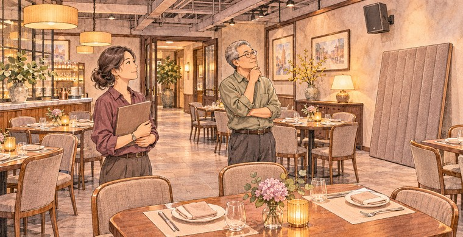

# Lively to one table. Too loud to another?

<!-- legacy-case-id: 192 -->

HSP-16 · Hong Kong · 10–15 minutes · Servicescape · Guest choice · Acoustic comfort

## Atmosphere is part of the service

On 12 September 2025, Disney described the designed interior and themed atmosphere of Wayfinders’ Table at Hong Kong Disneyland. That announcement illustrates attention to the dining environment; it reports no noise problem or acoustic evaluation. The independent restaurant, sound choices and observations below are original fiction, with no Disney affiliation.

## Opening decision

A fictional Hong Kong restaurant is choosing a six-week evening-service format. Its acoustic consultant has confirmed two workable packages at the same HK$30,000 all-in trial cost, including equipment, setup, staff training and monitoring. Both preserve required worker and guest protections, accessible routes, emergency communication, neighbour-noise obligations and reasonable adjustments. No decibel safety threshold is supplied, and guest preference cannot override those protections.

A uses one consistent moderate-music environment across 36 seats. The team can adjust its single sound setting but cannot create different simultaneous music levels. B uses screened, sound-treated areas with separate controls: 16 seats with little background music for conversation and 16 with a livelier, still compliant atmosphere. The screen and circulation space remove four seats. Neither zone is soundproof; voices, service sounds and some spillover remain. Food, prices, kitchen capacity and service quality are the same.

Both packages are affordable, and no existing booking is displaced. No demand forecast, spending difference or revenue premium is supplied. The restaurant wants a comfortable experience and a viable service, not to turn tables faster through sound. Choose one package; a 36-seat two-zone hybrid is not available within this approved layout and budget.

## Evidence

| Package | Seats | Experience |
|---|---:|---|
| A · One atmosphere | 36 | One adjustable moderate-music setting |
| B · Two choices | 16 + 16 = 32 | Conversation-focused and livelier areas; not soundproof |

**Student question:** Would you trial one consistent atmosphere (A) or two described zones (B)? Explain the experience you are prioritising and what you give up, without assuming that more seats mean more profit.

## Round two

During two busy evenings in the current single-setting room, staff obtain voluntary feedback from ten parties. Six say their main purpose is conversation; four of those six report repeatedly missing words or asking companions to repeat themselves. Four parties mainly want a sociable, lively outing and say the current atmosphere suits that purpose. These categories describe this visit, not age groups or medical diagnoses. The feedback is selected and small, with no comparison group or revenue data.

Staff observations place the conversation difficulties mainly near the central speaker and service station. The consultant confirms that B can create a meaningful relative difference between its two areas under the anticipated busy-service conditions, but cannot promise silence or effortless conversation for every guest. A can be adjusted down across the entire room; this changes the shared atmosphere rather than offering simultaneous choices. No tested satisfaction gain is supplied for either change.

If B is chosen, the host can explain the two areas before confirming a booking, ask the party’s preference without demanding a diagnosis, and show the actual available tables. Either area has the same menu, price and service. Parties are not assigned by age or appearance. If the preferred area is full, offer a truthful choice of another time or the available area before commitment; no unwanted relocation. Existing accommodation obligations remain separate. Reconfiguration and additional seats are not included.

**Student question:** Would you keep or revise your package choice? Give the host a truthful description and a response when the preferred area is full, then identify two checks for the six-week trial.

## Fit depends on the purpose of the visit

Conversation comfort and a sociable atmosphere can both be legitimate preferences. The same party may want different conditions on another visit. Ask what works for guests rather than labelling a zone for older people, assuming a diagnosis, or treating difficulty hearing as an unreasonable complaint.

## Choice has an operating cost

B gives guests more control and targets the observed contrast, but has 32 rather than 36 seats. Four fewer seats do not automatically mean four lost sales, and a better fit does not prove extra revenue. A keeps 36 seats and a consistent identity; reducing its overall setting is a credible response, though it cannot deliver two simultaneous environments. The small feedback exercise cannot establish a universal winner.

## Describe, do not guarantee

A host might say: “This area has less background music and is intended for easier conversation, but you will still hear other guests and service activity. The other area has a livelier music atmosphere. Which would you prefer?” Describe actual conditions and availability. If the preference cannot be met, explain alternatives before confirmation rather than promising a quiet table and improvising later.

## Check the room during real service

Ask about ease of conversation, comfort and whether the description matched the visit, separately by area and busy period. Track requests that could not be met, voluntary moves and booking outcomes. Combine feedback with professional acoustic and safety checks; a phone reading or a complaint count alone is not a full assessment. Do not record conversations or require health information for this review.

## Instructor note

Keep the 36-versus-32 capacity trade-off visible, but do not turn this into a table-packing or contribution problem without demand data. Require both a format choice and an honest guest-choice procedure. The reveal identifies a plausible mismatch, not a causal estimate of zoning benefits. Guest comfort and guest control inside the service distinguish this case from noise imposed on neighbours; all safety and access obligations remain constraints, not a vote.

## Sources and case assumptions · optional reference

All information needed for classroom decisions is provided above. Sources are optional reading.

All restaurant, budget, layout, capacity, observations and consultant findings are invented. Two packages each cost HK$30,000 all-in for six weeks. A has 36 seats; B has two areas of 16, total 32, with four seats foregone but no known sales or profit loss. Both professionally feasible and compliant for the exercise; no real acoustic certification or universal safe decibel limit claimed. Same menu, price and service, no existing bookings displaced. Six conversation-focused parties plus four lively-outing parties total ten; four of the six report difficulty, not all six. Selected feedback has no causal comparison or population inference. The consultant stipulation establishes a relative difference, not universal comfort or silence. Guest choice must not substitute for required accommodations. Five actual relevant bodies read: dated Disney design announcement; Lindborg restaurant sound-source study methods and taxonomy; Wilczek and colleagues correlational study methods/discussion/limits; Rohrmann exploratory research methods and customer-control observations; ASHA communication guide. No study dataset, figure, music, artwork or branded interior copied. Studies are bounded by their settings and selection, not current Hong Kong demand estimates; ASHA guide is not legal or acoustic engineering certification.

- [Disney · Wayfinders’ Table design announcement · 12 September 2025](https://disneyparksblog.com/hkdl/first-look-at-wayfinders-table-at-hong-kong-disneyland/). First-party interior and atmosphere context only; no claim about its noise or customer outcomes.
- [PerMagnus Lindborg · A taxonomy of sound sources in restaurants · 2016](https://scholars.cityu.edu.hk/ws/portalfiles/portal/71393326/41561243.pdf). Read methods and sound-source classification in a Singapore restaurant study. No general population or universal design optimum inferred.
- [Wilczek, Steffens and Weinzierl · Room acoustics, soundscape and customer satisfaction](https://d-nb.info/1217416005/34). Read Berlin field-study methods, discussion and self-selection/causal limitations. Association is not evidence that these fictional zones improve sales.
- [Bernd Rohrmann · Research about soundscapes and communication](https://www.rohrmannresearch.net/pdfs/2M3RBR-TextX-ReportSPX-ResearchAboutSoundscapesAndCommun_.pdf). Read exploratory methods, communication responses and limited customer influence; small samples and measurement limits are explicit.
- [ASHA · Tips for Improving Conversation in Noisy Environments · 2022](https://www.asha.org/siteassets/ais/ais-tips-for-improving-conversation-in-noisy-environments.pdf). Read background-noise and seating communication guidance. Not a diagnosis, local law or engineering approval.
