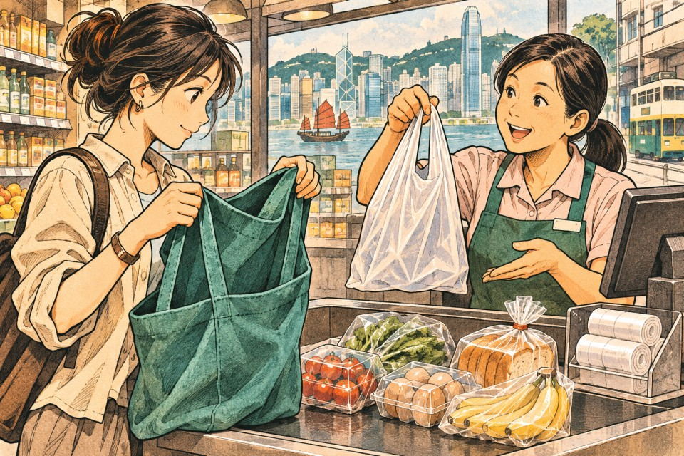

# Does refusing a checkout bag save a bag?

<!-- legacy-case-id: 5 -->

SUS-01 · Hong Kong · 10–15 minutes · Substitution, environmental incentives

## Opening decision

You manage a Hong Kong grocery. Your checkout team wants to print “One bag refused, one bag saved” on receipts. Most shoppers already own a tote. Before you approve the message, try the decision yourself.

## Evidence

| Choice | Cost to shopper (HK$) |
|---|---:|
| Bring existing tote | 0.60 in inconvenience |
| Take checkout bag | 1.00 paid to shop |

**Student question** If you have no further use for the checkout bag, which option do you choose? Would you have made the same choice at HK$0.50?

## Round two

Now suppose you need one bin liner tonight. A checkout bag fits the bin. If you bring the tote, you must buy a HK$0.70 liner. Everything else stays the same.

**Student question** Which option costs less now? Would you approve the receipt message for every shopper?

## Debrief

In round one, bringing the tote saves HK$0.40 at the HK$1 fee. At HK$0.50 you would take the checkout bag. In round two, the tote plus liner costs HK$1.30. Taking the HK$1 bag and using it twice saves HK$0.30. A replacement liner costing HK$0.40 would leave you indifferent.

A checkout count can tell the manager how many carriers left the shop. To estimate plastic saved, track the weight of carriers avoided and subtract the weight of extra liners purchased. If a shopper already has a spare liner, refusing the carrier can still save its full weight. A receipt could accurately say “You took no checkout bag today.”

## Instructor note

0–3 minutes. Vote at each fee and ask which shoppers would switch. 3–7 minutes. Reveal the liner purchase and have students name the cost that changed. 7–12 minutes. Ask pairs to rewrite the receipt and propose one measurement outside the checkout lane.

## Sources and case assumptions

All information needed for the classroom decisions is provided in the case. The sources below are optional background, not assigned reading.

- [Environmental Protection Department · enhanced scheme](https://www.epd.gov.hk/epd/english/environmentinhk/waste/pro_responsibility/psb_index.html). Documents the rise in the minimum charge from HK$0.50 to HK$1 on 31 December 2022.
- [Environmental Protection Department · supermarket examples](https://www.epd.gov.hk/epd/english/environmentinhk/waste/pro_responsibility/psb_retailers_foodstuff_non_foodstuff.html). Illustrates which supermarket transactions qualify for exemptions.
- [Environmental Protection Department · 2023–24 estimates replies](https://www.epd.gov.hk/epd/sites/default/files/epd/english/news_events/legco/files/EPD-1-e2.pdf). Describes the landfill disposal survey used to evaluate the earlier scheme.
- [Legislative Council · proceedings, 20 March 2024](https://www.legco.gov.hk/yr2024/english/counmtg/hansard/cm20240320-translate-e.pdf). Reports the change in bags distributed by major retailers after the charge increased. Compare this checkout measure with disposal.
- [Rebecca Taylor · Bag leakage (2019)](https://ideas.repec.org/a/eee/jeeman/v93y2019icp254-271.html). California evidence shows that some reductions in carryout plastic were offset by additional trash-bag purchases. The local magnitude is an open question for Hong Kong.

The shop charges the historical minimum for a non-exempt bag. The tote inconvenience, liner price and one-for-one reuse are classroom assumptions. The cartoon depicts a fictional checkout.