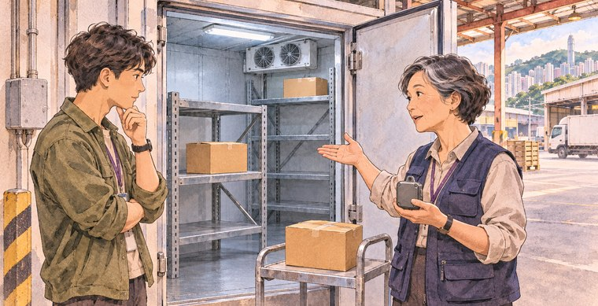

# The cold room averaged fine. Which cartons warmed?

<!-- legacy-case-id: 520 -->

OPS-43 · Hong Kong · 15 minutes · Temperature mapping · Measurement placement · Exception handling · Process validation

## Cold-chain guidance stresses temperature records

Hong Kong’s Centre for Food Safety recommends temperature records and calibrated instruments when delivering groceries that must stay cold. A local warehouse team can learn a related lesson by mapping a room with dummy cartons. This fictional exercise is a test of an operating process, not a food-release rule.

## Opening decision

At a fictional North District warehouse, Wing tests a new cold-room loading schedule using three dummy cartons. They contain no food or other saleable product. One logger is fixed beside the centre carton. Two movable loggers are available.

A trial passes only if each carton location has a complete trace and records no more than 20 minutes above 5°C during the 40-minute test. Apply the stated readings to each entire 10-minute block. At exactly 5°C count zero minutes above the threshold. These limits are fictional test specifications.

Previous air checks suggest the doorway is vulnerable to warm air and the upper rear rack to a late restart of circulation. A dashboard summarises the room as a single mean from the three carton locations.

## Evidence

| Carton location | Reason to monitor |
| --- | --- |
| Door-side rack | Repeated door openings |
| Centre rack | Existing fixed logger |
| Upper rear rack | Reduced circulation after loading |

**Student question:** Where should Wing put the two movable loggers? What cannot be determined from the room mean alone?

## Round two

All three carton loggers were installed. The first three 10-minute readings, followed by the last one, were: door 7, 7, 4, 4; centre 3, 3, 3, 3; upper rear 4, 6, 6, 7. The temperature unit is °C. The dashboard rounded the all-location mean to 4.8°C.

In a repeat test, all readings were the same except the upper rear logger’s last 10-minute record was missing. No separate sensor covered that carton location.

**Student question:** Does the first trial pass at each location and overall? Can Wing approve the repeat test, and what should Wing do next?

## Debrief · Measure all three positions

Put one movable logger at the door and one at the upper rear. Keep the fixed centre trace. A low mean cannot establish which carton warmed, for how long, or whether a local trace is missing.

## Debrief · Sum the minutes at each location

The door is above 5°C for 20 minutes, so it passes at the stated boundary. Centre is above for zero minutes. Upper rear is above for 30 minutes, so it fails. The 57 ÷ 12 = 4.75°C average rounds to 4.8°C and hides that local failure.

## Debrief · A missing block is not zero

Upper rear in the repeat has 20 confirmed minutes above the threshold plus 10 unobserved minutes. Its total could be 20–30, so the evidence cannot establish a pass. The incomplete trace also fails a separate rule. Keep the trial unapproved and rerun it after fixing or replacing the logger.

## Instructor note

Allow 15 minutes: 3 to assign loggers, 5 to compute exposure, 4 for the missing-data choice, 3 to explain why a mean is not a release test. Ask what a spare logger or redundant storage record would have to cover.

## Sources and case assumptions · optional reference

All information needed for classroom decisions is provided above. Sources are optional reading.

The location, company, dummy cartons, readings and pass criteria are fictional. None is a food safety threshold, product release decision or operating instruction.

- [Hong Kong Centre for Food Safety, Food Safety Guidelines for Online Grocery Trade](https://www.cfs.gov.hk/english/food_leg/guidelines_Online_Grocery_Trade_e.pdf). Recommends refrigerated delivery and records/calibrated instruments for relevant groceries.
- [Hong Kong Centre for Food Safety, Transportation and delivery](https://www.cfs.gov.hk/english/trade_zone/safe_kitchen/Transportation_and_delivery.html). Describes temperature monitoring and recording as validation for delivery controls.
- [Singapore Food Agency, Accreditation Criteria for Overseas Establishments](https://www.sfa.gov.sg/docs/default-source/food-import-and-export/accreditation_criteria_establishment.pdf). Explains the role of refrigerated vehicles and monitoring devices in its specific accreditation regime, not the exercise rules.
- [WHO, How to temperature map cold chain equipment and storage areas, second edition](https://www.who.int/publications/i/item/9789240042773). First-party guide to mapping conditions with loggers in another cold-chain setting.
- [WHO, Cold room temperature mapping studies](https://www.who.int/publications/i/item/WHO-IVB-18.05). First-party practical context for estimating temperature distribution, not a food requirement.
