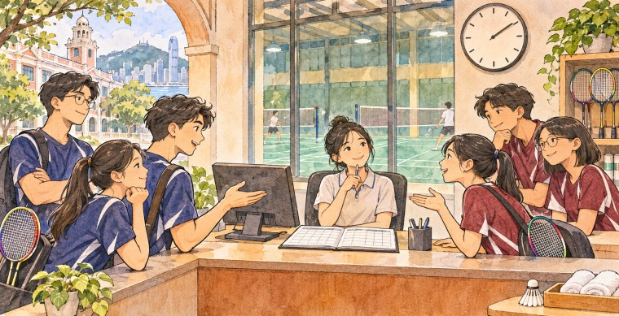

# Who gets the last badminton court?

Case 10 · Hong Kong · 10–15 minutes · Scarcity · Allocation rules

## Opening decision

You allocate the last 7 p.m. court at a university. Two clubs request the full hour. Splitting it would leave neither club enough time for its match. Announce a rule before you learn who can attend booking.

## Evidence

| Rules on offer | Assumption |
|---|---|
| Queue | First representative at noon wins |
| Ballot | One entry per club with equal odds |
| Auction | Highest bid wins and pays its bid |

**Your decision** Which rule would you announce? Name the outcome you want and a cost your rule imposes.

## Round two

The registrar checks the timetable. Every member of Club B has a compulsory lab at noon. Club A can send a representative. Both clubs can enter a ballot or bid online before noon.

**Your decision** Would you revise the rule before bookings open? Under each rule, what determines Club B’s chance?

## Debrief

A physical queue now gives B no chance. With valid entries from both clubs, the ballot gives each a half chance. The auction rewards willingness and ability to pay. Without bids or budgets, its winner is unknown.

## Instructor note

Minutes 0–3: vote and compare reasons in pairs. Minutes 3–7: reveal the changed fact and vote again. Minutes 7–12: reconcile the answers. A student defending the queue may value commitment. Ask what evidence separates commitment from an empty timetable. Ask ballot supporters how their rule treats a club with much greater need. Give each side one minute to defend its objective.

## Sources and case assumptions

The setting, participants, numerical exhibit and changed rule are fictional classroom assumptions. The readings below provide context and economic reasoning.

1. [Guide To The Booking Procedure For Use Of Fee Charging Recreation And Sports Facilities](https://www.lcsd.gov.hk/en/facilities/facilitiesbooking/procedure/feeindividual.html) — Explains the ordinary booking procedure.
2. [Free Use of Leisure Facilities-Booking Method](https://www.lcsd.gov.hk/en/freeuseday/booking.html) — Shows a ballot used for a special booking day.
3. [Conditions of Use of SmartPLAY System | SmartPLAY of Leisure and Cultural Services Department (LCSD)](https://www.smartplay.lcsd.gov.hk/website/en/about/conditions-of-use-of-smartplay.html) — Gives participation conditions for the booking system.
4. [LEGISLATIVE COUNCIL — 18 June 2025](https://www.legco.gov.hk/yr2025/english/counmtg/hansard/cm20250618-translate-e.pdf) — Provides the public policy discussion around facility access.
5. [Facility Booking | Features | SmartPLAY of Leisure and Cultural Services Department (LCSD)](https://www.smartplay.lcsd.gov.hk/website/en/features/facility-booking.html) — Shows how a booking system implements allocation rules.
