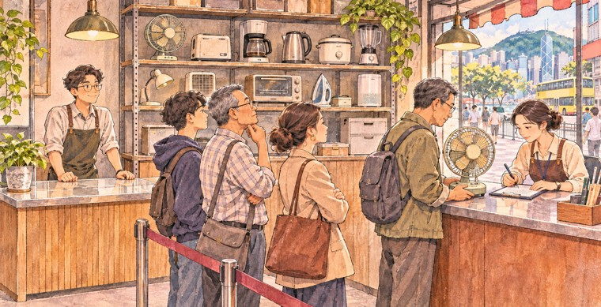

# An empty counter. A waiting customer.

<!-- legacy-case-id: 76 -->

OPS-07 · Hong Kong · 10–15 minutes · Operations · Queue design · Service objectives

## In the news

In a reply to a Legislative Council question on 18 December 2024, the Hong Kong Government said it would explore queue arrangements at the Hong Kong-Zhuhai-Macao Bridge Hong Kong Port alongside flexible staffing and additional peak-period kiosks.

The reply did not establish that a particular alternative had been adopted or would perform best. The shop below is a separate fictional exercise about queue choices.

## Opening decision

Fictional classroom situation. A repair shop is planning its collection desk, not repair work or safety triage. Two equally trained employees can each complete either a quick prepaid collection in two minutes or a collection requiring paperwork in six minutes. Each transaction stays with its employee until completion.

A: Common queue. Customers wait in one first-come-first-served queue and go to whichever employee is free. B: Dedicated counters. One employee serves only quick collections and the other only paperwork, first-come-first-served within each category. Under B, an idle employee cannot help the other queue.

Both employees start free at minute zero. Five customers are already present in recorded order P1, Q1, P2, Q2, P3; P means paperwork and Q means quick collection. This order breaks the arrival tie. In this first trace, nobody else arrives. The manager wants less waiting overall but also a useful express service for quick customers.

All durations are fixed classroom assumptions. Both employees have the equipment needed for either task, with no setup, transfer or speed difference. No extra employee is added. Waiting runs from arrival until service starts, not until it ends.

## Evidence

| Policy | Employee serving P1 | Other employee |
|---|---|---|
| A · Common queue | P1: 0–6; Q2: 6–8; P3: 8–14 | Q1: 0–2; P2: 2–8 |
| B · Dedicated | P1: 0–6; P2: 6–12; P3: 12–18 | Q1: 0–2; Q2: 2–4; then idle |

A: total wait 16 minutes, mean 3.2; quick mean 3; last completion 14. B: total wait 20 minutes, mean 4; quick mean 1; last completion 18. Intervals show service times, not waits.

**Student question:** Which policy would you pilot: A’s common queue or B’s dedicated counters? What evidence about arrivals or customer waits would make you switch?

## Round two

Now add one change to that same trace: a third quick customer, Q3, arrives at minute five. Everyone else’s arrival and service requirement is unchanged.

Under A, both employees are busy until minute six. Q2 is next and starts at six. At eight both employees become free, so P3 and then Q3 can both start. Q3 finishes at ten and waits three minutes. Under B, the express employee finished Q2 at four, so Q3 starts at five, finishes at seven and waits zero.

| Six-customer trace | A · Common | B · Dedicated |
|---|---|---|
| Q3 waiting time | 3 minutes | 0 minutes |
| Mean waiting (total / six) | 19 / 6 ≈ 3.17 minutes | 20 / 6 ≈ 3.33 minutes |
| Mean quick-customer wait | 3 minutes | 2 / 3 ≈ 0.67 minutes |
| Last service completion | Minute 14 | Minute 18 |

The extra arrival is a hypothetical comparison, not a forecast of tomorrow’s demand. Earlier customers’ waits are unchanged in this trace.

**Student question:** Would you keep your selected policy for tomorrow? Name the customer-wait measure you are protecting and the arrival pattern you need to check before extending the pilot.

## Compatible employees create an option to share capacity

In A, the employee finishing Q1 at minute two can take P2. In B, that person must remain on quick work, even while paperwork customers wait. The dedicated policy, not laziness or lack of training, creates the apparent idle capacity.

Pooling therefore improves overall waiting and last completion in these traces. It also makes Q2 wait longer: six minutes rather than two. A better overall mean is not a better experience for every customer.

## Idle time can preserve a service option

When Q3 arrives at minute five, B’s express employee is available immediately. In A both employees are already occupied, so Q3 waits. The previously idle express capacity has a use when that arrival occurs.

This does not establish that B is better overall or that future quick arrivals will follow this pattern. It shows why removing every idle interval need not be the only service objective.

## State which wait the manager wants to improve

The common queue still has the slightly lower mean waiting time in the six-customer trace, while dedicated counters give quick customers shorter waits. The manager must make that service tradeoff explicit rather than silently choosing a metric after seeing the results.

Observe arrival timing, category mix, service duration and waiting by category during a pilot. Check how employees actually work: this exercise holds their speeds fixed, whereas a real queue design may affect behaviour. No result here establishes universal superiority, fairness or financial returns.

## An overflow rule needs its own trace

A rule allowing the express employee to help paperwork when its queue is empty may be worth evaluating. But once that employee starts a six-minute transaction, they cannot interrupt it for a new quick arrival under the stated service rules.

Work through the complete revised dispatch sequence before claiming a hybrid achieves both benefits. It is another policy to test, not a free improvement assumed from the two existing results. Similarly, a ticket display can change where customers wait without adding service capacity.

## Instructor note · check each start time

For the original five, common-queue waits in recorded order are 0, 0, 2, 6 and 8 minutes, totalling 16. Dedicated waits are 0, 0, 6, 2 and 12, totalling 20. Their quick averages are respectively (0 + 6) ÷ 2 = 3 and (0 + 2) ÷ 2 = 1 minute.

With Q3, add its wait of three under A and zero under B. Total waits become 19 and 20 across six customers. Quick means become (0 + 6 + 3) ÷ 3 = 3 and (0 + 2 + 0) ÷ 3 = 2/3 minute. Completion times are not interchangeable with waiting times.

Ask students to defend a service objective and specify reversal evidence. Do not present one added arrival as a statistically reliable demand forecast, or analogise this collection desk to medical triage.

## Sources and case assumptions

All information needed for classroom decisions is in the case. Sources are optional reading for attribution and background.

The shop, transaction times and arrivals are invented. Both employees can perform either task at the same fixed quality and rate, with sufficient equipment and no setup, transfer or speed changes. Service cannot be interrupted. Common routing is first-come-first-served; dedicated routing is strict by category. Opening customers all arrive at zero in the stated tie-break order; only Q3 arrives later, at minute five. Wait ends when service starts. Results apply only to these deterministic traces and do not establish a universal optimum, fairness judgement or financial benefit. Sources checked 14 November 2026. The government reply is distinguished from assertions in the legislative question. Only abstracts and introductions of the three research manuscripts were read, not full proofs or papers. Their large-system, behavioural or inter-provider settings are not empirical validation of this small shop.

1. [Hong Kong Government, LCQ17: Hong Kong-Zhuhai-Macao Bridge Hong Kong Port, 18 December 2024](https://www.info.gov.hk/gia/general/202412/18/P2024121800166.htm) — Reply discusses exploring queue methods alongside staffing and kiosks. It does not establish adoption or effectiveness of an alternative described in the question.
2. [Airport Authority Hong Kong, Airport Operates Overnight to Handle Post-Typhoon Traffic, 8 September 2025](https://www.hongkongairport.com/en/media-centre/press-release/2025/pr_1815) — Describes taxi tickets allowing passengers to wait away from the physical line. Not evidence that tickets add supply or reduce total waiting.
3. [Ping Cao, Shuangchi He, Junfei Huang and Yunan Liu, To Pool or Not to Pool: Queueing Design for Large-Scale Service Systems, online 3 December 2020](https://yunanliu.wordpress.ncsu.edu/files/2020/12/opre.2019.1976.pdf) — Abstract and introduction read. Original large-system modelling cautions against universal pooling claims under differing objectives and conditions; not this shop’s model.
4. [Hummy Song, Mor Armony and Guillaume Roels, Queue Configurations and Operational Performance, INSEAD working paper 2022/55/TOM/ACGRE](https://flora.insead.edu/fichiersti_wp/inseadwp2022/2022-55.pdf) — Abstract and introduction of the 2022 working paper read. Experiments examine behavioural mechanisms; no processing-speed effect is imported into this fixed-rate exercise.
5. [V. Hari Rohit and colleagues, Partial Server Pooling in Delay Systems, 2021 author manuscript](https://www.ee.iitb.ac.in/~jayakrishnan.nair/papers/PartialPooling-ErlangC.pdf) — Abstract and introduction read. Analytical inter-provider sharing research distinguishes aggregate and individual benefits. Not direct evidence for a particular shop overflow rule; placeholder DOI is not cited.
