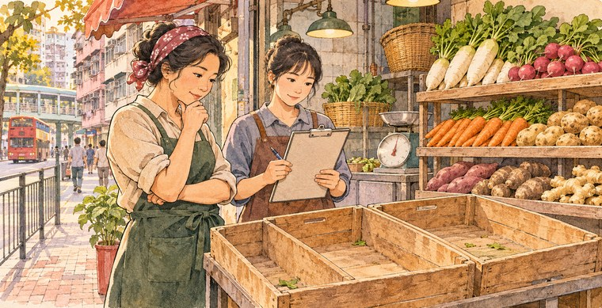

# The shelves are empty. Where did sales go?

<!-- legacy-case-id: 486 -->

ECO-43 · Kowloon, Hong Kong · 10–15 minutes · Demand and supply shocks · Stockouts · Substitution

## Reported context

Hong Kong authorities documented that cross-boundary transport disruption temporarily reduced fresh vegetable supply in February 2022. The government’s half-year review attributed the associated early-February fresh-vegetable price surge mainly to reduced supply after brief Lunar New Year effects. It also recorded an improvement as supply recovered.

## Opening decision

At a fictional Kowloon greengrocer, Mei sells identical boxes of leafy greens at a temporarily fixed HK$20. A reduced shipment arrived this Saturday. At closing, her assistant suggests using a promotion next Saturday because sales are down.

Last Saturday and this Saturday are comparable trading days in the same store. Each unmet request is from a separate customer who found no leafy box, and each request is for one box. The fixed price did not change and there are no preorders.

## Evidence

| Leafy greens | Last Saturday | This Saturday |
| --- | --- | --- |
| Boxes available at opening | 100 | 60 |
| Boxes sold | 90 | 60 |
| Unmet requests logged | 0 | 25 |
| Boxes left at close | 10 | 0 |

**Student question:** Should Mei first buy a promotion or arrange more usable deliveries, and what can she infer about demand from the sales drop?

## Round two

Of the 25 unmet requests, 15 customers bought one box of root vegetables instead and 10 left without buying vegetables. The next delivery will again be 60 leafy boxes unless Mei pays a HK$120 one-day surcharge to obtain up to 20 extra boxes.

Each extra leafy sale contributes HK$8 before the surcharge. A root-box sale contributes HK$5. In the forecast for next Saturday, six of the extra leafy customers would otherwise buy a root box, and the rest would buy nothing. The extra boxes are on consignment: Mei pays the supplier only for boxes sold, and that unit cost is already deducted in the HK$8 contribution. The supplier takes unsold extras back at no additional cost.

**Student question:** If 20 extra customers buy leafy boxes, is the surcharge worth paying? How many such sales would Mei need if six displace root sales?

## Debrief

Leafy sales fell by 30, but greens sold out. There were at least 85 requests at HK$20 this Saturday: 60 purchases plus 25 observed unmet requests. Promotion cannot sell unavailable boxes, and 85 is a lower bound, not evidence demand was exactly unchanged or exactly five lower.

Twenty additional leafy boxes contribute HK$160. Subtract HK$30 from six displaced root sales and the HK$120 surcharge, leaving HK$10 incremental contribution. To cover the two costs, 150 ÷ 8 = 18.75; Mei needs at least 19 extra leafy sales on that substitution assumption.

Secure the delivery if the forecast and small buffer are credible. At 18 additional sales and the same six displaced root sales, contribution is negative HK$6. Record shoppers who left and substitute sales separately before repeating it.

## Instructor note

Start with what buyers could purchase, then what they asked for. Spend the last four minutes distinguishing new sales from switching within the store.

Ask how the result changes if more stock makes former root buyers switch but does not bring back customers who walked away.

## Boundary of the evidence

The reported disruption is regional; one fictional store does not identify the citywide price effect. The request count misses people who did not ask or skipped the store, and subsequent sales need not repeat the same pattern.

## Sources and case assumptions · optional reference

All information needed for classroom decisions is provided above. Sources are optional reading.

The protagonist, decision and all exhibits are fictional classroom material. Only the separately labelled reported context describes real events. References are optional.

- [HKSAR Government, Food supply monitored](https://www.news.gov.hk/eng/2022/02/20220206/20220206_200058_422.html). 6 February update shows vegetable supply differed across wholesale markets and records transport arrangements.
- [HKSAR Government, Fresh food supply stable](https://www.news.gov.hk/eng/2022/02/20220208/20220208_165233_181.html). 8 February update reports vegetable supply increased after temporary cross-boundary disruption; different foods had different availability.
- [LegCo reply, Supply and prices of essential livelihood commodities amid epidemic](https://www.info.gov.hk/gia/general/202205/11/P2022051100534p.htm). Describes tight road capacity, expanded border hours and new sea routes for fresh food; it does not establish the impact at any individual store.
- [Government Economist, Food inflation in Hong Kong](https://www.hkeconomy.gov.hk/en/pdf/box-22q2-6-1.pdf). Attributes the early-2022 fresh-vegetable price surge mainly to reduced supply following cross-boundary land-transport disruption, after brief holiday effects.
- [HKSAR Government, 1 March 2022 fresh food update](https://www.info.gov.hk/gia/general/202203/01/P2022030100440.htm). Reports supplies largely returned to normal at the aggregate level by 28 February; not an observation at any fictional store.
