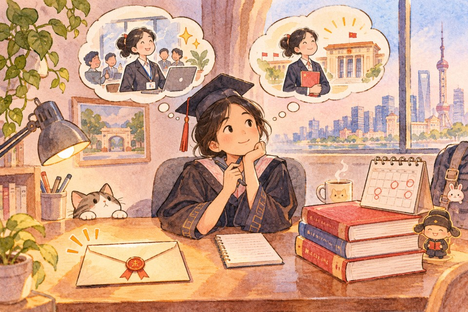

# The offer expires Friday

Case 8 · Mainland China · 10–15 minutes · Expected value and opportunity cost

## Opening decision

Lin has until Friday to accept a logistics job that starts Monday. She could instead turn it down and study full-time for the civil service exam. She cannot do both. What should she tell the recruiter?

## Evidence

Compare the same twelve months. Starting Monday pays ¥72,000. Lin estimates a one-in-four chance of securing the civil service post if she studies. Her income would be ¥96,000 if successful and ¥56,000 from temporary work otherwise. These totals already account for preparation time and expenses.

**Student question** Which choice gives Lin the higher expected income? How high would her chance of securing the post need to be for studying to pay?

## Round two

HR calls back. Lin can still start on Monday, or she can sit the exam with a written guarantee of a later start if she misses out. Starting late would pay ¥68,000 over the same twelve months. Her chance of securing the post stays the same.

**Student question** Should Lin start on Monday or take the guarantee and sit the exam? Which outcome did HR change?

## Debrief

Originally, studying yields ¼ × ¥96,000 + ¾ × ¥56,000 = ¥66,000 in expected income. Starting Monday pays ¥72,000. The exam breaks even when the chance of success reaches (72,000 − 56,000) ÷ (96,000 − 56,000) = 40%.

With the guarantee, studying yields ¼ × ¥96,000 + ¾ × ¥68,000 = ¥75,000. The better fallback adds ¥9,000 to the exam path because it pays an extra ¥12,000 three times out of four. Compared with the best original choice of ¥72,000, the gain is ¥3,000. Would your advice change if Lin needed at least ¥70,000 to cover her expenses?

## Instructor note

Minutes 0–3. Vote on the immediate offer. Minutes 3–6. Find the break-even probability in pairs. Minutes 6–10. Reveal the guarantee and vote again. Ask students which alternatives they compared to get ¥9,000 or ¥3,000. Around 26,000 national civil service vacancies in the 2024 intake were reserved for upcoming graduates. Ask what information about a specific vacancy would help Lin estimate her own chances.

## Sources and case assumptions

- [National civil service intake for 2024](https://english.www.gov.cn/news/202310/14/content_WS652a42dec6d0868f4e8e0347.html). Reports vacancies reserved for upcoming graduates.
- [Qualification screening for the 2025 intake](https://english.www.gov.cn/english.www.gov.cn/news/202410/27/content_WS671d770bc6d0868f4e8ec589.html). Distinguishes eligibility screening from later selection.
- [University job fairs for graduates](https://english.www.gov.cn/news/202405/27/content_WS66543b4ec6d0868f4e8e7850.html). Documents campus recruitment by employers.
- [Graduate recruitment campaign](https://english.www.gov.cn/news/202406/11/content_WS66683e9dc6d0868f4e8e7fee.html). Describes another channel for graduates seeking employment.
- [Community-level graduate posts](https://english.www.gov.cn/news/202405/13/content_WS6641fda2c6d0868f4e8e70ec.html). Illustrates fixed-term work opportunities for graduates.

Lin, the offers, the incomes and the personal probability are fictional classroom assumptions. All amounts cover one year. Job security and longer-term career prospects are discussion extensions.
