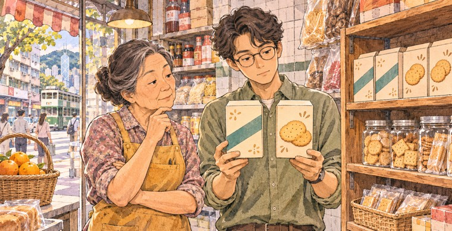

# A fresher pack. Still easy to find?

Case 87 · Hong Kong · 10–15 minutes · Marketing · Packaging · Brand recognition

## In the news

In an account dated 12 November 2025, Deuce Studio described a UK hot-sauce range project for Hong Kong-headquartered Lee Kum Kee. Fresh graphics retained familiar gold-plaque branding and a heritage pattern.

This is the designer’s account of its approach, not evidence of higher sales or a Hong Kong launch on that date. Our biscuit brand, designs and test below are fictional.

## Opening decision

Fictional classroom situation. An independent Hong Kong biscuit brand is choosing the pack for its next printing batch. Customers already know its diagonal teal band and the position of its name. But the current front is busy, and the flavour description is less prominent.

Pack A keeps the existing design. Proposed pack B gives the flavour description more space and a clearer hierarchy, but removes the teal band and moves the brand name. The owner wants both easier flavour identification and a brand that existing customers can still find.

The biscuits, quantity, price, materials, print cost and availability are unchanged. Both designs meet safety and required-information requirements and fit the deadline. Existing stock will be sold normally; no disposal decision is involved.

## Evidence

| Next-batch option | What it preserves or changes |
|---|---|
| A · Keep the current pack | Familiar band and name position; busy front with less prominent flavour |
| B · Print the refresh | Clearer flavour hierarchy and more open space; band removed and name moved |

There are no customer-test results yet. A familiar pack and a clear standalone mockup each offer a different reason to choose.

**Student question:** Would you keep A or print B for the next batch? Which customer task matters most, and what evidence would reverse your provisional choice?

## Round two

The designer offers a feasible pack C: it keeps A’s teal band and brand-name position while using B’s clearer flavour-information hierarchy. Cost, materials, required information and timing remain the same.

A small prototype session recruits 120 adult volunteers familiar with the brand. They are randomly assigned 40 to each design and see only that design. On the same mock shelf with the same competitors, the target position is rotated evenly. With neutral instructions and no coaching or preview, each person first tries to find the named brand within ten seconds.

Then all 40 people in each group see their assigned pack on its own and identify the flavour, including anyone who failed the shelf task. These are two separate tasks, not two groups of buyers.

| Correct task completion | A | B | C |
|---|---:|---:|---:|
| Find brand within ten seconds | 36 of 40 | 26 of 40 | 35 of 40 |
| Identify flavour with pack shown alone | 22 of 40 | 34 of 40 | 32 of 40 |

No purchases were made. These fictional counts describe this small session, not population rates or sales forecasts.

**Student question:** Which pack would you choose now for the next batch? Explain what C preserves and improves, and name one sign from actual shops that would make you reconsider.

## Separate the two customer jobs

Finding a known brand among alternatives is not the same task as identifying the flavour on a pack already in your hand. A redesign can make the second easier while disrupting the first.

In this session, A has more correct brand finds than B, while B has more correct flavour answers. Looking only at one row would hide the other part of the owner’s objective.

## A constructive compromise, not a perfect winner

C combines familiar recognition cues with clearer information. Compared with A, its group has ten more correct flavour answers and one fewer correct brand find. Compared with B, it has nine more correct brand finds and two fewer correct flavour answers.

C is a reasonable recommendation for the owner’s two-part objective. It does not have the highest observed count on both tasks. The small differences between 35 and 36, or 32 and 34, are not established population differences merely because the counts differ.

Keeping A can still be defended if recognition risk takes priority; choosing B needs a reason to place more weight on flavour clarity despite its weaker shelf result. Explain the tradeoff rather than declaring every refresh good or every familiar design untouchable.

## Do not turn task counts into a sales forecast

Random assignment helps make this comparison more informative, but it does not make volunteers representative of every shopper. These customers already know the brand, the shelf is artificial and nobody spends money.

The two rows each use the same 40 people per design. Do not add them as if there were 80 people, or call a missed find a lost sale. The session also cannot isolate the effect of the teal band from the name position and other layout changes.

The evidence supports a design decision to test in use, not a guarantee of sales growth or proof that one visual feature caused the results.

## Carry the choice into actual use

For the next batch, keep the decision’s two goals visible: can customers find the brand, and can they identify the intended flavour? Watch for requests for help, wrong-variant confusion and differences across actual shop displays.

Retain the old mockup for comparison and review actual purchases alongside price, promotion, stock and display changes. A sales movement alone does not tell you what the redesign caused. Required information and product protection remain non-negotiable.

## Instructor note

Take a provisional A-or-B vote before showing C and the session results. Ask students to justify a choice against both customer tasks. The reveal is an achievable design improvement, not an instruction to conduct endless research before deciding.

The groups are randomly allocated but drawn from familiar-customer volunteers. The flavour task is given to everybody after an isolated-pack display, so its denominator is not limited to successful shelf finders. Counts are sufficient; optional percentages are A 90%/55%, B 65%/85% and C 87.5%/80% for the two tasks.

No significance test, purchase-conversion estimate or general population claim is supplied. The case concerns recognition and information hierarchy for the same product, not a new target segment or a co-branding attribution decision. General usability guidance informs clear tasks; it does not validate this retail test’s sample or threshold.

## Sources and case assumptions

All information needed for classroom decisions is in the case. Sources are optional reading for attribution and background.

The biscuit brand, packaging alternatives, customer session and all counts are fictional. Pack changes do not alter product, quantity, price, materials, safety, required information, print cost or availability. No safety-label illegibility, legal breach or disposal waste is alleged. The 120 adult volunteers already know the brand; 40 are randomly assigned to each pack, see only that design and receive consistent neutral instructions without coaching or preview. Mock-shelf conditions are common and target position rotates evenly. All assigned participants then answer the isolated-pack flavour task, including those who missed the shelf find. Each row has the same denominator, and the rows must not be added as separate participants. No actual purchase, causal sales effect, representative population estimate or statistically established ranking is supplied. C is a feasible compromise, not a mathematically dominant option. Sources checked 14 November 2026. Five substantive documents and one supplemental corporate-identity source were reviewed in their relevant sections; they are not six independent empirical studies. The Deuce account is promotional design intent, dated by its account rather than an assumed launch. The journal paper concerns non-randomly recruited marketers’ self-reported redesign experience; it does not show that this shelf task guarantees commercial success. The Adelaide release describes research; it is not a claim that the underlying 2026 paper was read in full. UK service-usability guidance is adapted only for neutral, task-focused observation, not treated as retail validation.

1. [Deuce Studio, Igniting a New Chapter for Lee Kum Kee: Designing an Authentic Hot Sauce for Modern Tastebuds, 12 November 2025](https://deucestudio.com/journal/igniting-a-new-chapter-for-lee-kum-kee-designing-an-authentic-hot-sauce-for-modern-tastebuds/) — Substantive first-party design account read, including brief, retained visual anchors and typography. Describes a UK project, not a Hong Kong launch or independently established sales results.
2. [Caruso, Romaniuk, Page, Anesbury and Williams, The role of market research in pack redesign performance, first online 30 October 2024; 2025 journal issue](https://journals.sagepub.com/doi/10.1177/14707853241296656) — Relevant full methods, results, discussion and limitations read, not only the abstract. Reports a non-random marketer survey and self-reported outcomes. Does not establish a reliable shelf-testing/success association or validate the invented prototype session.
3. [OpenStax, Principles of Marketing, section 9.7: Creating Value through Packaging and Labeling, 2023](https://openstax.org/books/principles-marketing/pages/9-7-creating-value-through-packaging-and-labeling) — Relevant teaching body read. Supports packaging’s communication and brand roles; not a legal opinion or the source of this case’s designs and counts.
4. [Adelaide University, Reducing risks when modernising packaging, 7 April 2026](https://adelaide.edu.au/about/news/2026/reducing-risks-when-modernising-packaging/) — Substantive institutional research release read. Discusses recognisable packaging cues in US/UK shopper research. The underlying 2026 journal paper was not read in full; the release is not evidence of this fictional brand’s sales.
5. [UK Government Digital Service, Using moderated usability testing, published 21 February 2017; updated 3 October 2017](https://www.gov.uk/service-manual/user-research/using-moderated-usability-testing) — Relevant substantive methods read. General guidance on observing users completing clear, neutral prototype tasks. Written for services, not retail packaging; does not prescribe or validate this sample, shelf arrangement or ten-second threshold.
6. [Lee Kum Kee, Corporate Overview, undated; checked 14 November 2026](https://hk.lkk.com/en/about-lkk/overview) — Supplemental first-party identity reference confirms Hong Kong headquarters. Not counted as one of the five substantive teaching documents and not evidence of redesign performance.
