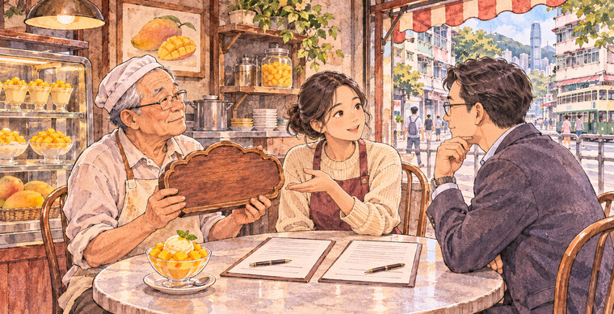

# Would you sell the family name?

Case 23 · Hong Kong · 10–15 minutes · Family business · Control rights

## In the news

Hui Lau Shan grew from a family’s herbal-drink and jelly business in Yuen Long into a dessert brand. An HKVCA retrospective records its acquisition by Navis Capital in 2007. Selling a business can provide an exit for its owners. But which parts of a family’s legacy should travel with the sale?

## Opening decision

You are meeting the other owners of a fictional Hong Kong mango-dessert business. Your family has decided to sell. One relative wants a secure retirement; another hopes to use the family name for a future venture. Two buyers want an answer today.

Both pay cash at completion and retain the staff for one year. Your family may start another business under a different name in either deal. Other sale conditions are identical. These are invented offers, not Hui Lau Shan’s transaction terms.

## Evidence

Two offers · Hong Kong · HK$ · classroom assumptions

| What changes hands? | Buyer A | Buyer B |
|---|---|---|
| Cash at completion | HK$12 million | HK$10 million |
| Family trading name | Buyer keeps exclusive use | Buyer rebrands within one year; family regains exclusive use then |
| Recipes and shop locations | Buyer decides | Buyer decides |
| Staff | Retained for one year | Retained for one year |

**Student question:** Which buyer gets your signature? What would your family gain by giving up HK$2 million?

## Round two

Buyer A adds a third option: HK$11 million with a five-year family veto over changes to the signature dessert sold under the family name. A veto means the buyer needs your approval before changing that recipe. A still controls shop locations and any future sale of the business. Assume the veto survives resale for its remaining term. The original A and B offers remain available.

**Student question:** Choose HK$12 million, HK$11 million with the veto, or HK$10 million with the name returned. If you care most about the original shop, what would you negotiate instead?

## Debrief

The highest price is not automatically the best family outcome. A pays HK$2 million more than B in exchange for keeping the trading name. Choosing B sacrifices that cash to regain control over the name after a year. It does not preserve the old shop, the recipe or the jobs beyond year one.

Price the right you actually want. The new A offer costs HK$1 million relative to unrestricted A. It protects one recipe for five years, not the whole business. A family that values this protection above the cash it gives up may choose it. A family that values retirement security more may still take HK$12 million. B can appeal to a family that wants the name back rather than a temporary recipe veto.

Make “preserve our legacy” specific. If the original shop matters, propose a defined operating commitment for that site, with a duration, a way to check compliance and a remedy if the promise is broken. Discuss what happens if the shop becomes unviable. The buyer may reduce its price or refuse. Do not assume an emotionally attractive promise is free or enforceable merely because it is written down.

## Historical reveal

In November 2021, Hong Kong reports said the last local Hui Lau Shan franchise, in Yau Tong, would close at month’s end. That later announcement is not proof that the 2007 sale caused the closure. Navis lists its exit in December 2015. A 2020 report also described a Singapore franchise opening: a brand name, a particular outlet and an ownership group are not the same thing.

To investigate why a shop closed, you would need evidence about its operating performance, leases, ownership and the conditions at the time. To assess a family’s original decision, you would also need its objectives and the options available then. This case supplies neither the real sale contract nor the family’s private preferences.

## Instructor note

Minutes 0–3: give a first vote and one reason. In pairs, assign the retiring owner and the next-generation relative different priorities. Minutes 3–7: reveal the veto and vote again. Ask a student who did not switch to explain why. Minutes 7–12: each pair proposes one protection, its maximum acceptable price reduction and who would check it. Finish with the historical reveal.

Ask A supporters which non-cash outcome would justify a lower price. Ask B supporters what keeping the name does not protect. Ask veto supporters whether they mean recipe, quality, shop location or future employment: these are different rights. There is no single correct bid without family preferences. Require a stated objective and an explicit trade-off, not a verdict that selling a family business is inherently good or bad.

## Sources and case assumptions

All information needed for the classroom decisions is in the case. Sources are optional reading for attribution and background.

All offers, amounts, rights, deadlines and family preferences are fictional teaching assumptions. Differences of HK$2 million and HK$1 million are calculated from the invented offers. No real sale price, contractual veto or motive is asserted. The illustration depicts a fictional shop, not the real company. This is a business discussion, not legal advice.

1. [HKVCA, June 2012 brown paper](https://www.hkvca.com.hk/wp-content/uploads/2023/10/HKVCA-Brown-Paper-Jun-2012.pdf) — Acquisition and succession context; an industry retrospective, not a copy of the sale contract.
2. [Hui Lau Shan, company history](https://www.hkhls.com/en/our-story/history/) — Company account of family origins in Yuen Long and the development of the dessert brand.
3. [Navis Capital Partners, investment overview](https://www.naviscapital.com/private-equity/overview-2/) — Lists Hui Lau Shan investment in July 2007 and exit in December 2015.
4. [The Standard, 18 November 2021](https://www.thestandard.com.hk/news/article/183116/The-end-of-an-era-Hui-Lau-Shan-to-close-its-doors-this-month) — Reported announcement that the last Hong Kong franchise would close at the end of November.
5. [Coconuts Hong Kong, 22 November 2021](https://coconuts.co/hongkong/lifestyle/mango-dessert-chain-hui-lau-shan-to-close-last-store-at-end-november/) — Contemporaneous report about the Yau Tong outlet and the closure announcement.
6. [CNA Lifestyle / 8days, 15 January 2020](https://cnalifestyle.channelnewsasia.com/8days/sneak-peek-hui-lau-shans-first-comeback-spore-outlet-521986) — Reported Singapore franchise opening; illustrates why a local outlet and the wider brand must be distinguished.
