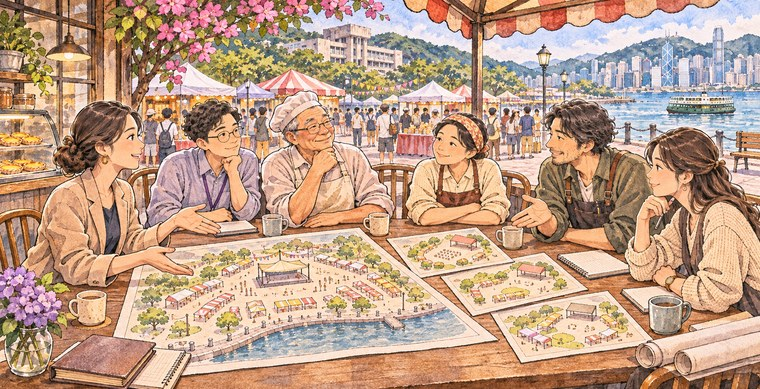

# The festival fills the town. Does the town benefit?

<!-- legacy-case-id: 300 -->

HSP-25 · Hong Kong · 15–20 minutes · Event additionality · Local value retention · Destination capacity

## A busy destination is not an impact estimate

Public event-evaluation guidance distinguishes spending associated with an event from spending that the event actually adds to a defined host economy. It also asks where that money goes. Tourism-policy research warns that attendance growth alone misses the effects on residents, infrastructure and local businesses.

This fictional comparison uses a deliberately limited spending bridge, not a complete economic-impact model or a claim about any real Hong Kong festival.

## Opening decision

Kai organises a proposed food-and-music festival for a fictional harbour town in Hong Kong. The destination committee must choose one two-day weekend or four smaller Saturday sessions over a month. Its priorities are additional business for town-based firms, a good visitor experience and acceptable disruption for residents. It has not ranked those priorities.

Both designs have a confirmed HK$300,000 operating budget, the same funding sources and no new infrastructure. The budget includes staffing, transport coordination, cleaning and programme delivery. Both meet the committee’s provisional crowd-management requirements; neither can be described as unsafe from the information given. The concentrated weekend needs more temporary equipment, while four Saturdays need repeated setup.

Cafés favour a strong shared occasion, guesthouses want new overnight demand rather than simply different guests, and residents prefer fewer days of disruption. Smaller sessions would fit spare trading capacity, but require the waterfront programme to reopen on four separate days. Kai has gross spending forecasts, not yet an estimate of additional benefit.

## Evidence

| Forecast over the month | One weekend | Four Saturdays |
| --- | --- | --- |
| Event days | 2 | 4 |
| Attendee-visits, including residents | 6,000 | 4,500 |
| Peak daily attendee-visits | 3,000 | 1,125 |
| Attendance-related spending inside town | HK$1,200,000 | HK$900,000 |
| Operating budget | HK$300,000 | HK$300,000 |

An attendee-visit is one person on one day, not a unique tourist. Spending counts purchases once across the month, excludes organiser spending and purchases outside town, and includes people who might spend here anyway. All figures are fictional.

**Student question:** Which format would you recommend provisionally: one weekend or four Saturdays? Name the stakeholder objective you prioritise and two missing facts needed before calling the spending forecast a benefit to the town.

## Round two

A fictional appraisal team now compares each format with the same no-festival month, using the town boundary for every row. It estimates spending residents would merely move between local businesses, spending visitors would make here without the festival, and normal visitor business lost because the event crowds it out. These deductions are separate and do not overlap.

| HK$ thousands | One weekend | Four Saturdays |
| --- | --- | --- |
| Attendance spending inside town | 1,200 | 900 |
| Less: spending that would occur here anyway | 400 | 150 |
| Less: other visitor spending crowded out | 200 | 50 |
| Net additional spending before supplier outflows | 600 | 700 |
| Less: associated net outflows beyond town | 240 | 140 |
| Simplified retained-spending balance | 360 | 560 |

Supplier outflows are estimated after the first two deductions. They are the net extra payments beyond the town associated with the remaining spending: 40% for the weekend and 20% for four Saturdays. These are case assumptions about purchases and supply arrangements, not national tourism leakage rates. Lost ordinary business and its avoided supplier purchases are already incorporated in these net estimates.

Local suppliers have more spare capacity across four Saturdays, explaining the lower assumed outflow share. The weekend would need more externally supplied stock and temporary services. A supplier outside town but elsewhere in Hong Kong counts as an outflow here; it is not necessarily a loss to Hong Kong.

The comparison excludes organiser expenditure, repeat spending rounds, longer-term publicity and all non-financial effects. The organiser budget’s local spending pattern is assumed identical across formats, so it does not change this limited ranking. Four Saturdays still mean four disruption days rather than two. The estimates are forecasts requiring verification, not observed outcomes.

**Student question:** Using the additionality and outflow estimates, which format would you fund? State the retained-spending comparison, one non-financial tradeoff and the evidence that could reverse your recommendation.

## Teaching focus

Separate three questions: how much attendees spend, how much spending the festival adds rather than replaces, and how much of the resulting flow stays within the chosen area after specified outflows. A purchase at a town stall need not leave all its proceeds in town. Conversely, a smaller attendance total can bring more additional local activity.

## Working through the bridge

All calculations are in HK$ thousands. Weekend: 1,200 − 400 − 200 = 600 additional spending before outflows; 600 − 240 = 360 retained. Saturdays: 900 − 150 − 50 = 700; 700 − 140 = 560 retained. Four Saturdays lead by HK$200,000 on this limited measure despite HK$300,000 less gross attendance spending.

The first deduction removes spending that would happen in town anyway, including resident switching and visits not caused by the event. The second removes different, ordinary visitor spending crowded out. Leakage concerns where money goes, not whether the original visit was additional. Do not deduct the same spending twice or apply the outflow rate again after subtracting its amount.

These figures are neither business profit nor public value for money. Do not divide 560 by the HK$300,000 budget and label it a social return. Wages, other inputs, opportunity costs, residents’ experiences and cultural value require different information. The equal budget permits a comparison, not a conclusion that costs vanish.

## A defensible recommendation

Prefer four Saturdays if the priority is additional activity retained locally and the committee accepts repeated disruption. Make the choice conditional on local supplier capacity and the spending counterfactual, rather than on the attendance headline. Protect access for residents on every event day and agree a complaint-and-response process before announcing the series.

The concentrated weekend can still be defensible if a single shared occasion and fewer disrupted days are priorities worth the forecast retained-spending difference. State that tradeoff honestly; do not invent publicity income to make the arithmetic agree. Both options require an operating plan, and neither wins on every stakeholder objective.

A useful sensitivity test holds all other estimates fixed. If the Saturdays’ spending-that-would-happen-anyway estimate rises from HK$150,000 to HK$400,000, its balance becomes (900 − 400 − 50) × 80% = HK$360,000, tying the weekend. This illustrates uncertainty in additionality; it is not a prediction that the estimate is wrong.

## What to verify

Survey a representative mix of local and nonlocal attendees about spending, trip purpose and whether the visit would occur in town during the comparison month without the event. Count purchases and repeat attendance consistently. Ask accommodation and other firms about normal bookings displaced, rather than treating full rooms as proof of new demand.

Check supplier accounts for net payments across the town boundary and test whether local firms can actually deliver the smaller-session plan. Record resident access problems and disruption on each day. Compare outcomes with the stated no-event baseline and report uncertainty; post-event sales totals alone cannot establish causation.

## Instructor note

Use 3 minutes for reading, 4 for the opening decision, 4 for the reveal and arithmetic, and 4–9 for debate. Initially ask each team which stakeholder it represents. Do not reveal the spending bridge until teams explain why gross sales and visitor counts might mislead.

After Round 2, ask students to label every deduction as counterfactual spending, displaced activity or outflow. Ask how the answer changes when the boundary expands to all Hong Kong, without pretending the case provides enough data to calculate that answer. Strong responses keep the boundary and month fixed, avoid double counting, distinguish the screen from welfare, and name a real condition for changing their recommendation. Accept either format when the arithmetic and stakeholder tradeoff are explicit.

## Sources and case assumptions · optional reference

All information needed for classroom decisions is provided above. Sources are optional reading.

The harbour town, organiser, stakeholders, budgets, attendance, expenditure, deductions and supplier patterns are invented. Sources support evaluation concepts, not these numerical estimates. The retained-spending balance is a transparent classroom screening measure, not profit, household income, GVA, GDP, a benefit-cost ratio or a complete measure of welfare. No multiplier is applied. Geographic boundary and one-month counterfactual are held constant.

- [eventIMPACTS, Direct Economic Impact](https://www.eventimpacts.com/impact-types/economic/content/direct-economic-impact). Defines additional expenditure within a specified host area and describes visitor surveys, organiser accounts and adjustment for spending that would occur anyway. Supports the common boundary and counterfactual.
- [International Association of Event Hosts, Economic Impacts](https://www.eventhosts.org/resources/event-impact-standards/economic-impacts-2/). Distinguishes additionality, displacement and leakage, and cautions against turning direct spending into a public-investment return ratio. Its guidance is aligned with eventIMPACTS, not independent corroborating data.
- [OECD (2017), Major events as catalysts for tourism](https://www.oecd.org/content/dam/oecd/en/publications/reports/2017/02/major-events-as-catalysts-for-tourism_3d98c603/a0e8a96f-en.pdf). The evaluation-methodology discussion compares hosting with not hosting, separates organiser and visitor expenditure, and explains why secondary effects need justified models. Supports omitting an invented multiplier.
- [HM Treasury, The Green Book (2026)](https://www.gov.uk/government/publications/the-green-book--2/the-green-book-2026). Place-based analysis distinguishes local effects from wider effects and requires credible evidence for additionality and leakage. Used as appraisal guidance, not a rule governing Hong Kong decisions.
- [OECD (2020), Rethinking tourism success for sustainable growth](https://www.oecd.org/en/publications/oecd-tourism-trends-and-policies-2020_6b47b985-en/full-report/component-7.html). Discusses concentrated visitor pressure and warns that dispersing tourism is not automatically a solution. Supports considering residents and capacity alongside spending.
