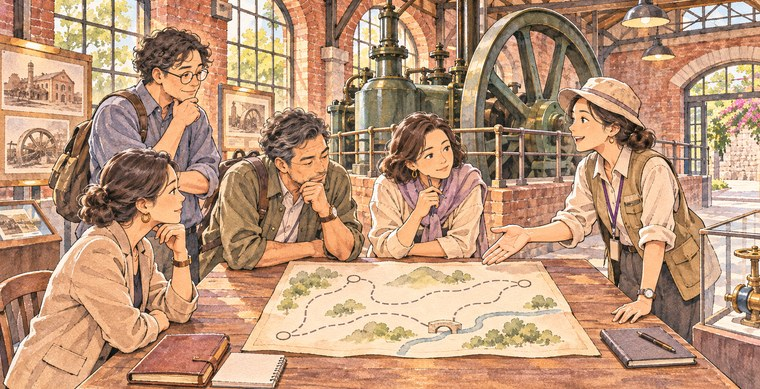

# Three landmarks, or one connected story?

<!-- legacy-case-id: 324 -->

HSP-27 · Fictional water heritage centre · 15–20 minutes · Heritage interpretation · Route sequencing · Visitor learning

## A route is more than its stop count

National Park Service interpretive planning guidance starts from significant ideas and desired visitor experiences rather than a requirement to cover every object. The ICOMOS interpretation charter connects heritage to its wider social and historical setting. Neither prescribes a universally best number of stops.

The Texas Historical Commission’s guide distinguishes a theme from a list of topics. GEM’s refreshed learning-outcomes framework includes understanding how subjects connect, while NPS accessibility guidance integrates access into planning. These principles inform the fictional choice below; they do not establish its times, local history or learning results.

## Opening decision

**Fictional classroom situation.** A water heritage centre is planning a guided visit for one adult group from 10:00 to 11:30, starting and finishing at the centre. The same guide, price, staffing, accessible paths and interpretive supports apply to both proposals. The group stays together. Five minutes of seated rest are included in the ten-minute centre welcome, and another five in the fifteen-minute centre closing session. Neither block nor travel pace may be compressed.

The three nearby landmarks are the Pump House, the Homes Gallery and the Clock Tower. The Pump House explains pumping technology. The Homes Gallery contains household water-carrying objects and evidence of who obtained piped connections. The Clock Tower offers distinctive architecture and a popular photograph but no additional evidence about water access. All names, objects and historical relationships here are invented.

The Highlights route gives ten minutes at each of the three landmarks, with 35 minutes of total travel and the common 25 minutes at the centre: 90 minutes. The Connected route gives twenty minutes each at the Homes Gallery and Pump House, with 25 minutes of travel and the same centre blocks: also 90 minutes. Its initial order is Homes first, then Pump House, to begin with daily life before machinery.

At either pace, both routes are safe and meet the group’s established access needs. Travel in either direction is five minutes between Centre and Pump House, ten between Pump House and Homes, and ten between Homes and Centre. Adding Clock Tower to a two-stop loop adds ten travel minutes plus at least ten viewing minutes. There are no faster routes, extra staff or split-group options. At this stage the group’s specific learning aim and the day’s Pump House opening window have not been confirmed.

## Evidence

| Initial proposal | Landmark time | Travel / centre blocks | Total |
| --- | --- | --- | --- |
| Highlights · three landmarks | 3 × 10 minutes = 30 | 35 + 25 minutes | 90 minutes |
| Connected · Homes then Pump | 2 × 20 minutes = 40 | 25 + 25 minutes | 90 minutes |

**Student question:** Which route would you provisionally offer, and why? Identify what you need to learn from the visitors and the site operator before promising that either landmark coverage or a connected theme will deliver the better visit.

## Round two

The group now confirms a shared aim: explain how the water system changed household work and why access was unequal. This is not a disagreement between members wanting separate tours. Within the fictional collection, the Pump House shows how water could be moved; the Homes Gallery shows which households gained connections and which continued carrying water. These two bodies of evidence must be connected, not merely named.

The educator has tested these activities with comparable groups using the same supports. For this visit, each needs twenty uninterrupted minutes at its respective site, plus the existing welcome and closing blocks. These are stipulated task requirements, not universal minimum attention spans. No equivalent substitute evidence is available at the centre today. Both sites can accommodate the whole group.

The Pump House is accessible only from **10:15 to 10:35** because of a separate conservation inspection. The entire twenty-minute activity must fit inside that window. Homes and Centre remain available throughout. No extension, early start or later return is possible. All original travel times and the 11:30 finish remain fixed.

The Clock Tower remains attractive, but adding it to a route that retains both twenty-minute activities requires twenty extra minutes. The guide can alter the order and use a brief framing question at the centre, then connect the evidence in the closing session. The team must state openly what the chosen route omits rather than advertise three full landmark visits.

**Student question:** Replan the ninety-minute visit, giving the sequence and times. What will you deliberately leave out, how will you connect the evidence despite the opening window, and how will you check the shared learning aim without treating attendance as proof?

## Answer the provisional choice

Before the reveal, Highlights is defensible for a broad orientation or landmark-focused visit. Connected is defensible for sustained exploration of a relationship. Neither is better merely because it has more or fewer stops. Ask visitors what they hope to understand or experience; confirm access, timing, evidence and operational constraints before making a promise.

A useful provisional Connected theme is that water infrastructure changed daily work, but its benefits depended on access. That is a complete claim to investigate, not simply the topic “water”. The exact interpretation must remain grounded in the collection’s evidence and acknowledge different household experiences.

## A feasible revised sequence

**Choose Connected, with Pump House first.** Welcome and rest at Centre 10:00–10:10; travel five minutes; Pump House activity 10:15–10:35; travel ten minutes; Homes activity 10:45–11:05; travel ten minutes; closing discussion and rest at Centre 11:15–11:30. This retains both activities, access supports, the full conservation window and the fixed finish.

The original Homes-first sequence reaches Homes at 10:20, finishes at 10:40 and reaches Pump House at 10:50, after it has closed. Keeping a narratively appealing order is therefore not viable. Changing geographical order need not abandon the thematic connection: introduce the household question before seeing the pump, then return to it at Homes.

## What the route sacrifices

Leave out the **Clock Tower visit and its photograph opportunity**. The two required activities take 40 minutes, travel 25 and centre blocks 25, exhausting all 90 minutes. Adding the tower’s ten-minute travel increment and ten-minute visit would make 110 minutes and finish at 11:50.

The omission has a real experience cost: visitors lose architectural variety and a landmark image. Explain it before departure and do not imply a take-home photograph replaces a visit. Do not regain the tower by rushing travel, removing rest or claiming ten-minute activities meet the new twenty-minute requirement. The recommendation follows this group’s aim and today’s constraints, not a general rule against sightseeing.

## Make the connection visible

At the welcome, ask whose daily work changes when water no longer needs carrying. At Pump House, identify the mechanism that makes distribution possible. At Homes, compare evidence from connected and unconnected households, distinguishing technical capacity from equal access. In closing, invite visitors to connect one feature of the pump to one household consequence and explain one reason benefits differed.

Offer spoken, written or supported pointing responses using the same accessible evidence. Treat responses as a modest check of the stated relationship, not a high-stakes test or proof of lasting learning. Ask separately about enjoyment and pace; a correct explanation does not mean every aspect of the visit succeeded. Revise unclear transitions after observing where links break down.

## Instructor note

Ask students for a provisional route before supplying the shared aim and opening window. Then require an actual clock-time schedule, not “visit the pump earlier”. Check 25 + 40 + 25 = 90, and the missed 10:50 arrival if Homes stays first. A recommendation that quietly removes access support or rest is not feasible.

This case differs from HSP-10’s community-voice problem and HSP-20’s divergent group preferences. Here a shared learning relationship drives selection and sequencing under an operational constraint. All sites, collections, schedules and educator findings are fictional. Public guidance supports planning and evaluation principles, not a measured causal claim that two stops always teach more than three.

## Sources and case assumptions · optional reference

All information needed for classroom decisions is provided above. Sources are optional reading.

Original fictional classroom design. All places, artefacts, historical relationships, route times, visitor aims and educator checks are invented. No real attraction or booking is described. Both initial proposals take 90 minutes with the same staffing, price and access supports. Required welcome 10 and closing 15 include five minutes of rest each. Centre–Pump 5, Pump–Homes 10, Homes–Centre 10 minutes in either direction. Pump only 10:15–10:35; two twenty-minute activities are mandatory for the stated task; no substitute evidence, faster route or split group. Revised Pump-first route ends 11:30. Homes-first reaches Pump 10:50 and fails. Clock adds 20 minutes, making 110 total. Learning check is qualitative and limited; no promised universal or lasting effect.

- [National Park Service · Planning for Interpretation and Visitor Experience · 1998](https://www.nps.gov/subjects/hfc/upload/interp-visitor-exper.pdf). Institutional planning guidance; sections on themes, visitor experiences and evaluation support goal-driven selection rather than exhaustive coverage. Not a timetable standard.
- [ICOMOS · Charter for the Interpretation and Presentation of Cultural Heritage Sites · 2008](https://www.icomos.org.tr/Dosyalar/ICOMOSTR_en0066198001536912401.pdf). Official national-committee copy of the charter. Principles 1–3 address access, evidence and wider context; Principle 5 warns against judging success only by attendance or revenue.
- [Texas Historical Commission · Heritage Tourism Guidebook, Step 3](https://thc.texas.gov/preserve/tourism-and-economic-development/heritage-tourism/heritage-tourism-guidebook/step-3). Institutional guidance on audience understanding and distinguishing complete themes from lists of topics. Used for these principles, not its numerical retention claims.
- [GEM and University of Leicester · Generic Learning Outcomes framework with examples · 2026](https://gem.org.uk/wp-content/uploads/2026/07/GLOs-Framework_2026_examples.pdf). Framework includes understanding how subjects connect alongside enjoyment, skills, attitudes and sensory engagement. Used to frame a limited learning check, not a guaranteed test score.
- [National Park Service · Programmatic Accessibility Guidelines for Interpretive Media · version 2.3, 2017](https://www.nps.gov/features/hfc/guidelines/). Planning and evaluation sections integrate access into goals, design and visitor feedback. Agency-specific legal provisions are not represented as rules for this fictional centre.
