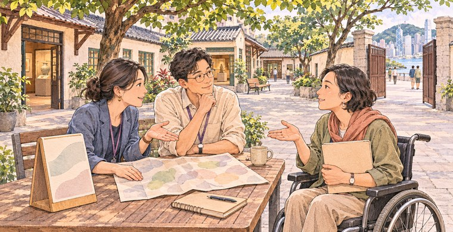

# They can read the map. Can they find the entrance?

<!-- legacy-case-id: 144 -->

HSP-12 · Hong Kong · 10–15 minutes · Wayfinding · Visitor journey · Service design

## In the news

For its September–November 2026 redevelopment period, the Hong Kong Maritime Museum announced temporary entrance arrangements supported by directional signage and staff assistance. The notice describes managing a changing arrival route, not evidence that visitors were getting lost.

The small museum, route and walkthrough below are fictional and unrelated to that redevelopment. The question is where information helps a visitor make the next spatial decision.

## Opening decision

**Fictional classroom situation.** A small museum occupies a shared courtyard complex. The manager has HK$12,000 for one three-month arrival-wayfinding enhancement. Both quotations include design, installation or printing, staff orientation, a prototype test and upkeep for the period; no extra staffing is funded.

Existing required access and safety provision, basic arrival information and assistance on request remain under either choice. The walking route is safe and step-free; neither option changes it. The enhancement is not a substitute for access assessment or necessary assistance.

A offers an improved portable map at the outer gate and a matching replacement for the existing map display. B offers a coordinated sequence of on-site orientation, direction, confirmation and entrance cues. A gives visitors an overview they can carry; B provides information where they need the next move. Neither trial requires a smartphone.

## Evidence

| HK$12,000 package | Primary advantage | Limit |
|---|---|---|
| A · Improved portable map and display | Whole-site overview; portable reference offered before entry | Visitor must connect the drawing to surroundings |
| B · On-site cue sequence | Guidance and reassurance at successive locations | Less detailed overall view; placement and wording must work together |

Both include readable text/symbols, contrast and specified accessible formats. B retains existing maps. Neither guarantees independent navigation for everyone; no comparative route test has been reported.

**Student question:** Which enhancement would you fund first, A or B? Explain when a visitor would use it and what you would observe during a walkthrough before finalising the design.

## Round two

A route check establishes the sequence: outer gate → a fork → a covered walk → a bend → museum door. At the fork, right leads toward the museum; left leads safely into an unrelated courtyard. The door is hidden from the fork. The existing map display is on the right-hand route, twenty metres after the fork; visitors who turn left never reach it.

Six adult first-time volunteers are offered A’s draft portable map at the gate and asked to find the museum, with help available. Four take the left turn. Later, seated with the same map, all six can point to the museum entrance on the drawing. The observation is not a population success rate or proof of why each person turned left.

The walkthrough identifies a design gap worth testing: the fork has no dedicated museum direction cue, and after the bend there is little reassurance that the entrance is ahead. B’s supplier can place a cue before the fork, repeat the museum name after the bend and identify the door, with an orientation cue at the gate, all within the quoted package. Permissions and safe, non-obstructing positions are confirmed in this fictional setting. B has not yet been tested with visitors.

A could instead refine its orientation and landmarks within its own quote; its gate distribution means it can reach visitors before the fork. The budget still buys only one enhancement, not both. Existing assistance and access provision remain unchanged.

**Student question:** Which package would you fund now, and what would you test next? Describe the information a visitor needs before the fork, after the bend and at the door, rather than simply asking for more signs or a larger map.

## Reading a map is not completing a journey

Pointing to a destination while seated tests one task. Recognising the correct direction while arriving in an unfamiliar place tests another. The four wrong turns identify a problem in this small walkthrough; they do not establish the exact cause or a general failure rate.

A map can still help people plan and recover their orientation. Its useful overview does not guarantee that a visitor can connect a symbol or landmark with the view at a particular junction.

## Put the decision in the right place

At the fork, the visitor needs to know which branch leads to the museum before committing to a turn. A display twenty metres beyond that junction cannot guide someone who has already gone the other way.

After the bend, a confirmation cue can reassure someone that the route continues toward the same destination. At the door, consistent identification answers “have I arrived?” The information has different jobs along the sequence, not simply more words everywhere.

## Choose a prototype, not an unearned guarantee

B is the stronger first trial for the specific gaps observed: it can address the fork and later confirmation points within the budget. But an arrow or sign is not effective merely because it exists. Check approach visibility, understandable direction, consistent naming, obstruction and clutter in context.

A remains a credible alternative if its revised orientation and recognisable landmarks help visitors relate the gate map to the route. Do not claim A cannot reach the fork: its portable map is offered at the gate. Explain what new route evidence would justify choosing it over B, rather than treating the two packages as equally supported after the reveal.

## Observe the whole arrival

Test the selected prototype from the actual approach, without telling visitors which branch to take. Ask consenting participants with varied access preferences to explain what they notice and where reassurance is missing; help remains available whenever needed.

Record wrong turns, backtracking, requests for help and whether people recognise arrival. Note the conditions and who participated. A small, supported test informs revisions; it is not proof of universal accessibility, a legal compliance certificate or a forecast of ticket sales. Keep assistance and usable existing information while reviewing the enhancement.

## Instructor note

Use three minutes for the first vote, three for drawing the route and locating the missed decision, then five for a prototype brief. Ask groups to give each cue a purpose: orientation, direction, confirmation or identification. A simple route sketch is enough; students need not design technical signage specifications.

This is HSP-12’s physical arrival journey, not HSP-08’s multiple ways to interpret an exhibit after arrival. Do not infer disability, language ability or carelessness from a wrong turn. The improved B is feasible, not proven successful. Preserve A’s genuine strength as a portable overview while making the observed placement problem central to the recommendation.

## Sources and case assumptions · optional reference

All information needed for classroom decisions is provided above. Sources are optional reading.

All museum layout, budgets, quotations, permissions, volunteers and observations are fictional. Six first-time adults consent to the walkthrough; no personal diagnoses or demographic cause is inferred. The four wrong turns are a small observation, not a population estimate or a causal comparison of A and B. B is untested; its stated placements are feasible within its quote. A reaches visitors at the gate and can be refined, so it is not artificially excluded from the decision point. Packages retain required accessibility/safety and assistance; no statutory deficiency is excused by a budget. The safe step-free route and both quoted formats are premises, not universal accessibility certification. No actual venue’s route, map or illustration is reproduced. The HKMM notice concerns a September–November 2026 redevelopment period; its precise publication date is not asserted, and it is not a current travel instruction. Source sections were read, not every linked standard or technical appendix. International school guidance supplies design considerations only, not Hong Kong museum obligations.

- [Hong Kong Maritime Museum · B Deck redevelopment notice · September–November 2026 period](https://www.hkmaritimemuseum.org/special-ann-15-redevelopment-of-b-deck/details). Announcement and entrance FAQ describe temporary reception/entrance directions and staff assistance. No finding of visitor confusion or current routing instruction is inferred.
- [Hong Kong Tourism Commission · Visitor Signage Improvement Scheme](https://www.tourism.gov.hk/en/tourism-projects.php?project=visitor_signage). Programme description distinguishes directional signs, mapboards and identification signs. A description of functions, not a comparative effectiveness study.
- [Mark A. Foltz · Designing Navigable Information Spaces · Chapter 5: Design Principles for Wayfinding](https://rationale.csail.mit.edu/pubs/mfoltz/mfoltz-thesis/node8.html). MIT-hosted thesis chapter discusses orientation, decision points and confirmation along routes. Conceptual synthesis, not an experiment validating this fictional museum.
- [Scottish Government · Navigation and wayfinding · 25 March 2026](https://www.gov.scot/publications/sensory-inclusive-learning-environments-additional-support-learning/pages/6/). Section 6 discusses consistent cues, confirmation, clutter and mock-up assessment in learning environments. Not transferred as Hong Kong law or a universal accessibility checklist.
- [Hong Kong Architectural Services Department · Universal Accessibility: Best Practices and Guidelines · Chapter 5](https://www.archsd.gov.hk/archsd/html/ua/05-Chapter5.pdf). Introduction and sections 5.1, 5.7 discuss connected routes, signs at decision points and maps. The document itself directs designers to relevant statutory requirements; this case is not a compliance assessment.
