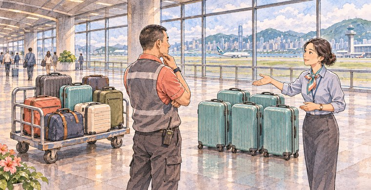

# Full carts. Slow connections?

<!-- legacy-case-id: 593 -->

OPS-50 · Hong Kong · 15 minutes · batch integrity · sorting capacity · transfer service

## Packing affects the next handoff

An IATA baggage process model describes grouping bags before loading to support priority handling at arrival. Hong Kong International Airport has also reported using baggage tractors to move bags between airport facilities. The cart and sorting choices below are a fictional planning exercise, not actual airport procedures.

## Opening decision

At a fictional Hong Kong transfer facility, Hoi has 36 already accepted, traceable bags to move into onward staging. Fourteen have a tight connecting deadline; the other 22 have ample time. Every bag moves during the same cart departure.

Two carts come with the service, with room for 20 bags each. For this exercise use one of only two approved layouts: Mixed uses the regular two carts, which go directly to a sorting bay. Separated uses one all-tight cart sent intact to priority staging and two carts for the remaining bags. Only an all-tight cart is cleared for priority staging as a batch; a partially mixed cart cannot use that route.

All bags in priority staging make the tight deadline; no individual sorting is needed there. At the regular bay, the team handles tight bags first but can finish only the number shown before that deadline. Flexible bags always make their later deadlines. No plane is held. Minimise extra cart fees plus late-bag costs.

## Evidence

| Input | Value |
| --- | --- |
| Tight bags | 14 |
| Flexible bags | 22 |
| Tight bags the regular bay can finish on time | 10 |
| Third cart fee | HK$600 |
| Incremental cost per late tight bag | HK$250 |

**Student question:** Which layout should Hoi choose? Find how many carts each layout needs and the extra cost of each.

## Round two

The regular bay confirms enough staff to finish 12 tight bags, not 10, before the deadline. All other numbers and routing rules are unchanged.

**Student question:** Would you still pay for the third cart? Find the regular bay capacity at which Mixed first becomes cheaper with these fees.

## First decision: a unit can be a cart or a bag

Mixed accommodates all 36 bags in two 20-place carts. The regular bay misses four tight bags, costing 4 × HK$250 = HK$1,000. Separated needs one cart for the 14 tight bags and two for the 22 flexible bags. There are no late bags, so the cost is HK$600. Buy the third cart and save HK$400.

## Second decision: price the help at the next stage

With 12 sorted in time, Mixed leaves two late bags costing HK$500, less than HK$600. At 11, three late bags would cost HK$750; at 12, two cost HK$500. Twelve is the first whole-bag capacity where Mixed is cheaper.

## What to take away

Packing tightly saves cart cost. Packing an eligible batch together saves sorting after arrival. Compare the whole handoff, keeping the batch rule and individual bag tracking distinct.

## Instructor note

Ask which assumption would change if flexible bags were allowed into the priority batch. All rates, layouts and timings are fictional; learners do not handle actual bags or airport operations.

## Sources and case assumptions · optional reference

All information needed for classroom decisions is provided above. Sources are optional reading.

Ask which assumption would change if flexible bags were allowed into the priority batch. All rates, layouts and timings are fictional; learners do not handle actual bags or airport operations.

- [IATA Airline Industry Data Model, bag handling process](https://airtechzone.iata.org/aidm_model/25.1/EARoot/EA3/EA2/EA5/EA6/EA1/EA5188.htm). Defines packaging as segregation to enable priority handling, including local versus transfer bags.
- [Airport Authority Hong Kong, electric baggage tractor news](https://www.hongkongairport.com/en/media-centre/news-stories-updates/AET). Historical account describes transfer-baggage movements between airport facilities.
- [Hong Kong International Airport, HKIA Connects](https://www.hongkongairport.com/en/passenger-guide/airport-facilities-services/hkia-connects). Official passenger guide distinguishes onward check-in and baggage check-in as parts of the passenger connection.
- [IATA, Baggage Tracking implementation guide](https://www.iata.org/contentassets/5c4aa8b8b3b1432697d2bf3301450684/reso753-implementation-guide---2023_issue-4.02.pdf). Section 6 distinguishes individual acceptance, load, transfer and arrival tracking points.
- [IATA, Baggage Information eXchange implementation guide](https://www.iata.org/contentassets/6bb095b194bc4ebf851ed73c83266c20/baggage_information_exchange_implementation_guide_v2.0.pdf). Logistics and Conformance discussion identifies flight and infrastructure use in routing; it does not describe the exercise’s layouts.
