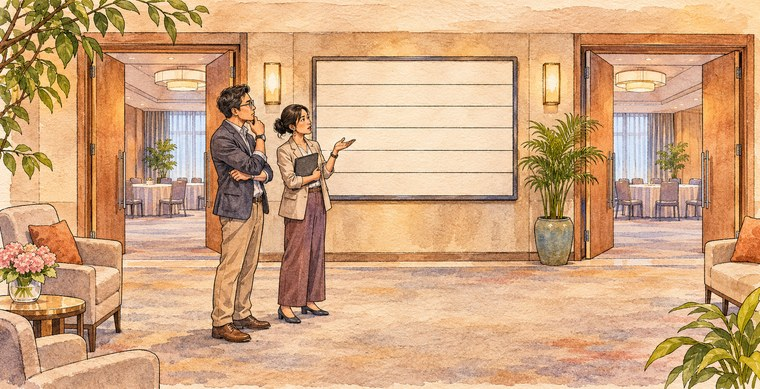

# A full programme. A complete guest journey?

<!-- legacy-case-id: 444 -->

HSP-37 · Hong Kong · 15–20 minutes · Conference programming · Participant journeys · Protected transitions

## An agenda is also a journey

W3C and conference accessibility guidance encourage organisers to plan around participants’ needs, not just presentation content. Massachusetts public-health guidance explicitly connects breaks with movement between activities. These are planning references, not a universal timetable or a statement of Hong Kong law. The conference and times below are fictional.

## Opening decision

You programme fictional Harbour Exchange, a half-day professional conference in Hong Kong. Twenty-four adult delegates have chosen a complete learning journey: plenary, workshop A, workshop B and closing discussion. Every delegate wants all four in full. Merely entering each room does not fulfil that aim.

All participants and speakers can stay until 13:00. Both schedules have the same funded rooms, staff, accessible materials, assistance and emergency arrangements. The venue and support are available until 13:00 without extra charges. Neither proposal has been advertised or contracted; no established guest entitlement is being withdrawn.

The plenary runs 09:00–09:45 in Hall A. Workshop A also takes place there, starting at 10:00 and initially expected to finish at 10:40. Workshop B occupies Hall B; the closing returns to Hall A. The two proposals differ only in the timing of those later sessions.

Between sessions, the group requires fifteen protected minutes for rest and personal needs. Moving between halls then takes ten additional minutes, including settling into seats. These non-overlapping intervals are agreed, case-specific requirements for this whole group, not medical diagnoses or universal accessibility minima. They cannot be shortened.

The fifteen minutes after the plenary are sufficient because the group remains in Hall A. No relocation, remote substitute or parallel version of A or B is available. B’s first ten minutes contain an essential exercise that will not be repeated. The organiser must select a deliverable journey, not maximise nominal session attendance.

The agreed inter-session rest rule applies after the plenary, A and B. After closing, the group needs no further scheduled rest; its funded, accessible departure takes five minutes. This is a separate, confirmed requirement for this fictional group, not a rule for other events.

## Evidence

| Session | C · Compact | L · Later |
| --- | --- | --- |
| B, Hall B | 11:05–11:45 | 11:20–12:00 |
| Closing, Hall A | 12:10–12:40 | 12:25–12:55 |

**Student question:** Which schedule would you provisionally select? Trace the group from the end of A to the start of B and then to closing. Distinguish protected rest, movement and any remaining margin rather than treating the entire gap as spare time.

## Round two

A full rehearsal now establishes that A’s essential demonstration takes fifty minutes rather than forty. For this classroom scenario that duration is fixed: A must run 10:00–10:50. Removing content would no longer deliver the promised workshop. No other duration, start time or access requirement changes.

A trial run of C logs all twenty-four delegates in both workshops because its attendance register records any entry, not arrival time or completion. The group follows the agreed fifteen-minute rest and ten-minute transfer after A. B still begins and ends at its printed times. These are invented diagnostic observations, not a causal study.

The team can still select either complete schedule before launch. It cannot move individual sessions independently, extend beyond 13:00 or ask delegates to sacrifice rest, transfer time or part of A. L’s later finish is acceptable to all attendees and funded suppliers, but it gives up C’s earlier departure.

**Student question:** Which schedule now delivers every required session in full? Calculate arrival at B and the missing minutes under C. Explain why the attendance register can look successful despite an incomplete experience, and specify a better check before launch.

## Debrief · Before the rehearsal

Initially A ends at 10:40. Rest lasts until 10:55 and movement until 11:05. C starts B exactly then, with no remaining margin. L starts at 11:20, leaving fifteen additional minutes after the required rest and transfer. Both initial journeys are feasible on the supplied durations.

After B, each proposal provides twenty-five minutes before closing: fifteen for rest and ten for movement. C ends B at 11:45 and reaches closing at 12:10; L ends B at 12:00 and reaches closing at 12:25. These intervals contain no additional margin.

## Debrief · Rebuild the actual journey

After the rehearsal, A ends at 10:50. Protected rest runs 10:50–11:05 and the hall transfer runs 11:05–11:15. In C, arrival at B is ten minutes after its 11:05 start. The essential opening exercise is missed even though everyone can subsequently enter and be recorded as attending.

L starts B at 11:20, five minutes after the group arrives. It delivers B until 12:00, rest until 12:15, movement until 12:25 and closing until 12:55. This meets the 13:00 limit with five minutes remaining. No extra session, staffing or faster movement has been invented.

Choose L for the stated complete-journey requirement. Its finish is fifteen minutes later than C’s, a real loss of early departure even though participants have accepted it. C cannot meet the new requirement unchanged. This is a deterministic feasibility result, not proof that longer programmes always improve learning or wellbeing.

## Debrief · Attendance is not completion

The register counts twenty-four people in each workshop under C, but none receives B’s opening ten minutes. That is 24 × 10 = 240 missed participant-minutes. It is a duration total, not a measured learning loss, a wellbeing score or evidence that all other parts of B are worthless.

Do not fix the dashboard by redefining completion as any entry. Separately check arrival before the essential exercise, receipt of required content and delegates’ reported ability to use the rest and transfer intervals. A headcount answers who appeared; it does not show whether the designed journey could be completed.

## Debrief · Keep the boundaries visible

L’s five-minute margin before B does not insure against every overrun. Its B-to-closing transition still has no additional margin beyond protected rest and movement. Test the whole journey with the actual supports, confirm realistic session durations and agree an explicit response to disruption before making reliable delivery claims.

Neither schedule justifies removing access support or pressuring guests to hurry. Actual needs can change and participants retain the freedom to step away. The arithmetic tests whether the offered complete journey is possible for this stipulated group, not whether every participant should be required to follow it.

## Instructor note

Draw three separate intervals after A: protected rest, transfer and remaining margin. Then replace the original forty-minute A with fifty minutes. Ask students why identical attendance counts can conceal ten missed minutes, and why unused time after closing cannot repair a missed opening exercise.

HSP-09 chooses reception facilitation around guest purposes; HSP-27 sequences heritage evidence within a fixed visit. This case tests conference journey completion against misleading room-entry counts after an overrun. All requirements and results are fictional. Sources inform planning distinctions, not numerical assumptions, medical conclusions or legal advice.

## Sources and case assumptions · optional reference

All information needed for classroom decisions is provided above. Sources are optional reading.

Initial A ends 10:40 +15 rest +10 move =11:05; C B 11:05 no margin, L 11:20 margin 15. Revised A ends 10:50 +15 rest +10 move =11:15; C misses 10 minutes B, L margin 5. C B ends 11:45+25=closing 12:10 ends 12:40. L B ends 12:00+25=closing 12:25 ends 12:55, five minutes before 13:00 support limit. Same B 40 and closing 30. L finish 15 later accepted by all, no extra cost. 24 delegates×10 missed=240 participant minutes not quantified learning loss. Rest and movement distinct fixed requirements, no rushing/substitute/free extras. Entry counts not completion. Deterministic feasibility not forecast, universal access minimum or legal/medical claim. Inter-session rest follows plenary/A/B; after closing no additional scheduled rest is required by this stipulated group. Accessible funded departure takes five minutes, so L departure completes 13:00.

- [W3C WAI · Making Events Accessible](https://www.w3.org/WAI/teach-advocate/accessible-presentations/). Original accessibility guidance asks organisers to respect individual needs and prepare accessible events and materials; it does not specify the fictional fifteen- and ten-minute intervals.
- [Massachusetts Department of Public Health · Planning Accessible Meetings and Events](https://www.mass.gov/doc/planning-accessible-meetings-and-events-1/download). Original public-health planning guide, especially Logistics and timing, connects breaks, self-care and movement between activities. Its US context is not Hong Kong law; the case intervals are independently stipulated.
- [ACM SIGCHI · Accessibility Guidelines for SIGCHI Conferences](https://sigchi.org/about/policies/conference-policies/accessibility-guidelines/). Conference association guidance integrates access planning, budget, assistance, quiet spaces and reporting channels. These provisions support planning the participant experience rather than only room schedules.
- [Microsoft Human Factors Lab · Research Proves Your Brain Needs Breaks · April 2021](https://www.microsoft.com/en-us/worklab/work-trend-index/brain-research). Original report describes fourteen volunteers comparing video-meeting days, including ten-minute meditation breaks. This small remote-meeting study is not evidence of an in-person learning effect or a universal optimal break length.
- [Hong Kong Convention and Exhibition Centre · Exhibition Event Rules and Regulations · July 2020](https://aplarcongress.com/wp-content/uploads/2022/07/Exhibition_Event_Rules_and_Regulations_Jul_2020_v2_en.pdf). Venue-authored historical manual, section 2.11, addresses access and unobstructed circulation. Hosted by an event organiser; not the fictional venue’s contract or a current legal standard for all conferences.
