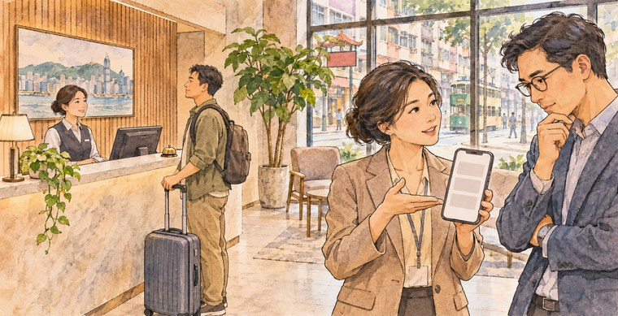

# The guest does the work. Is the service easier?

<!-- legacy-case-id: 420 -->

HSP-35 · Hong Kong · 15–20 minutes · Customer participation · Self-service design · Whole-service workload

## Self-service redistributes service work

Self-service research and service-blueprinting guidance ask managers to consider the entire service, including customer tasks and backstage support. A fast visible step need not mean less work overall. The property, process observations and numbers below are fictional; they are not results from any hotel brand or research study.

## Opening decision

You manage fictional Harbour Rooms, a Hong Kong serviced-apartment property. Choose A: retain assisted check-in as the default for routine arrivals; or B: make an optional self-check-in route the default invitation. Under B, guests can choose a fully staffed assisted route immediately, without penalty or pressure.

Both designs retain the same secure identity and access checks, privacy protections, accessible assistance, language support and emergency cover. Rooms, prices and confirmed arrival entitlements do not change. Staff never ask guests to share account passwords or bypass checks. The exercise compares service work, not whether to satisfy these obligations.

A routine-arrival process trial initially reports only lobby waiting and front-desk staff activity. Times below are arithmetic means per arrival, not simultaneous staffing requirements. The desk workload falls sharply under B, but the first report omits guest preparation and remote support. No staff dismissal, payroll saving or capacity increase has been established.

Management will change the default only if the measured process preserves completed access and does not increase average guest active task time, while reducing provider staff work. This is the supplied service objective, not a universal preference. Both designs and their required support fit the funded budget; software and staffing costs are not compared here.

## Evidence

| Measure | A | B |
| --- | --- | --- |
| Lobby waiting | 4 | 1 |
| Front-desk staff activity | 6 | 0.5 |

**Student question:** Would the partial report justify changing the default? Identify the guest and staff activities missing from it, and define check-in completion before comparing the two designs.

## Round two

The completed fictional trial ledger covers 100 routine arrivals under each design, with no missing records or abandoned cases. Treat these supplied cohorts as a process-accounting exercise, not a randomised experiment or forecast of population behaviour. The B cohort consists of people who voluntarily attempted self-check-in; it excludes those choosing assistance from the outset.

Under A, each guest spends six active minutes completing the assisted process, with no pre-arrival task. The provider spends six front-desk staff-minutes per arrival, with no additional check-in support work. Lobby waiting is separately measured at four minutes on average and is not included in active task time.

Under B, every guest spends six active minutes before arrival reading instructions and submitting the required information, plus two active minutes at arrival. These eight minutes include unsuccessful attempts. Eighty of the 100 complete without recovery; twenty need additional assistance after an access-activation failure.

Each of those twenty spends ten additional active minutes with support, beyond the eight already counted. Remote staff spend twelve additional staff-minutes per recovery, including two minutes of records work without the guest. All B arrivals also require 0.5 backstage staff-minute, in addition to the reported 0.5 front-desk minute.

All 100 in each cohort eventually receive authorised room access and understand the arrival instructions, the defined completion endpoint. B’s one-minute average lobby wait excludes remote-support time; it is not a whole-journey duration. There is no measurement of other waiting or total elapsed journey time, so do not invent either.

The assisted fallback remains adequately staffed and funded. These data do not predict how many future guests would choose either route. A redesigned form or lower failure rate is not a supplied free option: changes need costing and a new test. No real identity records are used in this classroom ledger.

**Student question:** Calculate guest active time and total provider staff time for each 100-arrival cohort. Distinguish B’s unassisted completion rate from eventual completion. Under the stated objective, should B become the default now? What would you measure before reconsidering?

## Debrief · Follow the guest’s work

A requires 100 × 6 = 600 guest-minutes, averaging six per arrival. B requires 100 × (6 + 2) + 20 × 10 = 1,000 guest-minutes, averaging ten. That is 400 more guest-minutes, or four more per arrival. The shorter lobby queue does not erase preparation and recovery.

The eighty B guests without recovery spend eight active minutes each; the twenty needing recovery spend eighteen. The mean is (80 × 8 + 20 × 18) / 100 = 10. Do not calculate a mean using only successful unassisted guests, or count the initial attempt twice in the recovery group.

## Debrief · Follow the provider’s work

A uses 100 × 6 = 600 staff-minutes. B uses 100 × (0.5 + 0.5) + 20 × 12 = 340 staff-minutes, averaging 3.4. The provider saves 260 staff-minutes in these ledgers, not the 550 suggested by looking only at the front desk. Remote and backstage work remain real work.

The 260-minute reduction is not a cash saving or permission to cut support. Pay rates, software costs, scheduling, peak demand and minimum coverage are absent. Guest and staff minutes may occur together; they belong to different people. Adding them measures person-time, not clock duration or an agreed monetary value.

## Debrief · Keep denominators and endpoints clear

B’s unassisted completion is 80 / 100 = 80%; eventual completion with recovery is 100 / 100 = 100%. A also has 100% eventual completion through its intended assisted process. Calling B “100% self-service success” hides recovery; comparing B’s unassisted rate with A’s assisted completion confuses different measures.

These B results apply to the 100 volunteers who attempted that route. They do not supply uptake among all guests, outcomes for people choosing assistance immediately, or a controlled causal effect. Retain separate counts for invitations, route choices, attempts, recovery and eventual access when evaluating the actual default policy.

## Debrief · Make the decision against its objective

Retain A as the default for now under the supplied objective. B reduces provider work and preserves eventual access, but increases average guest active time from six to ten minutes. A shorter lobby wait alone does not satisfy the no-increase-in-guest-work condition. This conclusion does not prohibit voluntary self-service.

If management values convenience at a chosen time more than active minutes, it could adopt a different explicit objective and investigate guest preferences. The ledger alone cannot make that value judgment. Even eliminating all B recovery leaves eight active guest-minutes, so fixing failures alone would not reach A’s six-minute benchmark.

## Debrief · Test the complete service

Map instructions, pre-arrival entry, arrival actions, authorised access and exception recovery. Investigate unnecessary repeated entry or unclear instructions without removing required checks. A revised process needs observed guest effort, staff effort and completion data across intended users, including people who decline or stop self-service. Do not infer accessibility from device ownership.

Measure waiting separately from active work, before and after arrival, and preserve the outcome endpoint. Examine longer recovery experiences rather than only the mean. Record support capacity and complete costs before claiming savings. Any redesign must retain the accessible staffed alternative, privacy protections and secure access controls.

## Instructor note

Ask for a provisional decision from the partial lobby report. Reveal the full ledger and assign guest and provider calculations separately. Compare 600 with 1,000 guest-minutes and 600 with 340 staff-minutes. Require both the 80% unassisted and 100% eventual B completion rates before revisiting the default decision.

SUS-16 studies access barriers and assisted booking windows; HSP-26 studies ownership across separate providers. This case traces redistributed guest and provider work inside one hospitality check-in design. Numbers are invented accounting facts, not trial evidence of effectiveness. No legal requirement or real hotel failure rate is inferred from the sources.

## Sources and case assumptions · optional reference

All information needed for classroom decisions is provided above. Sources are optional reading.

Fictional 100-arrival ledgers for each design; B volunteers attempted self-service, not all arrivals or random assignment. A guest active 6 and staff 6 each; lobby wait 4 separate. B all guests pre-arrival 6 plus arrival 2; 20 of 100 need additional guest 10 and remote staff 12 each. B all arrivals front desk 0.5 plus backstage 0.5. Guest totals A 600 B 1000; staff A 600 B 340. B independent 80 percent, eventual 100 percent; A assisted eventual 100 percent. No other wait or elapsed duration supplied. Provider reduction 260 staff-minutes not payroll savings. Management objective requires no greater mean guest active effort and completed access preserved; B fails 6-to 10 even zero recovery leaves 8. Immediate assisted choice retained without penalty, secure identity checks and privacy/accessibility unchanged. No free redesign or invented uptake/cost forecast. All sources conceptual or specific operational guidance, not fictional observations.

- [Meuter, Ostrom, Roundtree and Bitner · Self-Service Technologies: Understanding Customer Satisfaction with Technology-Based Service Encounters · 2000](https://www.ida.liu.se/~steho87/und/htdd01/3383341.pdf). Original critical-incident research distinguishes technology, process and design problems and discusses fallback to employees. The reported incidents are not representative failure rates or this fictional property’s workload data.
- [Sarah Gibbons · Nielsen Norman Group · Service Blueprints: Definition](https://www.nngroup.com/articles/service-blueprints-definition/). Original practice guidance maps customer, frontstage, backstage and support activities, including time. No proprietary diagram or example is copied; mapping identifies work rather than proving a causal productivity gain.
- [UK Government Service Manual · Measuring completion rate](https://www.gov.uk/service-manual/measuring-success/measuring-completion-rate). Official guidance defines starts, completions and assisted support measurement. Its measurement principles inform explicit denominators; government transaction definitions and publication duties are not imposed on this hotel.
- [W3C Web Accessibility Initiative · Form Instructions](https://www.w3.org/WAI/tutorials/forms/instructions/). Original accessibility guidance explains clear instructions, required inputs and accessible labels. A limited design reference, not a complete accessibility audit or evidence that the fictional process meets every applicable requirement.
- [Hilton Help Center · Digital Key](https://www.hilton.com/en/help-center/check-in-and-check-out/how-does-digital-key-work/). Hotel operator’s own instructions explain digital access, physical-key alternatives and possible front-desk identification. Operational context only: Harbour Rooms is unrelated, and no Hilton time or failure rate is asserted.
