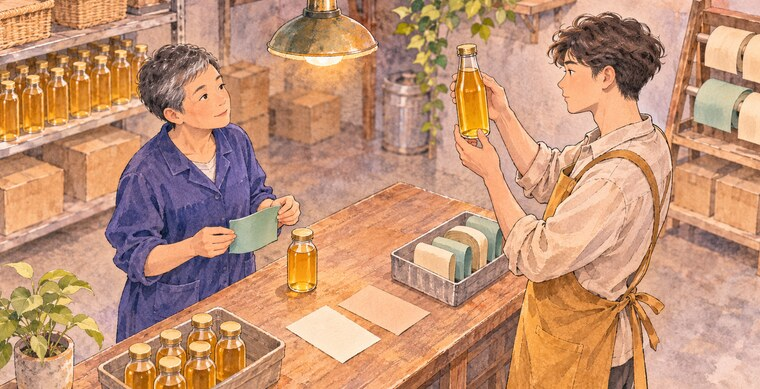

# Less sugar. More in the bottle?

<!-- legacy-case-id: 498 -->

MKT-41 · Hong Kong · 12–15 minutes · Packaging · Claim comprehension · A/B testing · Channel execution

## What does the number on a bottle measure?

Hong Kong’s Consumer Council reported a test of 30 bottled green teas in 2006, including laboratory testing for total sugars. A separate Centre for Food Safety survey covered sugars in non-alcoholic packaged drinks, including teas. These are dated examples of why consumers need to read the unit next to a number, not evidence about today’s shelves.

## Opening decision

The marketing team at fictional Harbour Leaf plans to introduce a reformulated green tea in a larger bottle. The retailer wants the front panel ready this week. Design A leads with a comparison versus Harbour Leaf Classic on an equal-volume basis; design B leads with two plain readings side by side: grams per 100 mL and grams per whole new bottle. Both mock-ups show the same fictional product, price, and nutrition panel.

In a fictional randomized shelf mock-up, each shopper saw only one design for three seconds, then answered two questions. The team will advance a design only if at least 60 out of 100 report purchase interest and at most 12 out of 100 wrongly say the whole new bottle has less sugar than Classic. This is a comprehension gate, not proof of sales or legal approval.

## Evidence

| Fictional pack | Sugar per 100 mL | Bottle size |
| --- | --- | --- |
| Classic | 13 g | 330 mL |
| New | 7 g | 650 mL |

| Shelf mock-up, 100 people each | Interested in buying | Wrongly think the whole new bottle has less sugar |
| --- | --- | --- |
| A: comparison first | 74 | 39 |
| B: both bases visible | 61 | 7 |

**Student question:** How much lower is the sugar per 100 mL, and does the whole new bottle contain less sugar? Which design should go to the next test under the team’s rules?

## Round two

A mobile retailer trims the image in its product listing. B now shows the 100 mL figure but hides the whole-bottle line on first view. Design C puts both values in plain listing text before the image. In a new fictional randomized phone test, the same targets apply to each phone design separately.

| Phone listing, 100 people each | Interested in buying | Wrong whole-bottle inference |
| --- | --- | --- |
| B as cropped | 64 | 16 |
| C: both bases above the fold | 60 | 9 |

**Student question:** Which phone design should advance? If B’s shelf and phone samples are pooled, would it appear to pass the comprehension gate? What does pooling hide?

## Debrief · Compare like with like

At equal volume the difference is 13 − 7 = 6 g per 100 mL, or 6 ÷ 13 ≈ 46% lower than Classic. The old bottle contains 13 × 3.3 = 42.9 g; the new one contains 7 × 6.5 = 45.5 g, an increase of 2.6 g per bottle. Lower concentration and lower total content are different claims.

## Debrief · Comparison is not low sugars

The concentration meets the two numerical difference tests of 25% relative and 5 g per 100 mL absolute, but the new recipe is not low in sugars under the 5 g per 100 mL limit. The test does not clear the actual packaging for legal use.

## Debrief · Use both gates

On the shelf A wins on stated interest (74 versus 61) but fails the comprehension gate (39 exceeds 12). B reaches both targets, 61 and 7. On phones, cropped B misses the local comprehension gate at 16 false inferences; C meets both at 60 and 9. Pooled B shows 23 wrong answers in 200, or 11.5%, so it appears to pass. It hides a 16% error rate on phones, where the team must make a separate decision.

## Debrief · Draw the right conclusion

Advance B on the shelf and C on phones to a larger follow-up, not to a print order. One fewer interested phone respondent would put C below the interest cutoff. Report each channel, use a fresh comparable sample and capture real choices where possible. A quick stated-interest result does not measure actual purchases or repeat behavior.

## Instructor note

Ask students to name the unit before answering. If someone chooses A based on interest, ask what a customer who drinks the whole bottle would actually get. Discuss why a single pooled dashboard figure is inappropriate when each channel needs to meet the gate.

## Sources and case assumptions · optional reference

All information needed for classroom decisions is provided above. Sources are optional reading.

Published testing and official guidance are factual background. Harbour Leaf, the products, sample outcomes and release gates are invented. Calculations use both bottle sizes as if consumed in full. Numerical checks illustrate the distinction, not legal clearance or dietary advice. 

- [Centre for Food Safety · Hong Kong Food and Drugs (Composition and Labelling) Regulations](https://www.cfs.gov.hk/english/food_leg/food_leg_cl.html). Schedules 5 and 8 distinguish the relative and absolute rule for comparative claims from the concentration cap for a low-sugars claim.
- [Centre for Food Safety · Trade nutrition-labelling FAQ](https://www.cfs.gov.hk/english/programme/programme_nifl/programme_nifl_faq.html). Sections 3.20 and 3.21 explain how to identify the reference food and express the difference; two versions of the same food can be similar foods.
- [Hong Kong Consumer Council · Bottled green tea drinks assessed for tea and sugar contents](https://www.consumer.org.hk/en/press-release/20060815-1). Original 2006 report identifies 30 bottled green teas and the attributes measured during the testing.
- [Centre for Food Safety · Sugars in prepackaged non-alcoholic beverages](https://www.cfs.gov.hk/english/programme/programme_rafs/programme_rafs_n_01_11.html). Original survey distinguishes tea categories among the sampled packaged beverages and documents discrepancies in historical claims.
- [Singapore Health Promotion Board · Measures for Nutri-Grade](https://www.hpb.gov.sg/healthy-living/food-and-beverage/nutri-grade/). A separate jurisdiction illustrates the use of front-of-pack sugar information; its rules are not applied to this Hong Kong case.
