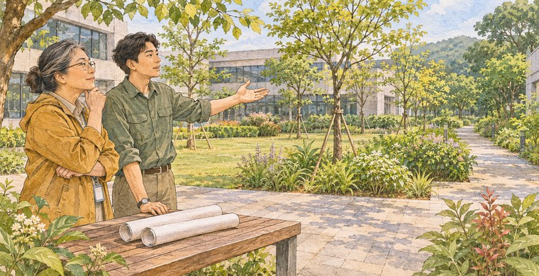

# More trees. Better habitat?

<!-- legacy-case-id: 178 -->

SUS-15 · Hong Kong · 10–15 minutes · Sustainability · Habitat connectivity · Biodiversity objectives

## A Hong Kong biodiversity context

On 31 December 2025, Hong Kong announced its updated Biodiversity Strategy and Action Plan, including habitat restoration and biodiversity-friendly urban design. This is policy context, not an assessment of our fictional site.

The business park, planting proposals and ecological findings below are original classroom assumptions.

## Opening decision

A fictional Hong Kong business park has HK$120,000 for one five-year landscape package. Its stated primary purpose is to improve habitat function for a locally occurring butterfly group already recorded on the site. Staff shade and an attractive courtyard are valuable secondary aims. No proposal has been selected or promised.

A creates a new planted courtyard plot with 30 young trees and suitable understorey planting. B restores a narrow planted connection between two existing habitat patches, using 10 young trees and suitable shrubs and ground-layer plants. Both use professionally selected local native planting; neither is simply bare trees on lawn. A offers more new tree planting and future courtyard amenity; B puts the money into a connected route.

Both professionally assessed packages are feasible and cost HK$120,000 including five years of paid establishment care, inspections and ecological monitoring. The park controls both locations for that period. Neither removes existing habitat or trees, impairs required access or replaces mandatory conservation duties. One complete package can be funded; no combined design has been assessed or quoted.

## Evidence

| Package | A: new courtyard plot | B: restored connection |
|---|---|---|
| New young trees | 30 | 10 |
| Spatial design | Separate planted plot | Links two existing patches |
| All-in five-year cost | HK$120,000 | HK$120,000 |
| Other benefits | More future courtyard shade and amenity | Planted route; less courtyard amenity |

**Student question:** Which package would you provisionally fund, A or B? Explain how its layout could serve the stated habitat purpose, rather than treating the tree count as a biodiversity score.

## Round two

A site-specific ecological assessment now identifies the missing connection between the two existing patches as the main constraint on movement for the target butterfly group. Both patches already contain suitable feeding and breeding resources. The proposed B strip fills that gap with suitable cover and resources; its width, planting and management have been assessed for this target and site. There is no intervening road or unaddressed physical barrier in this exercise.

The proposed A plot lies away from that route. It provides additional suitable planting and potential resting or feeding space, but does not connect the two patches. Its greater courtyard shade and amenity potential remain real reasons to value it. The assessment favours B for the specified movement function; it does not show that A has no ecological value.

No increase in butterfly numbers or breeding success has yet been measured. Weather, establishment and habitat conditions can affect results. The ecologist has specified baseline and repeated comparable-season checks of planting condition and target-group movement between patches, with review if the route is not used. Both quotes include this work and a named facilities officer to oversee it. Neither package is certified as a conservation offset.

**Student question:** Does the site assessment change your choice? State the objective your recommendation prioritises, the benefit you forgo, and what evidence would tell you whether the funded habitat function is actually improving.

## Name the function before counting the planting

The decision is about movement between habitat patches for a specified target group. Thirty new trees versus ten describes an installation output, not a measured ecological outcome. Plant choice, understorey, location and management matter alongside quantity. A large isolated plot and a smaller connection do different jobs.

## Use the assessment without turning it into a guarantee

B is the stronger recommendation for the stated primary purpose because it addresses the identified constraint. Its advantage is not that fewer trees are inherently better, but that this particular layout links suitable patches. A remains useful for additional habitat and courtyard amenity. Choosing A after the reveal requires openly changing the priority, not claiming it solves the same connection problem.

## Make the opportunity cost explicit

Both packages cost HK$120,000. Choosing B forgoes 20 additional young trees and the greater courtyard amenity offered by A. Those 20 trees are not a quantified biodiversity loss: species, survival, location and ecological function cannot be reduced to that difference. There is no supplied monetary value for either outcome and no cost-benefit ranking to calculate.

## Monitor a function, not just a planting ceremony

Record planting establishment and maintenance as delivery measures. Use the ecologist’s repeated, comparable-season observations to assess whether the target group uses the connection. Movement observations support a narrower claim than increased population or breeding success. Review poor establishment or lack of use with the ecologist; do not advertise an assured population recovery or offsetting entitlement.

## Instructor note

Ask students first to sketch a separate plot and a link between two patches, then explain what each can do. Reveal the site-specific limiting condition. A defensible answer recommends B for the agreed habitat purpose while recognising A’s amenity advantage. Do not make this a rule that every corridor works, every isolated patch is worthless, or native tree counts measure biodiversity. No real landscape specification, wildlife handling or legal permission is being designed.

## Sources and case assumptions · optional reference

All information needed for classroom decisions is provided above. Sources are optional reading.

All site details, costs, tree counts and ecological assessment findings are original fiction. Both five-year quotes include paid care and monitoring; required access, existing habitats and conservation obligations remain protected. B is assessed as suitable for the specified target and gap, not asserted suitable for all species. A includes appropriate understorey and is not an intentionally defective planting scheme. Thirty minus ten equals 20 additional young trees under A, not 20 biodiversity units. No population, breeding, carbon, health, property-value or financial return estimate is supplied. Establishment and movement monitoring are not proof of population recovery. No unpriced hybrid, offset certification or permission to damage other habitat is implied. Distinct from SUS-07 human service reach/outcomes and SUS-14 shade timing/heat adaptation: spatial ecological connectivity is the mechanism. Five actual relevant source bodies read. The announcement and BSAP are related Hong Kong government documents, not independent evaluations; CBD and FAO guidance also concern the same global framework. NParks is a Singapore example, not Hong Kong engineering guidance. IUCN full PDF timed out, so its abstract-only landing page was not counted or cited. FAO page contains repeated definitions and a malformed decision reference; only its explicit practice/monitoring guidance is used, not those defects.

- [Hong Kong Government · Updated Biodiversity Strategy and Action Plan · 31 December 2025](https://www.info.gov.hk/gia/general/202512/31/P2025123100202.htm). Dated policy context on restoration and biodiversity-friendly urban design; not a finding about the fictional park.
- [Environment and Ecology Bureau · Hong Kong Biodiversity Strategy and Action Plan 2035 · December 2025](https://www.afcd.gov.hk/english/conservation/Con_hkbsap/updating_bsap/files/common/HKBSAP_2035_EN.pdf). Chapter 1 explains ecological relationships rather than species counts alone. Relevant body sections read, not an exhaustive plan appraisal.
- [NParks · Nature corridors and nature ways · updated 15 June 2026](https://www.nparks.gov.sg/visit/when-visiting-parks/about-parks-nature-reserves-pcns/nature-corridors-ways). Explains site profiles, connectivity and layered planting in Singapore. No species prescriptions or measured benefits transferred to our site.
- [Convention on Biological Diversity · Target 2 guidance](https://www.cbd.int/gbf/targets/2). Restoration objectives, resources, integrity and connectivity. Global guidance, not a business-site certification or licence to offset damage.
- [FAO · Target 2 in Practice](https://www.fao.org/ecosystem-restoration-monitoring/target-2-help-desk/target-2-in-practice/en). Practice and monitoring sections distinguish activity records from effectiveness assessment; not evidence that this fictional connection succeeds.
