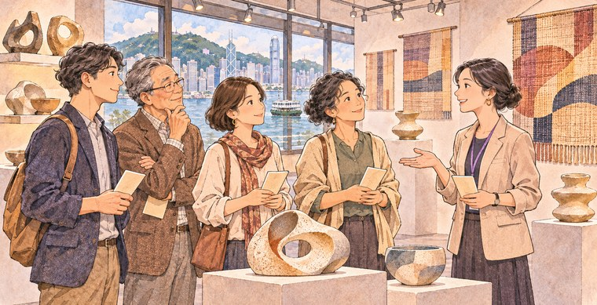

# One booking. Several different visits?

<!-- legacy-case-id: 240 -->

HSP-20 · Hong Kong · 10–15 minutes · Group experience · Visitor motivations · Consented service design

## A shared introduction can allow individual exploration

For its November–December 2025 Dream Rooms Community Day, M+ described an orientation followed by self-guided viewing at participants’ own pace. That was a programme for social-service organisations, not the private package below. Our four adult friends, gallery, prices and timing are fictional; no booking at M+ is offered.

## Opening decision

A host at a fictional Hong Kong design gallery is preparing a ninety-minute private visit for four adult friends. The organiser booked and paid for the group, asking for “a memorable visit together”. The package permits either one shared guided route or an agreed split-and-rejoin format at the same price. A host and a second trained guide are already paid and available for either format. Both routes are accessible, safe and within gallery capacity; individual access needs can be discussed privately and supported without an extra fee.

U keeps all four together for a ten-minute welcome, sixty-minute shared exploration and twenty-minute closing conversation. P uses the same welcome, two simultaneous thirty-minute segments tailored to agreed interests, ten minutes to regroup, and a shared forty-minute closing exploration and conversation. Each participant receives ninety minutes in either format. The two thirty-minute segments occur at the same time, not one after another. P’s split is optional and requires everyone’s agreement; no one is left alone or treated as an obstacle to the group.

U offers one continuous shared story with less coordination. P can make room for different interests but uses some time for regrouping and gives the group fewer shared minutes. The host has not yet asked the other three visitors what they hope to do. The organiser’s payment does not authorise the host to infer their preferences. Before suggesting a route, invite each person to name a priority, a concern and whether they want to remain together.

## Evidence

| Format | Welcome | Middle | Shared ending |
|---|---|---|---|
| U | 10 minutes | 60 minutes together | 20 minutes |
| P | 10 minutes | 30 parallel + 10 regroup | 40 minutes |

**Student question:** Would you initially suggest U or P, and what would you ask each visitor before agreeing the route? Explain the tradeoff between shared time and individual depth without treating the organiser as the whole group.

## Round two

All four now speak for themselves. The organiser and one friend want close examination of materials and making techniques. The other two prefer a relaxed overview with time to discuss personal associations. All four value a shared finish and say they are comfortable with a thirty-minute split if the route, guides and reunion are clear. These are their stated wishes for this visit, not categories inferred from age, job or appearance.

Under P, one guide can lead the two detail-focused visitors through a materials gallery while the host accompanies the other two on the relaxed route. Both groups have confirmed admission, seating and accessible movement. The ten-minute regrouping allowance covers travel to the named, staffed meeting point; the forty-minute shared ending begins only once everyone is present. Staff coordinate without requiring visitors to own phones. A missed reunion triggers the gallery’s agreed assistance procedure, not abandonment or a rushed unsafe search.

U remains feasible: the host can layer a short common explanation with optional questions and brief quiet-looking time, keeping everyone together. It offers less sustained specialist depth but more continuously shared experience. No extra charge, promised feature or right is lost under either agreed format. Visitors may change their minds; the staff explain any timing adjustment and obtain agreement rather than forcing a split or cutting the paid visit. There is no evidence that one format produces a higher satisfaction score for all groups.

**Student question:** With all four preferences known, would you recommend U or P? Describe the agreed experience for each pair, verify the ninety-minute schedule, and explain how the reunion and a change of mind will be handled.

## The booking unit is not the experience unit

One person can organise payment while several people bring different purposes. Ask rather than assign visitor types. The revealed wishes support a split as one reasonable option, but do not compel it. Shared time may itself be valuable; a host should make the tradeoff visible rather than maximise the number of objects covered.

## Parallel time is not double time

U takes 10 + 60 + 20 = 90 minutes. P takes 10 + 30 + 10 + 40 = 90 minutes for each person. The two thirty-minute routes run simultaneously with two paid staff. Do not add them as sixty elapsed minutes or quietly remove the regrouping allowance. The split offers specialist depth at the cost of continuous togetherness, not a longer visit.

## Make rejoining part of the service

Agree the staffed place, time, route and assistance plan before separating. Staff, not a visitor’s phone ownership, coordinate the reunion. Preserve accessible movement, rest and consent. If preferences change, explain a feasible revised schedule and obtain agreement while protecting the paid duration and commitments. A clever itinerary fails if the group cannot confidently come together again.

## Instructor note

P is supported by these four stated preferences and consent; U remains defensible if they decide shared continuity matters more. Do not infer motivations from demographics or import a population average as a prediction for this group. The London Zoo research is context-specific observational work, not a causal test of this package. M+ and Smithsonian materials illustrate varied engagement, not permission to reuse their programme terms. HSP-09 concerns interaction among event attendees; this case negotiates differing purposes within one booking.

## Sources and case assumptions · optional reference

All information needed for classroom decisions is provided above. Sources are optional reading.

Original adult-only fictional private gallery; not M+booking. Both accessible/safe/funded two qualified staff; separate consent and private access needs. Same price and 90 minute commitment. U 10+60+20; P 10+30 parallel+10 regroup+40=90 per person, not 120. All 4 preferences elicited 2 detail 2 relaxed, everyone comfortable split but can change. Staffed reunion/non-phone fallback, no abandonment/no forced split. M+historical Nov Dec 2025 community organisation programme; two source same publisher. UCL primary paper actual method/results read, complete 28 families 90 people context not causal or universal. AAMUS survey interpretation not HK forecast.

- [M+: Connecting at M+, historical Dream Rooms Community Day listing](https://www.mplus.org.hk/en/events/community-and-access-visits-connecting-at-m-plus/). Actual November–December 2025 section describes orientation and self-guided visit for social-service organisations. Not the fictional private package.
- [M+: Groups and tours](https://www.mplus.org.hk/en/groups-and-tours/). Actual page describes guided, pop-up and self-guided formats, including own-pace audio. No current booking, fee or access promise imported.
- [Moussouri and Roussos: Examining visitor motivation and observed visit strategies](https://discovery.ucl.ac.uk/id/eprint/1361779/1/Moussouri_Examining%20the%20Effect%20of%20Visitor%20Motivation.pdf). Actual primary manuscript methods/results at London Zoo connect reported motivations and observed strategies in a limited sample. Not a causal test of split visits or a demographic rule.
- [Smithsonian: Guide to Interpretive Writing for Exhibitions](https://exhibits.si.edu/wp-content/uploads/2021/09/SI-Guide-to-Interpretive-Writing-for-Exhibitions.pdf). Actual visitor-behaviour section discusses varied agendas and voluntary engagement, recommending own audience research. US museum context, not four-visitor prediction.
- [AAM/Wilkening: Repeat visitation data story, 4 October 2024](https://www.aam-us.org/2024/10/04/repeat-visitation-at-museums-a-2024-annual-survey-of-museum-goers-data-story/). Actual survey account includes learning, respite, fun and time with others. Illustrative motivation diversity; not causal evidence or Hong Kong representative data.
