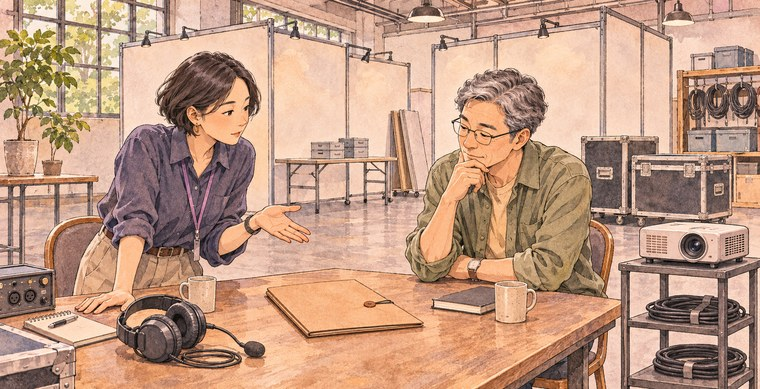

# We will launch if you do.

<!-- legacy-case-id: 203 -->

ECO-17 · Hong Kong · 10–15 minutes · Coordination failure · Complementary investment · Conditional commitment

## Collaboration can bring an event into being

On 3 September 2026, Hong Kong’s Commerce and Economic Development Bureau announced the forthcoming Festival of Connoisseurs, describing facilitation with venue operator AsiaWorld-Expo. This establishes a dated collaborative event context, not the partners’ payoffs or proof of a commitment mechanism. The two suppliers and arrangement below are original fiction.

## Opening decision

You run Sound Step, a fictional supplier of accessible audio interpretation. A small exhibition client needs both your custom audio module and Light Step’s complementary projection module. These independent suppliers do not compete for either module. Each can choose to commit HK$6,000 to its own production or decline. Neither has committed yet. The decision is simultaneous, and a verbal expression of interest is not a funded order.

The client pays each supplier HK$10,000 only if both modules are produced. For this classroom model, the stated receipt is certain when both proceed; production meets the specification, no further costs or alternative use of the module exist, and declining has zero incremental payoff. All accessibility, safety, licensing, staff pay and existing customer obligations are protected within funded arrangements. Each can afford its own commitment, but producing alone costs HK$6,000 and earns nothing. These are stipulated incremental cash payoffs, not forecasts for a real exhibition.

Your commercial decisions outside this project remain independent. No prices to unrelated customers, competitors’ information, exclusion arrangements or market sharing are discussed. The classroom model does not establish that any real collaboration complies with competition law.

## Evidence

| Sound / Light | Light proceeds | Light declines |
|---|---:|---:|
| Sound proceeds | (4,000; 4,000) | (−6,000; 0) |
| Sound declines | (0; −6,000) | (0; 0) |

HK$ incremental net cash, Sound first; no probabilities supplied.

**Student question:** Would you commit to production now or decline? Explain how your choice depends on what you believe Light Step will do.

## Round two

Before either production cost is incurred, a project administrator offers a verified conditional-order process. Each participating supplier places its HK$6,000 production funding in a segregated holding arrangement and pays a separate HK$500 nonrefundable administration fee. If both have deposited by Friday noon, the administrator releases both funded production orders together. If either has not, no production order is released and every HK$6,000 deposit is returned in full; a participant still loses its HK$500 fee. Neither party can withdraw an accepted order after the joint release.

Light Step has now deposited its HK$6,000, paid its fee and signed the conditional instruction. The administrator has verified its funds and production readiness. Its deposit and instruction remain in place until Friday noon. Sound Step can accept in time, with all funding available. Under the stipulated process, a verified matching deposit triggers both orders; it is not merely an assurance that someone intends to pay later.

The holding, refund and release arrangements have been independently checked and are assumed to operate as described for this exercise. This is not a real escrow recommendation or legal template. The process removes this specific risk of one funded production order proceeding without the other. It does not generally eliminate customer demand, quality, counterparty or administrator risk; those wider risks are fixed by the classroom assumptions, not cured by the word “conditional.”

**Student question:** Would you now accept the conditional order? Compare your net cash outcome with declining, and identify exactly which risk the arrangement changes.

## Debrief: a coordination problem, not free riding

If Light proceeds, Sound prefers proceeding: HK$4,000 instead of zero. If Light declines, Sound prefers declining: zero instead of losing HK$6,000. Light faces the same comparisons. Both proceeding and both declining are stable outcomes in this simple simultaneous model: neither player would gain by changing alone. The better joint outcome need not happen just because both can see it.

## The cost of verified commitment

Light’s funded conditional instruction is now verified and remains open. Accepting in time gives Sound HK$10,000 − HK$6,000 − HK$500 = HK$3,500, compared with zero from declining. Both suppliers earn HK$3,500 if the orders release. If only one had joined the mechanism, that participant would lose HK$500, not HK$6,000; the production deposit would return. The arrangement has a real cost and does not guarantee participation when no partner has yet committed.

## Keep the boundary of the result

A risk-neutral calculation without the mechanism would favour proceeding only if Sound assigned more than 60% probability to Light proceeding: 4,000p − 6,000(1 − p) > 0. No such probability is given, so it is not a forecast or a required initial answer. In the verified round-two branch, a fee of HK$4,000 would exhaust Sound’s entire incremental gain; the given HK$500 does not. Coordination must remain limited to the necessary complementary project, with independent advice for real arrangements.

## Instructor note

Ask pairs to choose independently before the reveal and explain their beliefs, rather than label caution irrational. Contrast this with a public-good free rider: declining here earns zero, not the project benefit. Reveal Light’s verified funded instruction before the second vote. Require students to distinguish the HK$6,000 refundable deposit from the HK$500 nonrefundable fee, and a simultaneous funded release from a handshake. Do not generalise the fixed-payoff model into guaranteed real project profits or lawful competitor coordination.

## Sources and case assumptions · optional reference

All information needed for classroom decisions is provided above. Sources are optional reading.

Original fictional incremental cash model. Each cost 6,000 is fully inclusive, conditional receipt 10,000 yields 4,000 when both produce; unilateral production loses 6,000; declining yields 0. All figures HK$. No payoff probabilities or real investment recommendation. Ordinary simultaneous model has two pure equilibria: both proceed and both decline. Risk-neutral threshold 0.6 follows 10,000p − 6,000 greater than zero; no assigned probability. Conditional process adds 500 per participating supplier; production deposit 6,000 refundable if threshold fails, fee not refunded. Light already funded and verified until Friday noon, Sound able to match, independent simultaneous release stipulated. Both-release payoff 3,500 each, lone participant −500, nonparticipant 0. Fee tie 4,000 applies only verified successful-release branch. Administrator performance, production readiness and fixed receipt are explicit modelling assumptions, not actual escrow/legal advice or general risk guarantees. Two Competition Commission pages share institutional provenance; academic legal analysis and teaching notes are conceptual, not causal evidence of this mechanism. Source hook is an announced event collaboration, not claimed outcome. Distinct from SUS04 canopy nonexcludable benefit and STR01 price rivalry: complementary private production and coordination uncertainty. No source figures or numerical tables copied.

- [Hong Kong Government: CEDB exhibition announcement, 3 September 2026](https://www.info.gov.hk/gia/general/202609/03/P2026090300490p.htm). Dated collaboration with AsiaWorld-Expo; no payoff or effectiveness evidence.
- [Yale-hosted game-theory lecture: coordination game example](https://bpb-us-w2.wpmucdn.com/campuspress.yale.edu/dist/3/352/files/2012/04/Week-11-Lecture.pdf). Teaching explanation of mutual best responses and multiple equilibria, not empirical evidence; the case table is original.
- [Julia Y. Lee: Gaining Assurances, Wisconsin Law Review (2012)](https://api.law.wisc.edu/repository-pdf/uwlaw-library-repository-omekav3/original/413344b5390a3788decace76d24d324e12f75c5e.pdf). Conceptual discussion of assurance games, conditional guarantees and credibility; not a Hong Kong contract template or measured effect.
- [Hong Kong Competition Commission: joint ventures](https://www.compcomm.hk/en/practices/what_is_comp/joint_ventures.html). Collaboration can create competition concerns; source examples are not copied and do not legally approve this fictional arrangement.
- [Hong Kong Competition Commission: exchange of information](https://www.compcomm.hk/en/practices/what_is_comp/exchange_information.html). Boundary against exchanging competitively sensitive information. Same institutional framework as the preceding source.
