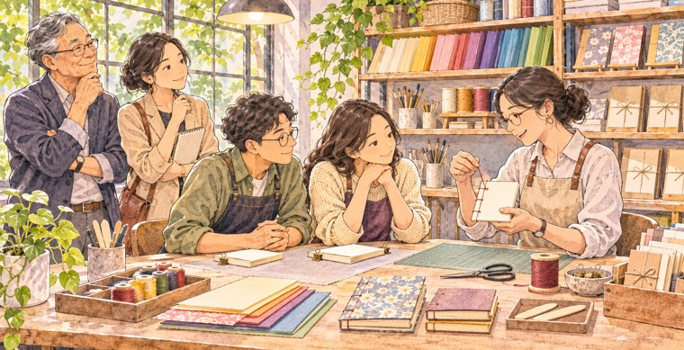

# Four signs. One business system?

<!-- legacy-case-id: 78 -->

STR-07 · Hong Kong · 10–15 minutes · Strategy · Franchising · Business replication

## In the news

HKTDC advertised its Hong Kong International Franchising Show for 4–6 December 2019, covering non-food sectors alongside food businesses.

This is historical Hong Kong context, not a current event or proof of franchise profitability. The paper-craft brand below is fictional.

## Opening decision

Fictional classroom situation. A Hong Kong paper-craft studio has two established locations. Customers can book a standard 90-minute notebook-making workshop using a prepared kit, or a custom private-group session built around their own theme. The founder wants to expand.

One option is a third company-owned location offering both formats. Another is four business-format franchises run by independent local operators, initially requesting both formats. No agreements are signed or fees collected.

Both routes are financially feasible within owner-authorised resources and include a separately planned support programme. Its coverage and effectiveness still need confirmation. The founder values reach, the creative full-menu experience and direct control. No comparable profit forecast is supplied.

## Evidence

| One company-owned studio | Four independent franchises |
|---|---|
| Company invests and hires/controls its team | Operators invest and manage locally |
| Company retains outlet operating upside/downside | Company receives fees/royalties and supplies brand/system |
| Both formats; direct implementation of changes | Both formats initially requested; training, specifications, checks and ongoing support |

**Student question:** Choose one company-owned studio or four franchises provisionally. What must the operating system demonstrate before you would change that choice?

## Round two

In a supervised trial at an existing location, trained non-founder facilitators used the written manual and kit for three standard sessions. The founder observed without intervening. Staff delivered the planned sequence, materials and completion checks without founder assistance.

In a separate custom-session rehearsal, they needed the founder to turn an unusual client theme into a workable design. No accident or complaint is reported. This small trial does not establish equal customer satisfaction or success across all situations.

The prospective operators now accept a standard-workshop-only initial franchise menu. Custom sessions would remain company-operated and clearly advertised as available only there. Commercial terms for that narrower package remain to be settled; operator acceptance is not proof of customer demand.

**Student question:** Which expansion model do you now back: one full-menu company-owned studio or the narrower franchise network? Which customer promise must every new outlet deliver without the founder, and what evidence would reverse your choice?

## Replicate an operating system, not just a sign

A business-format franchise involves a way of operating, training, standards and an ongoing relationship, not just permission to put up a brand name. The relevant growth asset is a system others can reliably deliver.

The trial provides bounded positive evidence for standard sessions. It also identifies a founder-dependent part of the custom offer. Treat these as different transfer questions rather than declaring the whole brand either ready or unready.

## The narrower network is a real strategic option

Standard-only franchises could extend reach while the company retains custom work at its own locations. That requires clear customer expectations: do not advertise custom sessions as available everywhere.

This choice sacrifices some breadth and direct control at the new outlets. Training, readiness checks, supplies and ongoing support still take resources. Confirm support capacity and settle the narrower commercial terms before commitment; the case gives no basis for assuming unchanged fees or four times the profit.

## Owned expansion remains defensible

One more owned studio may fit if the creative full-menu experience is central to the intended positioning and the founder values direct control over changes. But ownership alone does not make custom work transferable or guarantee quality.

The company still needs a workable way to deliver both formats at the new location without overstretching the founder. The case assumes the route is financially feasible, not that its staffing and operational execution need no attention.

## Choose a promise and a reversal signal

Back the standard-only network if reliable standard workshops and wider reach fit the chosen strategy, subject to operator readiness and support. Back owned expansion if offering the full creative experience under direct control matters more than the larger footprint.

State what would change your view: repeated standard-session dependence on founder intervention, customer demand concentrated on custom work, or broader evidence that the custom process can transfer reliably. These are possible future signals, not results already observed. Three sessions are not a universal readiness threshold.

## Instructor note

Require a provisional ownership-mode choice before the trial evidence. Afterwards, make students identify which promise travels and which remains founder-dependent. Do not reward simply repeating “more research” without a direction and an explicit reversal signal.

Franchising is neither inherently bad nor free growth. Distinguish franchisor fees from franchisees’ sales and profits. Both owned and franchised expansion need support; their control and investment relationships differ.

All locations, operators, trial observations and commercial alternatives are invented. This is strategy education, not a real franchise-contract recommendation or statement of legal requirements.

## Sources and case assumptions

All information needed for classroom decisions is in the case. Sources are optional reading for attribution and background.

The brand, two existing locations, one-owned/four-franchise alternatives, 90-minute format, three-session trial and operator acceptance are fictional. Both routes are financially feasible within authorised resources and include planned support; coverage and effectiveness remain checks. Independent franchisees are not company employees. No agreements or fees exist and no comparable profit forecast is supplied. Standard-only commercial terms remain unsettled; no full-menu projection is carried forward. Trial observations concern delivery of specified routine tasks, not equal satisfaction, universal transfer or commercial success. Sources checked 14 November 2026. The HKTDC hook is the historical December 2019 event, not current market evidence. Relevant WIPO sections, not the entire publication, were read. US buyer guidance and industry definitions supply business-model context, not Hong Kong legal duties, government endorsement or independent return estimates.

1. [HKTDC, Hong Kong International Franchising Show, organiser article for 4–6 December 2019](https://hkmb.hktdc.com/en/1X0AIYUC/article/hktdc-hong-kong-international-franchising-show) — Historical event context including food and non-food sectors. No publication date is invented, and promotional claims are not evidence of franchise success.
2. [WIPO, In Good Company: Managing Intellectual Property Issues in Franchising, publication 1035](https://www.wipo.int/edocs/pubdocs/en/wipo-pub-1035-en-in-good-company-managing-intellectual-property-issues-in-franchising.pdf) — Relevant advantages/disadvantages, feasibility/pilot and quality-control sections were read. Supports examining transfer and continuing obligations without importing jurisdiction-specific legal statements.
3. [US Federal Trade Commission, A Consumer’s Guide to Buying a Franchise](https://www.ftc.gov/business-guidance/resources/consumers-guide-buying-franchise) — Buyer-focused guidance distinguishes running an outlet from supporting a network and discusses training and support. US disclosure rules are not applied to this Hong Kong fiction.
4. [International Franchise Association, What is a Franchise?](https://www.franchise.org/franchising-overview/what-is-a-franchise/) — Industry association definition explains business-format systems and continuing relationships. Not independent impact research or a guarantee of returns.
5. [US Small Business Administration, Plan your business: Buy an existing business or franchise section](https://www.sba.gov/counseling/plan-your-business/) — Buyer-oriented explanation of franchise control, investment and ongoing relationships. Not an equation of buying an independent business with opening an owned branch, or endorsement of the fictional brand.
