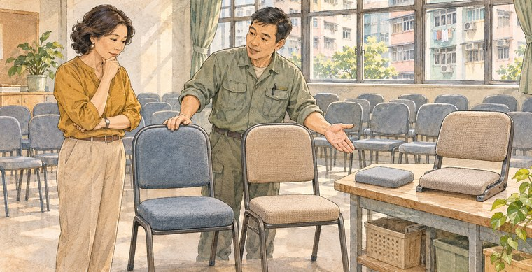

# Repair the chair. Replace which part?

Case 118 · Hong Kong · 10–15 minutes · Sustainability · Repairability · Circular procurement

## In the news

In a Legislative Council reply on 6 November 2024, the Hong Kong Government described furniture resale, exchange, donation and refurbishment channels and encouraged reuse.

This historical context supplies no measured benefit for the fictional chair purchase below.

## Opening decision

Fictional classroom situation. A Hong Kong community meeting venue needs 40 additional chairs for a new room. No serviceable chairs will be discarded. Suitable used stock and borrowing have been checked but cannot meet this opening requirement.

Both shortlisted models meet the same independently checked safety, comfort, cleaning, appearance and intended-use requirements. Either purchase is affordable. Both have documented five-year parts and service arrangements and qualified repair instructions.

The quoted restoration prices include parts, labour, collection and delivery, and appropriate handling of removed parts. Planned service time is comparable; an existing funded spare provision maintains required seating during repairs. Routine maintenance and safe inspections remain necessary. Ordinary wear is not a warranty claim in this exercise.

## Evidence

| Comparison | A · Replaceable seat assembly | B · Separately replaceable pad |
|---|---|---|
| Purchase price per chair | HK$500 | HK$550 |
| Purchase of 40 chairs | HK$20,000 | HK$22,000 |
| Pad-only wear repair | Replace the whole seat assembly; retain the frame | Replace only the removable pad; retain seat support and frame |
| All-in price per qualifying restoration | HK$300 | HK$100 |

B costs HK$2,000 more upfront and saves HK$200 per qualifying pad-only restoration. Both products are repairable; neither requires discarding the frame for this wear.

Compare five years in constant Hong Kong dollars, without a financing or discounting difference. Other maintenance costs are equivalent. Major structural repairs are outside this comparison; unsafe chairs are withdrawn and competently assessed under either choice.

**Student question:** Which chair would you order? What must happen during use for the HK$2,000 premium to be worthwhile, and what evidence would reverse your decision?

## Round two

The venue finds maintenance records for 40 comparable chairs used over the previous five years. Twelve restorations addressed worn seat pads while the frames and seat supports remained serviceable. These are 12 events, not 12 chairs discarded or structural failures.

Staff confirm that both quoted restoration processes and parts arrangements apply to this pad-only wear. The proposed models have comparable intended-use and wear specifications, but their actual failure rates are not known to be identical.

If 12 such events recur, A costs HK$20,000 + 12 × HK$300 = HK$23,600. B costs HK$22,000 + 12 × HK$100 = HK$23,200. B is HK$400 lower in that scenario.

The record identifies what wore out at this venue. It is not a random sample or a guarantee that the same number of repairs will recur.

**Student question:** Does the record justify the premium? Choose A or B, name one retained component and one operating condition needed to realise the repair benefit.

## Match the design to the part that wears

The useful reveal is not simply that chairs need maintenance. It identifies pad wear while other components remain useful. B can retain both the seat support and frame; A retains the frame but replaces a larger assembly.

The historical pattern strengthens B’s case without establishing how the new models will perform. Both remain legitimate repairable products.

## Locate the cash threshold

The HK$2,000 premium divided by HK$200 saved per qualifying restoration gives 10 events. At 10, both purchase-plus-restoration totals are HK$23,000. B becomes lower in this comparison only above 10 events.

Twelve events produce a conditional HK$400 advantage, not a guaranteed saving. The calculation counts restorations, not unique chairs, and predicts neither useful life nor carbon emissions.

## Repairability needs a working service chain

The smaller component is useful only if suitable parts, instructions and competent service remain available at workable prices and times. Track actual failure modes, restoration costs, turnaround and remaining use.

A removable part does not make untrained repairs safe or arbitrary substitutions suitable. Do not discard functioning components just to reach a numerical threshold.

## Choose without inventing an environmental score

B fits a plausible repeated pad-wear pattern and retains more functional material in each such repair. A preserves upfront funds if few qualifying repairs occur or the service assumptions change.

A smaller replaced part is not a whole-life environmental assessment. No weights, production impacts or disposal outcomes are supplied. Do not claim 12 chairs were saved from landfill or attach a quantified emissions saving.

## Instructor note

Ask for the retained component and the practical repair condition, not simply an “eco-friendly” label. Keep A credible: it too retains frames and has documented service support.

For sensitivity, four qualifying events give A HK$21,200 and B HK$22,400: A is HK$1,200 lower. This alternative reinforces why the historical record informs rather than determines the purchase.

The objective is component-level circular procurement supported by maintenance arrangements, not recycling alone or a claim that all modular furniture lasts longer. The safety and service facts are stipulated, not a real repair instruction or product certification.

## Sources and case assumptions · optional reference

All information needed for the classroom decisions is provided above. Sources are optional reading.

The venue, products, records, prices and service arrangements are original fiction. Forty additional chairs meet an unmet opening requirement; no serviceable existing stock is discarded. Both shortlisted products meet checked requirements and have credible five-year parts, instructions and qualified-service support. All restoration prices include parts, labour, transport and removed-part handling; comparable downtime is covered by funded spares. Ordinary wear is not covered by warranty here. Only pad-only restorations with serviceable frames and supports enter the comparison. A costs HK$20,000 plus HK$300 per event; B costs HK$22,000 plus HK$100 per event. Equality occurs at ten events, HK$23,000 each. At twelve, A is HK$23,600 and B HK$23,200; at four, A is HK$21,200 and B HK$22,400. Historical events are not unique chairs discarded or a forecast guaranteed to recur. The five-year comparison uses constant dollars, no financing or discounting difference, and equivalent other maintenance costs. Structural faults require withdrawal and competent assessment; no unsafe repair is endorsed. No emissions, landfill or lifetime improvement estimate is supplied. Five substantive institutional source bodies were read during research, not five product-impact studies. The government’s lack of separately held furniture-disposal statistics is respected; no waste-volume estimate is reproduced. No source graphics, tables, examples or quotations copied. Sources checked 15 November 2026.

- [Hong Kong Government · LCQ1: Disposal of waste furniture · 6 November 2024](https://www.info.gov.hk/gia/general/202411/06/P2024110600261p.htm). Historical reuse and refurbishment context. No furniture-waste tonnage, new right-to-repair claim or measured outcome for these fictional products is inferred.
- [Business Environment Council · Repair and Reuse: Exploring the feasibility of R&R business model in Hong Kong · December 2023](https://bec.org.hk/sites/default/files/publications/RepairandReuseExploringthefeasibilityofRepairandReusebusinessmodelinHongKong.pdf). Relevant parts availability, repair labour and price-comparison passages read. Local scoping report, not chair engineering evidence; waste-volume estimates and manufacturer climate claims are not transferred.
- [European Commission Green Forum · Circular and fair procurement of office and public furniture · Helsinki case](https://green-forum.ec.europa.eu/green-business/green-public-procurement/good-practice-library/circular-and-fair-procurement-office-and-public-furniture_en). Relevant 2024 tender specifications and contract provisions read. Describes repair support and procurement conditions, not measured climate benefits or Hong Kong requirements.
- [Interreg North Sea CEO consortium · Circular Furniture Design Guide · 2026](https://www.interregnorthsea.eu/sites/default/files/2026-03/Interreg-CEO_Circular%20Furniture%20Design%20Guide_1.pdf). Relevant context, durability, repair-instruction and spare-parts passages read. Benefits depend on use and support; no copied diagrams or guaranteed lifetime extension.
- [US EPA · Sustainable Materials Management: Non-Hazardous Materials and Waste Management Hierarchy](https://www.epa.gov/smm/sustainable-materials-management-non-hazardous-materials-and-waste-management-hierarchy). Substantive reduction and reuse guidance read. Supports retaining useful components, not a product-specific life-cycle result, universal treatment choice or Hong Kong legal requirement.
