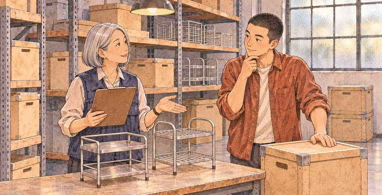

# Returned and checked. Where next?

<!-- legacy-case-id: 172 -->

OPS-15 · Hong Kong · 10–15 minutes · Operations · Reverse logistics · Recovery routing

## In the news

On 20 March 2026, DFI Retail Group described IKEA Hong Kong’s Bargain Corner resale of good-condition returned and discontinued furniture. Its account illustrates a route back to sale, not evidence that every returned item should stay at its receiving store.

The kitchenware retailer, classifications, schedules and quotes below are original fiction, not IKEA’s operations.

## Opening decision

A fictional Hong Kong retailer has accepted and refunded 80 returned metal kitchen organisers across two branches. Ownership, safety, completeness and condition have already been checked. Sixty are cleared for honestly labelled resale; twenty need a specified workshop repair and final release check before sale. There are no unresolved safety defects or recalled items in this exercise. The refund process and customer rights are complete and do not depend on the recovery route.

It is Monday morning. Choose one of two fully quoted recovery schedules for this batch. A sends everything through the central recovery hub, using consolidated transport, a reserved repair slot and redistribution. B offers cleared items locally first, forwards repair items on the ordinary collection and rebalances remaining cleared stock on the next weekly transfer. Both follow identical condition disclosures and release standards.

A costs HK$1,800; B costs HK$1,000. These fixed, all-in incremental quotes cover the full batch through repair, safe storage, handling, transport and redistribution, not just the first truck. Both are affordable and use funded normal capacity. Original acquisition costs, completed refunds and existing inspection costs are common and excluded. No extra vehicle or unpriced hybrid is available; choose between these two schedules. The branch-level stock and demand picture has not yet been compared.

## Evidence

| Quoted whole-batch route | A: central hub | B: local first |
|---|---|---|
| Incremental recovery cost | HK$1,800 | HK$1,000 |
| Cleared items | Consolidate and redistribute | Offer locally; weekly rebalance |
| Repair items | Reserved hub slot | Ordinary repair collection |
| Standards and refunds | Preserved | Preserved |

**Student question:** Which route would you provisionally choose, A or B? Explain what the HK$800 difference buys and which location, timing and demand information you need before calling B the better recovery route.

## Round two

North holds 50 cleared units and 10 repair units; South holds 10 cleared and 10 repair units. The current planning forecast for the promotion ending this Friday is 10 units at North and 70 at South. The products are interchangeable after any required repair, and the forecast already allows for disclosed condition. It is not paid demand or a guarantee. There is no online or cross-branch collection channel during the promotion.

Under A, Monday consolidation reaches the reserved workshop slot. Its assessed capacity completes all twenty specified repairs and final checks by Thursday. Redistribution places 10 cleared units at North and 70 at South by Friday opening: all 80 can be offered during the promotion. The stated successful completion and release are assumptions for this scheduling exercise, not permission to waive a failed check.

Under B, the 60 already cleared units can be offered where they are from Tuesday. At the forecast branch mix, only 10 North units and 10 South units match demand by Friday. North’s other 40 cleared units remain safely stored. They transfer the following Monday and are available at South on Tuesday. The 20 repair units leave on Thursday, miss this week’s Wednesday repair cutoff, and finish repair, final checks and delivery to South the following Thursday. Capacity and all these movements are included in B’s quote; none can be accelerated for free.

Thus A makes 80 units available in the forecast locations by Friday; B matches 20 there, although those 20 are available earlier. No sales, later demand, selling prices, markdowns or environmental results are established. The promotion deadline is a recovery opportunity, not a promise to existing buyers. Waiting under B does not make the remaining stock unsafe or worthless. Neither route is committed yet.

**Student question:** Which route would you choose now, and why? Trace the units and dates, compare the additional Friday availability with the HK$800 premium, and state what further evidence would justify that premium financially.

## Follow the classified units

Both routes handle 60 cleared and 20 repair units. Under B, forecast-matched cleared availability by Friday is min(50, 10) at North plus min(10, 70) at South: 20 units. The remaining 40 cleared units are in the wrong branch for this forecast, not missing or defective. Repair capacity exists, but the collection misses its cutoff.

## A cheaper movement can mean a slower recovery

A combines transport with the earlier repair slot and redistribution: 10 North plus 70 South equals 80 forecast-positioned units by Friday. B provides 20 earlier local units, then moves the remaining 40 cleared units and 20 repaired units after the promotion. A’s HK$800 premium buys 60 more units positioned by Friday in this model, not 60 guaranteed sales.

## Choose the recovery objective

A is defensible if Friday availability is valuable enough to justify the extra cost. B is defensible if the promotion forecast is weak, later resale remains attractive, or the retailer prioritises the lower known recovery spend. Keeping B is not neglecting refunds or safety. Choosing A is not proof of higher profit.

To justify A financially, estimate the incremental net recovery from earlier availability compared with B’s later opportunities, including any price or selling-cost differences. It must exceed HK$800. Dividing HK$800 by 60 gives about HK$13.33 per additionally positioned unit, a descriptive benchmark only. It is not a per-sale margin threshold unless all 60 produce incremental recoveries on that basis. Record actual route time, released quantities and recovery receipts separately.

## Instructor note

Start with the two complete route quotes, then draw two branch-to-workshop timelines. Require stock conservation: A delivers 80 by Friday; B has 20 forecast-matched locally, 40 awaiting redistribution and 20 awaiting repair. Distinguish sale-ready stock from stock at a location with demand, and a scheduled release from a guaranteed real-world repair outcome.

ACC-04 asks about inventory carrying value; MKT-04 asks about return friction. This case begins after inspection and refunds, asking how to route known classes through a reverse network. Do not reopen mandatory inspections as a cost-saving choice or infer carbon savings from fewer trips. The bounded two-quote comparison is not a globally optimal network design.

## Sources and case assumptions · optional reference

All information needed for classroom decisions is provided above. Sources are optional reading.

All retailer facts, categories, branch quantities, forecasts, prices of recovery services, cutoffs and assessed completion times are invented. Non-electrical metal kitchen organisers are already inspected; repair units stay unavailable until specified repair and final checks succeed. Both schedules preserve applicable safeguards and honest condition descriptions; no legal exemption is asserted. Ownership and refunds are already resolved. Full-batch quotes include all incremental storage, handling, repair, final checks and transport for the stated cycle, with no additional differential costs supplied. A Monday collection reaches this week’s repair slot and Thursday completion; B Thursday collection misses Wednesday cutoff, uses next week’s slot and completes delivery Thursday. Repair success is a classroom assumption, never a rule to release a failed item. Friday demand 10 / 70 is a forecast, not orders. B early local availability is Tuesday, A Friday; the comparison does not assume all demand waits or purchases. Under B the 40 transferred and 20 repaired units reach South after Friday. Both routes ultimately recover 80; no unsold balance is assigned zero value. No selling price, later demand or carbon model is supplied. Five actual source bodies/sections were read. DFI and DHL are company accounts, Microsoft/Infor vendor process descriptions, and the Vanderbilt-hosted author paper supplies conceptual reverse-network/time tradeoffs, not proof of this scenario. No source diagram, numerical example or loss percentage is reproduced. IBM bodies returned 403 and were not counted; GRLA page contained internal-review content and was excluded.

- [DFI Retail Group · IKEA Hong Kong Bargain Corner · 20 March 2026](https://www.dfiretailgroup.com/en/sustainability/sustainability-stories/ikea-hong-kongs-bargain-corner-gives-furniture-a-second-life/). Read company description of good-condition resale. No independent measured environmental or profit effect is adopted.
- [DHL · Hong Kong peak-shipping preparation · 13 October 2025](https://www.dhl.com/discover/en-hk/logistics-advice/logistics-insights/how-to-prepare-for-peak-shipping-seasons). Read reverse-logistics and consolidated-return discussion. Commercial guidance, not evidence of case costs or service guarantees.
- [Blackburn, Guide, Souza and Van Wassenhove · Reverse Supply Chains for Commercial Returns](https://cdn.vanderbilt.edu/vu-web/owen/files/publications/Commercial%20product%20returnsCaliforniaMgtReview.pdf). Read process, time-value and network-design discussion in the author-hosted paper. No example, loss percentage or figure is reproduced.
- [Microsoft Learn · Return reason codes and disposition codes](https://learn.microsoft.com/en-us/dynamics365/supply-chain/sales-marketing/disposition-and-return-reason-codes). Read distinction between return reason, condition and next action. Vendor workflow, not a mandatory operating standard.
- [Infor · Reverse logistics in warehousing](https://www.infor.com/solutions/scm/warehouse-management-system/reverse-logistics-in-warehousing). Read receipt, inspection, disposition, movement and partner handoffs. No AI performance or guaranteed recovery claim is adopted.
