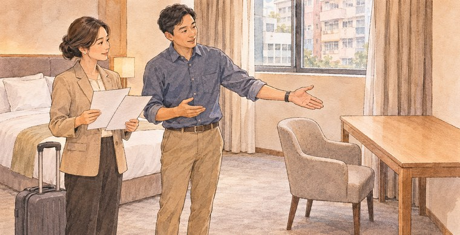

# The room is larger. Does it feel usable?

<!-- legacy-case-id: 252 -->

HSP-21 · Hong Kong · 12–15 minutes · Guest-room usability · Task walkthroughs · Functional space

## A room is used in sequences, not as a furniture list

Universal-design guidance treats comfortable reach, use and movement as design concerns, not merely the amount of floor area. Task-based usability research examines what people actually do, including the effort between activities. A room can meet its requirements yet offer different everyday convenience.

The hotel, layouts and walkthrough results below are fictional. The exercise is not an architectural specification or a claim about a real property.

## Opening decision

You manage a fictional Hong Kong hotel preparing a larger room category. Existing standard rooms are 20 square metres; both proposed rooms have the same **24-square-metre internal floor area**, measured on the same basis including their identical bathroom. They have identical beds, storage for clothing, lighting, connectivity and views. The extra area does not tell you which furniture plan works better.

Both layouts have passed the same qualified local safety, access, circulation and furniture-stability checks for the intended category. Required accessibility and individual adjustments remain available without extra charge. These stipulations are not derived from the floor area alone. No essential provision is traded for an amenity.

**A: lounge-led.** A generous armchair and separate coffee console accompany one multipurpose table and a suitable work chair. The table can hold an open carry-on case, or a laptop with papers, or a meal tray, but not two of those full setups together. A dedicated reachable bay safely stores the closed case. The coffee console has fixed equipment and is not a second work or dining surface.

**B: activity-led.** A more compact comfortable armchair and a smaller tea station make space for a dedicated luggage platform, plus a table and work chair of the same usable dimensions as A’s. B’s table still serves work or dining, not both at once. Both layouts include safe drinks facilities; B forgoes A’s larger lounge seat and coffee equipment.

A complete two-room, four-week trial costs HK$12,000 under either layout, including furniture hire, setup, cleaning, staff preparation, participant support and removal. Only one layout can proceed to this trial now. Existing room promises are not changed: participating guests receive an accurate description and agree to the trial, with a funded alternative and all existing rights retained. No price premium, occupancy gain or cost saving is established. Full-size mockups of both layouts are already available for review.

## Evidence

| Feature | A: lounge-led | B: activity-led |
|---|---|---|
| Internal floor area | 24 m² | 24 m² |
| Relaxation offer | Generous armchair; coffee console | Compact armchair; tea station |
| Open-case location | Multipurpose table | Dedicated luggage platform |
| Work / meal surface | Same table, used in turn | Same table, used in turn |
| Two-room trial budget | HK$12,000 | HK$12,000 |

Both new layouts have 4 m² more than the existing 20 m² category: 20% greater area, not 20% greater convenience. Identical table usable dimensions; each table holds one full setup at a time. Safe closed-case bay inA; dedicated open-case platform inB. No construction dimensions supplied.

**Student question:** Which layout would you provisionally trial, A or B? Name a guest activity you are prioritising and a sequence of tasks you would observe before treating more space or more amenities as better usability.

## Round two

Six consenting adult volunteers who make short hotel stays try both full-size mockups. They use the same supplied carry-on case, laptop, papers and meal tray, with empty surfaces at the start. Three try A first and three B first. Access support is available and no participant is pushed to move something they cannot safely handle. This small purposive walkthrough illustrates relevant activities; it is not a representative survey of all guests or an accessibility certification.

The sequence is: open the case and retrieve an item while leaving the remaining contents available; set up a short laptop task with papers; pause to eat at the table; then resume work. The bed remains available for rest and is not used as a luggage or dining surface in this scenario. All six can complete the sequence in either layout without moving furniture, obstructing circulation or calling staff to rearrange the room.

Count a **put-away episode** when an unfinished setup has to be packed or stored to make room for the next activity. Closing and storing the still-needed case counts once; storing the unfinished laptop-and-paper setup counts once. Restoring that same setup later is part of that episode, not another count. Normal meal-tray clearance after finishing the meal is not counted.

| Observed measure | A | B |
| --- | --- | --- |
| Completed the full sequence safely | 6 of 6 | 6 of 6 |
| Put-away episodes per person | 2 | 1 |
| Chose this layout after both tests | 2 of 6 | 4 of 6 |

In A, each person closes and stores the case before setting up work, then puts work away before the meal. In B, the case stays open on its platform, but work still goes away for the meal. All six describe this surface-sharing conflict; four prefer B’s luggage continuity, while two prefer A’s larger lounge seat and coffee offer despite the extra reset. These preferences are reported reasons, not a spending or booking forecast.

The mockup uses one case size and one activity sequence, not every traveller’s routine. The volunteers’ comments do not establish that all future guests prefer B. Both trial budgets, safeguards and amenities remain unchanged. A free hybrid with A’s amenities plus B’s luggage platform has not been designed, checked or priced.

**Student question:** Which layout would you fund for the four-week trial now? Explain the task conflict the walkthrough reveals, the benefit your choice gives up, and one further observation you would collect before a wider rollout.

## Find the competing functions

The floor area is identical. A’s single table supports luggage, work and dining one after another; B separates luggage from the other two functions. B therefore removes one conflict, not every conflict. Its work-and-meal switch remains.

The six participants finish safely in both. Completion alone misses their effort to put an unfinished setup away and restore it later. Conversely, a reset count alone misses the appeal of a generous chair or coffee facilities. Evaluate the activities as well as the amenity list.

## Count the observation, not a universal score

A records 6 × 2 = **12 put-away episodes**; B records 6 × 1 = **6** for this selected sequence. That is six fewer episodes, or 50% fewer on this particular count. It is not “50% more usable”, half the task time or a forecast of customer satisfaction.

Four of six prefer B and two prefer A in the mockup. There is no random population sample, observed booking choice, willingness-to-pay study or statistically supported market-share estimate. Counterbalancing the first layout reduces a simple order concern; it does not eliminate every learning or selection effect.

## Choose the experience you want to test

**B is defensible** if the hotel prioritises short-stay guests who want ready access to their luggage while working and eating. It removes a specific interruption while retaining safe completion. It gives up A’s larger relaxation seat and coffee equipment, and still requires clearing work for a meal.

**A is defensible** if the trial prioritises guests who value its relaxation offer enough to accept extra setup changes. The walkthrough does not show that these guests are mistaken. Describe the shared surface honestly rather than implying that the larger room supports every activity simultaneously.

Neither choice is universally optimal from the supplied data. State the intended use, invite guests rather than assume preferences from age or nationality, and keep individual access requirements and service promises protected.

## Design the next observation

Observe consenting trial guests completing their own relevant routines, including different luggage sizes, a longer work session, eating and resting. Record which unfinished setups move, assistance requested, task completion and guests’ descriptions of convenience. Collect relaxation feedback too, so the metric does not favour B by design.

Recruit people with varied relevant access and travel needs and provide appropriate support. Participation is voluntary; do not record personal work or private belongings unnecessarily. A small trial identifies issues and possible redesigns, not certification that everyone can use a room. Professional access and safety review remains separate.

If a new hybrid is proposed, obtain an actual layout, complete cost and renewed checks before treating it as available. Do not solve the case by blocking circulation, putting food on a suitcase or removing a required feature.

## Instructor note

Allow 12–15 minutes: three for initial priorities, four for tracing the task sequence, three for the second decision and two to five for a test plan. Keep the debrief hidden until the second vote. Use paper cards labelled luggage, work and meal on one imagined table, then move luggage to a second imagined surface. No real lifting or food is needed.

Ask what changes when activities happen in sequence rather than separately. Challenge “both finished, so both are equally convenient” and “four chose B, so all rooms should be B”. The selected put-away count is not a complete usability measure; the two supporters of A supply a real tradeoff, not an error to dismiss.

HSP-06 matches table sizes to restaurant parties; HSP-12 tests wayfinding along a route; HSP-16 compares acoustic atmospheres. This case concerns functional interference among luggage, work and dining inside a room. Do not import foreign accessibility dimensions as Hong Kong requirements: compliant layouts are stipulated and not constructed from the vignette.

## Sources and case assumptions · optional reference

All information needed for classroom decisions is provided above. Sources are optional reading.

All hotel layouts, costs and walkthrough observations are fictional. Both new rooms have 24 m² internal floor area versus 20 m² in the existing category: 4 m² or 20% more, not 20% greater usability. Both trials cost HK$12,000 for two rooms over four weeks. Six consenting adults each try both layouts; three try A first and three B first. All complete the selected luggage, work, meal and return-to-work sequence safely. A requires two put-away episodes per person and B one: 12 versus 6 episodes across six sessions per layout. This is 50% fewer on one defined measure, not a universal usability or time saving. Preferences are A: two, B: four, not a population or booking forecast. Restoring the same unfinished setup is not counted again; clearing the completed meal is not counted. B separates luggage but still shares work and dining; A retains larger lounge and coffee amenities. Local professional safety and access approval is stipulated, not inferred from floor area or foreign guidance. Five institutional guidance bodies read; two UK manual pages cover distinct task observation and measurement purposes, not independent empirical studies. No actual guest data or source-study observations are reproduced.

- [NC State Center for Universal Design · Principles of Universal Design · 1997](https://design.ncsu.edu/research/center-for-universal-design/). Principles of flexible use, low physical effort and space for approach/use. Guidance, not certification of either fictional layout.
- [National Disability Authority, Ireland · Building for Everyone, Booklet7 · Hotel and bedroom sections](https://universaldesign.ie/uploads/publications/7-Building-Types_2024-09-23-161756_zblk.pdf). Hotel guidance considers access to furniture, controls and different guest needs. Irish design guidance is not presented as Hong Kong law; numerical dimensions are not imported.
- [GOV.UK Service Manual · Using moderated usability testing](https://www.gov.uk/service-manual/user-research/using-moderated-usability-testing). Supports observing actual or likely users doing believable tasks without coaching the answer. Applied as a method analogy to a physical mockup, not hotel-effect evidence.
- [GOV.UK Service Manual · Usability benchmarking a website or whole service](https://www.gov.uk/service-manual/measuring-success/usability-benchmarking-a-website-or-whole-service). Distinguishes task completion, time and participant feedback. The six-person exercise is exploratory, not the larger benchmarking exercise described here.
- [US Access Board · Clear floor or ground space and turning space](https://www.access-board.gov/ada/guides/chapter-3-clear-floor-or-ground-space-and-turning-space/). Explains why usable clearance at furniture and controls matters. US-specific requirements are not applied as local rules; qualified safety/access review remains separate from the toy walkthrough.
