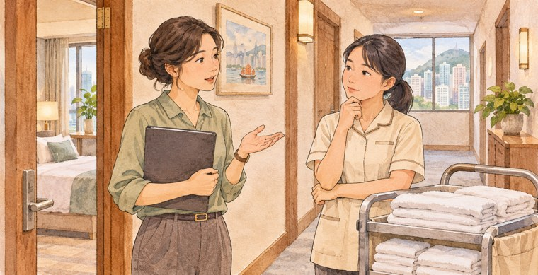

# The same occupied nights. The same cleaning workload?

<!-- legacy-case-id: 264 -->

HSP-22 · Hong Kong · 15 minutes · Length of stay · Housekeeping workload · Service capacity

## Operational context

Hotel operations systems can distinguish stayover cleaning from departure cleaning rather than assign every room the same effort. A published study of one Spanish hotel also found cleaning times differed by room and cleaning type. Those observations motivate this exercise; they do not establish a universal room quota or the times below.

The operator, offers, service times and costs are entirely fictional. Required service quality and safe working arrangements are fixed, not variables to cut.

## Opening decision

You manage 12 identical serviced apartments in Hong Kong. All are clean and vacant before arrivals on day 1. Two mutually exclusive offers fill all 12 apartments on nights 1–6. Neither has been accepted; existing guests are unaffected. Payment and arrivals are certain for this classroom comparison, with no cancellations, vacancies or additional sales.

**S, short stays:** three successive groups each book all 12 apartments for two nights. They arrive on days 1, 3 and 5 and depart on days 3, 5 and 7. **L, long stays:** one group books all 12 for six nights, arriving on day 1 and departing on day 7. Both supply 72 occupied room-nights.

After all other differing costs, but before any extra housekeeping cover, S brings HK$900 more than L. Existing housekeeping funding is the same under both offers: three usable task-hours each morning on days 2–7, plus six extra usable task-hours on day 7. This is team capacity after breaks and other duties, not a worker’s shift length. It cannot be moved between dates.

One routine stayover service is due after each occupied night except a departure morning, when a complete departure clean replaces it. Include the final day-7 clean even though the comparison has only six occupied nights. There is no extra pre-arrival clean. Service quality, supplies, consent and safety arrangements are unchanged. Today you can check the supervisor’s task estimates and reserve additional qualified cover before accepting either offer.

## Evidence

| Measure | S: short stays | L: long stays |
|---|---|---|
| Apartments | 12 | 12 |
| Occupied room-nights | 72 | 72 |
| Arrivals | Days 1, 3 and 5 | Day 1 |
| Departures | Days 3, 5 and 7 | Day 7 |
| Receipts before extra housekeeping | HK$900 more than L | Comparison baseline |
| Funded usable task-hours | 3 each morning on days 2–7; 6 more on day 7 | Same as S |

**Student question:** Would you provisionally prefer S or L? Explain why occupied room-nights alone cannot confirm the housekeeping plan, and identify the missing workload information.

## Round two

The supervisor estimates 15 minutes per stayover service and 45 minutes per departure clean for these apartments. These are hypothetical planning allowances for this case, not industry benchmarks, worker quotas or instructions to finish faster. The separately protected breaks, travel, supplies and other duties are already allowed for outside the usable task-hours.

Qualified cover is available on each required morning at an all-inclusive HK$100 per additional usable task-hour, with no minimum booking or other charge. It must be reserved now; the supervisor confirms the combined team can complete the services within the agreed access and turnaround windows. No overtime, rushed work, skipped cleaning or reduction of existing entitlements is permitted. If actual conditions require more time, the manager must arrange safe additional capacity rather than enforce these estimates.

On mornings 3 and 5, all 12 apartments depart under S but remain occupied under L. On morning 7, all 12 depart under either offer. All remaining service mornings are stayovers. The HK$900 advantage and all other assumptions remain unchanged.

**Student question:** Which offer would you accept now? Show the extra cover by day and its cost, then state the minimum short-stay premium that would make the two offers financially equal.

## A room-night is not a cleaning event

Each two-night stay produces one stayover service and one departure clean. S has 36 stays, so 36 of each. Each six-night stay produces five stayover services and one departure clean. L has 12 stays, so 60 stayovers and 12 departures. Both produce 72 service events, but their task mix differs.

S needs (36 × 15 + 36 × 45) ÷ 60 = 36 task-hours. L needs (60 × 15 + 12 × 45) ÷ 60 = 24. The 24 additional departures under S replace 24 stayover services; they are not extra services on top of the same stayover count.

| Measure | S: short stays | L: long stays |
| --- | --- | --- |
| Stayover services | 36 | 60 |
| Departure cleans, including day 7 | 36 | 12 |
| Total usable task-hours | 36 | 24 |
| Extra hours beyond funded cover | 6 on day 3; 6 on day 5 | None |
| Additional cover cost | HK$1,200 | HK$0 |

## Put the hours on the right mornings

Twelve stayovers require three hours; twelve departures require nine. L fits the three hours on days 2–6 and the nine funded hours on day 7. S also needs nine hours on days 3 and 5, leaving a six-hour gap on each date. Buy 12 additional usable hours in total. Unused capacity on another date could not clean a room before its occupants depart.

The day-7 departure clean belongs in both calculations. Omitting it would understate both workloads; adding a stayover clean that morning would double-count service.

## Compare value after the workload

S adds HK$900 before extra cover but costs 12 × HK$100 = HK$1,200 more to service. Its advantage becomes HK$900 − HK$1,200 = −HK$300. Under the stated objective of higher net receipts after these costs, choose L. This is a difference between offers, not a claim about total property profit.

A short-stay premium of HK$1,200 makes the offers financially equal. Above that, S yields more, provided the necessary cover is reserved and all safeguards remain satisfied. The case supplies no repeat-business, guest-satisfaction or strategic benefit to offset the current HK$300 difference; do not invent one as a measured result.

## A better booking handoff

Send housekeeping arrivals, departures and stayovers by date, not just an occupancy percentage. Confirm task allowances with the team, service commitments, qualified cover and actual room conditions. Longer stays are not always better: prices, services and schedules can differ. Here the mechanism is the work caused by a booking mix, not a general rule to reject short stays.

## Instructor note

Allow 3 minutes for the initial choice, 5 to draw service mornings 2–7 and 5–7 for the reveal and commercial comparison. Ask students to write D or S for each offer on every morning. The correct sequences are S-D-S-D-S-D and S-S-S-S-S-D. Distinguish room-nights, stays, service events, usable task-hours and paid staffing arrangements. Do not turn the fictional minutes into employee performance targets.

A reasoned first answer can provisionally favour the HK$900 premium while refusing to commit before checking workload. The reveal supports L on the supplied financial facts, not a moral judgement about short-stay guests. Protect final departure cleaning, quality and worker recovery in every answer. No legal or occupational-health compliance certification is implied.

## Sources and case assumptions · optional reference

All information needed for classroom decisions is provided above. Sources are optional reading.

All business facts and arithmetic are original fiction. Twelve identical apartments are already clean before day-1 arrival. Six occupied nights are followed by a final day-7 clean, included in both alternatives. Three two-night groups create 36 stays; one six-night group creates 12. Services occur on mornings 2–7. Stayover/departure allowances are 15/45 minutes, not sourced benchmarks or worker quotas. Funded usable capacity is 3 hours on days 2–6 and 9 on day 7, totaling 24; it already protects separate duties and breaks. Short stays require 3,9,3,9,3,9 hours; long stays require 3,3,3,3,3,9. Two six-hour gaps cost HK$1,200 at HK$100 per usable hour. The HK$900 receipts premium therefore becomes a HK$300 disadvantage. Financial equality requires a HK$1,200 premium. Qualified cover and access windows are assumed feasible and must be reserved before acceptance. Payment, arrivals and all other costs are fixed; no additional benefits are invented. No source supplies these numbers. Research supports separate task categories and the need for safe, context-specific workload planning; observational and qualitative evidence is not a universal productivity standard. California guidance is an external safety example, not Hong Kong law. Five substantive source bodies were read on 16 November 2026. Links are optional reference, not required student reading.

- [Oracle OPERA Cloud 25.2 · Configuring Rooms](https://docs.oracle.com/en/industries/hospitality/opera-cloud/25.2/ocsuh/t_rooms_managing_rooms.htm). Configurable stayover and departure housekeeping credits illustrate separate task categories; not a prescribed time standard.
- [Aguilar-Escobar and colleagues · Hotel Room Cleaning: Time Study and Analysis of Influential Variables in a Spanish Hotel (2021)](https://www.jiem.org/index.php/jiem/article/download/3441/983). Original single-hotel study distinguishes cleaning types and reports time variation. Its observed times and regression coefficients are not used as quotas or case inputs.
- [Canadian Centre for Occupational Health and Safety · Hotel Housekeeping](https://www.ccohs.ca/oshanswers/occup_workplace/hotel_housekeeping.html). Guidance addresses physical demands, equipment, work design, participation and recovery. No room quota is adopted.
- [California Department of Industrial Relations · Section 3345: Hotel Housekeeping Musculoskeletal Injury Prevention](https://www.dir.ca.gov/title8/3345.html). External example identifying excessive work-rate and inadequate recovery among hazards to evaluate. Its jurisdiction is California; it is not stated as Hong Kong law.
- [Chela-Alvarez and colleagues · Perceived Factors of Stress and Its Outcomes among Hotel Housekeepers in the Balearic Islands (2021)](https://mdpi-res.com/d_attachment/ijerph/ijerph-18-00052/article_deploy/ijerph-18-00052.pdf). Qualitative research identifies checkout counts, room conditions and unexpected tasks among perceived workload factors. Not a causal estimate or representative time standard.
