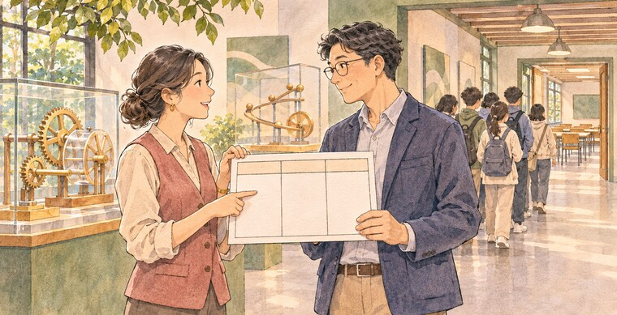

# Save the school slot. Which session?

<!-- legacy-case-id: 548 -->

HSP-45 · Hong Kong · 15 minutes · Museum operations · Group scheduling · Timed admissions · Access objectives

## School visits can have their own booking route

Hong Kong Palace Museum published school-group visit and application information for its Art Journey for Youth programme. Local museums also describe distinct advance booking arrangements for other groups. The exhibit and capacity rule in this exercise are fictional and do not represent any museum’s admissions policy.

## Opening decision

Kwan schedules three repeats of a hands-on museum demonstration. The sessions do not overlap. Each can take up to 24 visitors, including adults. The museum must admit both schools in full, keeping each group together in its own session. It then wants to accommodate as many individual visitors as it can without moving them to a time they did not request.

School A has 18 visitors including adults and can arrive for either of the first two sessions. School B has 20 and can arrive only for the second. Each school needs one session; groups cannot be split. Individual visitors each want one seat at their stated time and would fill up to the stated demand. Tickets are not yet committed and staffing does not vary by policy.

## Evidence

| Session | 09:30 | 10:30 | 11:30 |
| --- | --- | --- | --- |
| Seats available | 24 | 24 | 24 |
| Individual requests | 20 | 16 | 8 |
| Can A arrive? | Yes | Yes | No |
| Can B arrive? | No | Yes | No |

**Student question:** Where should Kwan place the two groups, and how many individual visitors can attend in total? Give the leftover capacity for each session after admitting both types of visitor.

## Round two

Before bookings are confirmed, School A says it can also arrive at 11:30. All its participants can make any one of the three sessions. School B, individual requests, group sizes and all capacities are unchanged.

**Student question:** Should Kwan move School A to 11:30? Recompute total admissions and explain which otherwise-unserved individual visitors gain or lose a place.

## Debrief · Place the less flexible group first

School B must be placed at 10:30. The 20-person school leaves only four seats there, too few for School A. A therefore takes 09:30, leaving six seats. At 11:30 no school uses seats. Admit individuals in counts of 6, 4 and 8, for 18 in total.

## Debrief · Empty seats are tied to a time

Total admissions are 18 + 20 school visitors plus 18 individuals, or 56. The first two sessions are full and the last has 16 empty seats; those seats cannot be assigned to people who requested an earlier session.

## Debrief · Use the added flexibility

Put A at 11:30 and keep B at 10:30. Individual counts become 20, 4 and 6, giving 30. Relative to the original allocation, 14 more attend at 09:30 and two fewer at 11:30; total admissions rise by 12 to 68. There are four empty seats at 09:30 and none later.

## Debrief · Do not overbook to fill a target

Check the two schools’ transport and arrival commitments before releasing allocations, then offer only remaining seats to individual visitors. If schools had priority for every future session, a broader policy could change the balance; this decision protects just the two given groups.

## Instructor note

Allow 15 minutes: 2 to read, 4 to allocate round one, 4 to compare the new option, and 5 to discuss access. Ask students to identify the group’s binding time and explain why maximising headcount alone does not define the museum’s goals.

## Sources and case assumptions · optional reference

All information needed for classroom decisions is provided above. Sources are optional reading.

All figures, requests, priorities and constraints are fictional. Museum sources describe their own booking services, not the classroom policy or live availability.

- [Hong Kong Palace Museum, School Group Visits – Art Journey for Youth](https://www.hkpm.org.hk/en/learn/student-and-teacher/school-group-visits-art-journey-for-youth-at-hkpm). Museum programme page describes organised visits and application details.
- [M+, Groups and Tours](https://www.mplus.org.hk/en/groups-and-tours/). The museum identifies school programming and distinguishes other group booking routes.
- [Hong Kong Science Museum, Group Guided Tour](https://hk.science.museum/en/web/scm/event/gts.html). A distinct museum offers bookable tours addressing different groups and age ranges.
- [Hong Kong Heritage Museum, Application for Group Visit and Guided Tour](https://www.heritagemuseum.gov.hk/documents/doc/en/downloads/forms/Application_Form_For_Group_Visit_and_Guided_Tour_Services_20240916.pdf). The museum’s form describes applying in advance and confirming bookings.
- [Hong Kong Science Museum, School Visit Application Form](https://hk.science.museum/documents/download/LCS_50a.pdf). A separate form for school visits sets out advance arrangements, not our scheduling limits.
