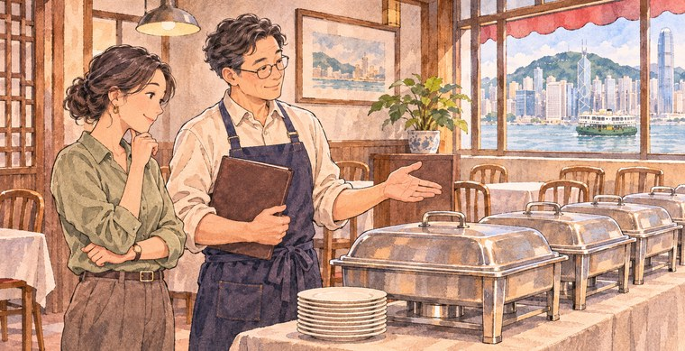

# A beautiful display. An easy meal to assemble?

<!-- legacy-case-id: 276 -->

HSP-23 · Hong Kong · 15 minutes · Service sequence · Buffet layout · Guest task design

## A display is part of a service journey

Service-design research treats the customer’s sequence of actions as a starting point for design, rather than assuming an attractive collection of objects is enough. Food-safety guidance separately requires attention to holding, serving and contamination controls. The restaurant, layouts and observations below are original fiction, not findings about a real buffet.

## Opening decision

You manage a Hong Kong restaurant’s modest lunch buffet. Nine hot dishes remain on offer: three culinary groupings, each containing one starch, one protein dish and one vegetable dish. Guests may combine them however they wish. The question is not nutritional advice or which foods to remove, but how to arrange the same assortment for serving.

A keeps three counters grouped by cuisine, with each cuisine’s three dishes together. B groups the same dishes by their meal role: a counter with three starch choices, one with three protein choices and one with three vegetable choices. Both offer clear individual dish names, accurate ingredients and allergen information, culturally accurate descriptions and trained assistance. Guests can preview all dishes before taking food and are free to revisit counters. Neither forces a prescribed meal.

Both prepared layouts have been checked in the fictional scenario for required access, circulation, holding equipment and hygiene. Dedicated utensils, cross-contact precautions, replenishment and safe food handling remain unchanged; no control can be sacrificed for convenience. Staffing, price, quantities and opening hours are the same. All dishes are easy to see and identify in A. Existing service is safe and usable; this is an enhancement choice, not an excuse to defer a necessary correction.

The manager has a funded one-service trial slot for either layout, using existing movable equipment and staff. Setup and restoration effort fit the same allocated resources. Permanent changes are not yet authorised. A keeps each culinary grouping coherent; B may help guests compare parts of a meal but separates familiar combinations. You have no comparative outcome evidence yet.

## Evidence

| Counter | A: cuisine groups | B: meal-role groups |
| --- | --- | --- |
| First | Cuisine 1: starch, protein, vegetable | Three starch dishes |
| Second | Cuisine 2: starch, protein, vegetable | Three protein dishes |
| Third | Cuisine 3: starch, protein, vegetable | Three vegetable dishes |

Same nine dishes and required information. Categories are diagrammatic, not a measured floor plan.

**Student question:** Would you use the funded trial for cuisine grouping A or meal-role grouping B? Describe the guest’s meal-building task you prioritise and one observation that would change your choice.

## Round two

Before the trial, twenty consenting adult guests are observed during one quiet service using A. Twelve first compare protein dishes across counters, choose one, then return to an earlier counter for a starch or vegetable to complete their first plate. They accurately identify their chosen dishes and say they returned to complete the combination they wanted, not because a label was missing. Five choose a combination within one cuisine counter without returning. Three combine cuisines without returning to an earlier counter.

All twenty obtain the food they want. No one is asked to hurry or given a meal target. The observations record first-plate assembly only, not second helpings, time saved, satisfaction scores, spending or food waste. The volunteer sample was not selected to represent the full clientele, and B has not been tried. The data suggest different ways to assemble a meal, not a single correct route.

You can test B with its planned preview and clear meal-role headings while retaining each dish’s cuisine description and ingredients. Keep safe circulation and assistance; do not duplicate food displays or move dishes away from required holding equipment without a separate safety review. Alternatively, use A’s trial to test a preview guide that shows the full menu before guests begin serving. Either fits the funded slot; neither has a demonstrated advantage.

**Student question:** Would you now test B or refine A’s preview first? Explain the observed assembly problem your test addresses, what you would measure, and one reason not to claim that fewer returns automatically mean a better meal.

## Finding a dish is not the whole task

The twelve returns are 12 ÷ 20 = 60% of this small observed group. They show that some guests build a desired combination across the cuisine boundaries. They do not show a 60% failure rate: everyone obtained their chosen meal, and a return may be a preference rather than a problem.

The important observation is the sequence: compare proteins, choose one, then add other elements. Clear dish identification solved a finding task, but did not necessarily make this combination task convenient. The five single-cuisine journeys also matter. Do not redesign for only the majority in a small convenience sample.

## Use a journey hypothesis, not a universal layout rule

B puts alternatives for one meal role together and is a plausible test for guests who start by comparing proteins. It also separates dishes that another guest wants together. A preserves those familiar groupings; a full preview may let someone plan a mixed plate before serving. Neither arrangement is universally superior, and the evidence does not isolate a causal effect of layout.

Sketch the actions guests choose, including previewing, asking about ingredients, selecting, collecting and returning. Then walk both guest routes and staff replenishment routes. Do not equate fewer counter visits with shorter distance: no dimensions or travel times are supplied. Keep voluntary revisiting possible.

## Test the experience without rushing the guest

Record whether guests can assemble the combination they want, where they reverse direction, what prompts the return and whether help is requested. Ask a brief, optional question about ease and enjoyment, not merely speed. Check congestion, access, ingredient comprehension, holding and replenishment throughout. Stop the trial if controls or accessible circulation deteriorate.

Include varied meal-building preferences and access needs in subsequent research with appropriate consent and minimal data. Compare similar service conditions and document menu, volume and staffing differences. One quiet service is not a capacity test or a causal estimate of B’s improvement. More formal comparison would need an appropriate design, not simply comparing different lunch crowds as if they were identical.

## Protect the constraints while changing the arrangement

Food safety and accurate allergen information are prerequisites, not competing options. Meal-role headings cannot replace each dish’s identity or imply it is suitable for every diet. Maintain individual information, trained assistance and cross-contact precautions; do not infer allergens from cuisine names or illustrations.

A recommendation to test B is defensible because it targets a visible assembly sequence. A recommendation to improve A’s preview is also defensible if preserving culinary coherence and avoiding unnecessary movement are priorities. State the observation that would justify keeping, revising or reversing the tested arrangement.

## Instructor note

0–4 minutes: vote and draw a guest journey. 4–8 minutes: reveal the twenty observations and distinguish finding an item from assembling a plate. 8–12 minutes: propose a narrow trial with an observation and stopping condition. 12–15 minutes: compare the experience of mixed-cuisine and single-cuisine guests.

Do not claim B has already reduced travel, queues, waste or dissatisfaction. Twelve returns are observed actions, not defects or a population rate. The case holds assortment fixed but is not a replica of a catalogue-choice case: the mechanism is physical sequencing while combining complementary dishes. It is also not arrival wayfinding or pushing faster table turnover. Protect safety, access and guest autonomy in every answer.

## Sources and case assumptions · optional reference

All information needed for classroom decisions is provided above. Sources are optional reading.

All restaurant details, nine dishes, layouts, funding and twenty observations are fictional. The three meal roles are organisational categories, not nutritional prescriptions; guests may choose any combination. Same dishes, quantities, staffing and required information in both. Safety/access feasibility is a stipulated scenario condition, not a real compliance assessment. Twelve mixed-cuisine return journeys, five single-cuisine direct journeys and three mixed direct journeys sum to twenty. Twelve of twenty is 60% only within the volunteer observation; all completed their intended first plate. B is untested. No measured floor distances, timing, satisfaction, financial result, congestion effect or causal comparison is supplied. Trial and restoration are funded with existing equipment; no food duplication or holding/control compromise. Sources read 16 November 2026 support design and non-negotiable handling/information principles, not this layout’s effectiveness.

- [Bitner, Ostrom and Morgan · Service Blueprinting: A Practical Technique for Service Innovation · 2008](https://www.ba.ihu.gr/wp-content/uploads/2026/03/bitner-et-al-2008-service-blueprinting-a-practical-technique-for-service-innovation.pdf). Original paper, components and building sections: customer actions and supporting employee processes. No blueprint figure or empirical effect copied.
- [Mary Jo Bitner · Servicescapes: The Impact of Physical Surroundings on Customers and Employees · 1992](https://eli.johogo.com/Class/jm-1992.pdf). Original conceptual paper, spatial layout/functionality and self-service propositions. Conceptual framing, not evidence that B outperforms A.
- [UK Government Service Manual · Creating an experience map](https://www.gov.uk/service-manual/user-research/creating-an-experience-map). Actual guidance on mapping observed steps and separating different user journeys. General method adapted to a short service sequence, not a UK requirement for restaurants.
- [Hong Kong Centre for Food Safety · Keeping Your Buffet Safe](https://www.cfs.gov.hk/english/programme/programme_haccp/programme_haccp_buffet.html). Substantive buffet flow, monitoring, display and contamination-control guidance. Supports constraints retained under both options, not a legal certification.
- [Hong Kong Centre for Food Safety · Food allergens](https://www.cfs.gov.hk/english/trade_zone/safe_kitchen/Food_allergens.html). Actual recommendations on correct information, staff/cook communication and avoiding cross-contact. No unsupported claim that cuisine or meal role identifies allergens; prepackaged-labelling law is not applied to this buffet.
