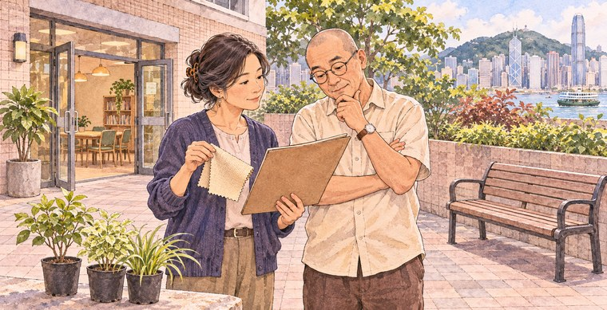

# A cooler courtyard. Ready for a hotter summer?

<!-- legacy-case-id: 166 -->

SUS-14 · Hong Kong · 10–15 minutes · Heat adaptation · Benefit timing · Maintenance responsibility

## Heat makes timing matter

On 8 January 2026, the Hong Kong Observatory reported 53 very hot days in 2025, the third-highest annual count on record. This is an observation about that year, not a forecast for any particular courtyard.

The centre, quotations and shade estimates below are fictional. They explore when an adaptation investment delivers usable space, not how to engineer a structure or prescribe safe exposure to heat.

## Opening decision

Fictional classroom situation. A Hong Kong community centre has HK$60,000 for one discretionary courtyard improvement before next summer. It controls the site for at least five more years. It wants more comfortable outdoor seating during suitable weather, while also improving its longer-term environment.

Two professionally assessed packages fit the site and meet current structural, access and tree-safety requirements. A installs removable shade over seating. B creates a planted shade area intended to develop a canopy over time. Both include installation and their stated maintenance commitments within the same HK$60,000; neither relies on unpaid volunteers.

This is not a choice between outdoor exposure and safety. Existing funded indoor space, drinking water, access arrangements, weather monitoring and decisions to move or cancel outdoor activity remain under either option. No one must stay outside. The board has not ranked immediate outdoor amenity above longer-term improvement; students must make that priority explicit.

## Evidence

| Proposal | A · Removable shade | B · Planting |
|---|---|---|
| Package price | HK$60,000 | HK$60,000 |
| Main asset | Removable shade installation | Site-suitable planting |
| Intended value | Earlier usable shaded seating | Developing canopy and planted setting |
| Evidence still to examine | Service life and operating arrangements | Growth timing and care arrangements |

Only these complete packages are quoted. A smaller combined scheme is not yet designed or priced; choosing “both” does not fit the current offer.

**Student question:** Which package would you provisionally choose? State whose use of the courtyard you are prioritising and which timing or upkeep evidence you need before treating installation as a delivered benefit.

## Round two

The detailed site assessment estimates shaded seating area at the same specified afternoon time, under comparable sun conditions. A provides 20 square metres from the first summer when safely deployed. Its quoted service covers three summers, including inspection, trained deployment, required storm removal and final removal. Replacement after that is not funded.

B provides about 4 square metres in the first summer. With healthy growth and the specified care, the site-specific forecast is about 20 square metres by the fourth summer, with potential to last beyond the five-year planning period. That is a forecast, not a canopy or lifespan guarantee. Installation is ready before summer, but mature shade is not.

B’s package includes five years of professional establishment care, watering, inspections and agreed replacement of failed new planting. A named centre facilities officer oversees delivery and keeps records under either package. Future care beyond those funded terms needs a new budget. No temperature reduction, health benefit or total environmental footprint has been measured for either design. Equal shaded area at one time would not prove equal cooling throughout the day.

**Student question:** Which package would you fund now? Give one first-summer objective and one later review point, name who is responsible for upkeep, and explain the benefit gap your choice leaves without inventing a free second project.

## Separate installation from delivery

Both packages can be installed before summer. Only A supplies the stated 20 square metres of shaded seating immediately. B starts with about 4; its larger canopy depends on growth and care. A therefore offers 16 square metres more in the first-summer design estimate, not a measured 16-square-metre health benefit or a specified temperature advantage.

## Use a timeline rather than a single photograph

A prioritises near-term shaded outdoor space but leaves a renewal decision after three summers. B accepts a smaller early contribution in pursuit of a developing planted environment; the fourth-summer forecast is conditional. Neither drawing tells you how many safe outdoor sessions will actually occur.

The same initial price does not establish equal lifetime cost or benefit. A replacement and B’s care beyond year five are unpriced. Do not divide cost by a guessed lifespan to manufacture a winner, or treat all shaded hours and all users as interchangeable.

## Specify stewardship and a fallback

For A, the officer checks inspections, safe operating procedures and whether the expected seating area is actually shaded at the relevant times. A year-three review must confront replacement funding rather than silently assuming renewal. For B, track establishment and observed canopy development; revisit the shade forecast if growth falls behind. Qualified professionals, not a classroom vote, determine planting and structural work.

Existing indoor arrangements remain the fallback during unsuitable weather or while outdoor benefits are limited. A long-term preference does not justify leaving people in hazardous heat. Equally, retaining an adequate indoor fallback does not make additional pleasant outdoor space worthless.

## Instructor note

Ask each group to put its decision on a five-summer timeline: usable shade, maintenance responsibility and the next funding decision. Accept either package when its priority and shortfall are defended. A staged objective is a sequence of delivery and review commitments, not an automatically affordable hybrid.

SUS-10 compares repairable goods; SUS-07 separates service reach from outcomes. Here the mechanism is adaptation whose benefit arrives over time and requires stewardship. Source guidance supplies principles, not these numerical forecasts. Shade, air temperature, thermal comfort and health outcomes are distinct; do not promise that a tree or canopy makes an outdoor event safe in every condition.

## Sources and case assumptions · optional reference

All information needed for classroom decisions is provided above. Sources are optional reading.

All site assessments, areas, costs, timings and contracts are original fiction. HK$60,000 funds exactly one complete package. Five-year site access confirmed. Existing safety, indoor alternatives and accessibility retained; nobody required to remain outdoors. Both assessed designs meet current requirements; no engineering approval implied for any real site. A: 20 square metres of shaded seating at a fixed afternoon assessment time from summer one when safely deployed; three-summer maintained service and final removal funded, later replacement not funded. B: about 4 square metres initially and conditional forecast about 20 by summer four, possible life beyond year five, not guaranteed. Five years of professional care and agreed failed-new-plant replacement funded; replacement can affect growth timing, so no guaranteed canopy. Same sun/time basis for estimates, not all-day exposure or temperature equivalence. First-summer area difference 20 minus 4 equals 16 square metres, not cooling degrees or health gain. No added-capacity calculation, carbon offset, biodiversity score, cost-effectiveness ranking or real heat projection supplied. Facilities officer is named accountable role; competent contractors perform work. Lifecycle costs beyond funded terms unknown. Mixed scheme unpriced. Three/ four/ five-year terms are fictional project facts, not a general growth rule or recommendation. Five substantive bodies read; CDC page returned no readable body and is excluded. Handbook pages 33–39 read for establishment and ongoing care, not full legal compliance review.

- [Hong Kong Observatory · The year’s weather 2025 · 8 January 2026](https://www.info.gov.hk/gia/general/202601/08/P2026010800329.htm). Read annual summary and hot-day definitions. Historical local context only; no projection or courtyard temperature estimate inferred.
- [US EPA · Benefits of Trees and Vegetation](https://www.epa.gov/heatislands/benefits-trees-and-vegetation). Read shade and evapotranspiration explanation and benefit discussion. No published average cooling or health-effect estimate applied to this fictional site.
- [Hong Kong Development Bureau · Common Tree Problems and tree-care FAQs](https://www.greening.gov.hk/en/tree-care/common-tree-problems/index.html). Read site/species selection, space, watering and maintenance sections. Site-specific planning principles, not a prescribed species or growth timetable.
- [Hong Kong Development Bureau · Handbook on Tree Management · February 2026](https://www.greening.gov.hk/filemanager/greening/en/content_34/HTM_Feb_2026_Eng.pdf). Read printed pages 33–39 on site suitability, establishment and continuing care. Not a full handbook/legal assessment; fictional contracts exceed or differ from generic guidance as explicitly stated.
- [US National Weather Service · During a Heat Wave](https://www.weather.gov/safety/heat-during). Read outdoor activity, cooling and monitoring guidance. Supports retaining heat precautions rather than treating shade as sufficient protection; US information is not a Hong Kong operating protocol.
