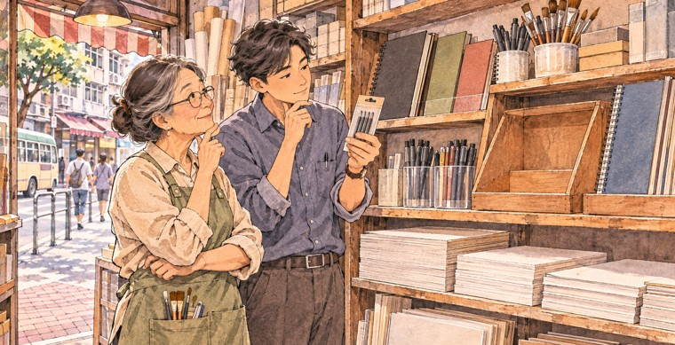

# A slow seller. An important basket?

<!-- legacy-case-id: 57 -->

MKT-05 · Hong Kong · 10–15 minutes · Marketing · Assortment decisions · Basket effects

## In the news

In its results announcement of 3 March 2026, DFI Retail Group described trimming slow-selling products in its IKEA operations alongside changes to pricing, accessibility and digital channels.

This company-reported programme illustrates an everyday retail question: what should occupy limited shelf space? It does not establish that any particular deletion succeeded or failed. Our small Hong Kong art-supplies shop below is fictional and separate from DFI.

## Opening decision

Fictional classroom situation. An art-supplies shop has committed one display slot to a new product trial. For this decision, it must remove one of two existing lines: specialist drawing-pen refills or one notebook colour. Both occupy the same display space, were continuously available throughout the comparison month, and have comparable handling costs.

The owner suggests removing the refills because they sell less. Her colleague worries that a narrow sales ranking might remove a useful part of the shop’s range. The new-product trial and its space requirement are the same under either choice; no other slot is available during the trial.

## Evidence

| Invented last-month results | Units sold | Contribution per unit | Own-item contribution |
|---|---:|---:|---:|
| Refill packs | 20 | HK$5 | HK$100 |
| One notebook colour | 60 | HK$5 | HK$300 |

Contribution is selling price less costs varying with the unit sold. Past own-item amounts are not forecasts of the total effect of removal.

**Student question:** Which line would you remove for the trial: refills or the notebook colour? What could make the lower own-item contribution misleading?

## Round two

A review of last month’s receipts shows that 16 of the 20 refill purchases also included other drawing supplies. Each of the 20 refill purchases contained one pack. The shop has no compatible substitute for these refills; several other notebook colours will remain.

These are observed purchases, not an experiment. Nobody has established whether refill shoppers would abandon the rest of their basket, buy the other supplies anyway, or obtain refills elsewhere and still return. Nor is it known whether buyers of the removed notebook colour would accept another colour.

Prices, contribution per unit and the one-slot constraint are unchanged. The contribution from the other items in those baskets has not been supplied.

**Student question:** Would you change which line to remove? Name the customer behaviour you need to test, rather than assuming all linked purchases will disappear or switch.

## Count the customer’s shopping mission

Own-item contribution ranks what the line earned last month. It does not capture everything that could change when the line disappears. A small refill purchase may help complete a drawing-supply trip, whereas another notebook colour may be an acceptable replacement. Both are possibilities to investigate, not facts established by this exhibit.

Compare the shop-wide contribution under each proposed range, including the common new-product trial. Do not select by unit volume alone, or assume every slow seller deserves permanent protection.

## Separate substitution from basket loss

Substitution: some customers buy a remaining product instead. That can recover some sales, but depends on what customers accept and the replacement item’s contribution.

Basket effect: an unavailable item changes purchases of other items, or the decision to shop here at all. The 16 linked receipts flag a question; they do not prove that removing refills loses 16 entire baskets.

Do not multiply all associated purchases by an assumed loss rate of 100%. The case supplies neither causal loss rates nor the other items’ contribution, so it cannot identify a numerical winner.

## Use the trial to learn

Make a provisional choice and specify what would reverse it. Record requests for the removed product, accepted substitutes, unfilled needs and changes in total basket contribution. Observe whether customers return, not only the sales of the new item.

Compare similar trading periods or use a staged comparison where practical, keeping prices, availability and promotions comparable. A before-and-after change alone can reflect seasonality or other events. Customer explanations help diagnose the problem but do not by themselves establish the financial effect.

Removing refills remains defensible if customers retain the rest of their purchases and the alternative range performs better. Removing the notebook colour remains defensible if substitution is acceptable and refills support valuable shopping trips. Revisit the choice with evidence.

## Instructor note

Use two minutes for the first vote, two for the contribution comparison, two for the reveal and six for test design. The arithmetic is 20 × HK$5 = HK$100 and 60 × HK$5 = HK$300. The HK$200 difference is historical own-item contribution, not the loss caused by a deletion.

Ask refill defenders whether all linked baskets would truly leave. Ask notebook defenders whether every customer accepts another colour. Reward a clear provisional decision with a measurable reversal rule, not an unsupported claim that variety is always good or that low sellers should always go.

## Sources and case assumptions

All information needed for classroom decisions is in the case. Sources are optional reading for attribution and background.

The art shop, products, display constraint, unit sales, contribution figures and receipts are invented classroom assumptions. They are not DFI or IKEA data. Co-purchase is not proof of causal complementarity, and no percentage of basket abandonment is given. Both lines were fully available in the comparison month. Sources checked 14 November 2026; research findings and vendor examples are background, not predictions for this shop.

1. [DFI Retail Group, 2025 Preliminary Announcement of Results, 3 March 2026](https://www.dfiretailgroup.com/media/ne5ahfub/p260303.pdf) — Page 7 describes assortment rationalisation in its IKEA operations alongside other initiatives. This is a company report, not an isolated causal estimate of deleting products.
2. [Oracle Retail AI Foundation, Using Assortment Recommender Results, release 26.2.301.0](https://docs.oracle.com/en/industries/retail/ai-foundation-cloud-service/26.2.301.0/aifug/using-assortment-recommender-results.htm) — Illustrative planning example considers basket relationships and substitution rather than simply removing the worst sellers. Vendor documentation, not independent performance evidence or a software endorsement.
3. [Mani, Thomas and Bansal, Estimating Substitution and Basket Effects in Retail Stores, 2022; Penn State research record](https://pure.psu.edu/en/publications/estimating-substitution-and-basket-effects-in-retail-stores-impli/) — Public abstract of original research using 12 office-supply stores distinguishes substitution from basket abandonment. Study estimates are not transferred to the fictional shop.
4. [Borle and colleagues, The Effect of Product Assortment Changes on Customer Retention, 2005](https://students.marshall.usc.edu/sites/default/files/jnunes/intellcont/Effect%20of%20Assortment%20Reduction%20on%20Retention-1.pdf) — Original study using an online grocer’s records examines shopping frequency and purchase quantity, with effects differing across categories. Context-specific results do not establish that all assortment reductions are harmful.
5. [Vasilyev, Maier and Seifert, Assortment optimization given basket shopping behavior using the Ising model, 2025; revised 20 October 2026](https://arxiv.org/abs/2502.16260) — Public abstract and metadata of modelling research that accounts for linked product demand. Its model and numerical gains are not classroom-shop evidence.
