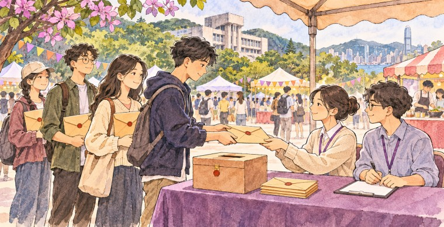

# One stall, one bid

Case 16 · Hong Kong · 10–15 minutes · Auction design · Private values

## Hong Kong in the news · 15 November 2023

Hong Kong concluded the open auction for stalls at the 2024 Victoria Park Lunar New Year Fair. Students now bid for a fictional festival stall under two sealed-bid rules and see how changing the payment rule changes a sensible bid.

## Opening decision

Your society values a stall at HK$900 after allowing for all costs except the stall fee. The highest rival bid will be either HK$500 or HK$800, equally likely. You are risk neutral, can bid in HK$10 steps, and lose ties. Highest bid wins.

## Evidence

| First-price auction, HK$ | Assumption |
|---|---|
| Private value | 900 |
| Possible highest rival bids | 500 or 800 |
| Payment if you win | Your own bid |

**Your decision** What single sealed bid maximises expected surplus? Compare bidding just above each possible rival bid.

## Round two

The organiser changes only the payment rule. The winner now pays the highest rival bid. You still submit your bid before you learn what rivals offered.

**Your decision** Would you bid your HK$900 value? Calculate what you pay and keep in each rival-bid scenario.

## Debrief

In round one, bidding 510 wins half the time and yields expected surplus 195. Bidding 810 always wins but leaves only 90. Intermediate bids cannot improve on 510. In round two, a 900 bid wins both times and leaves 400 or 100, averaging 250.

## Instructor note

Minutes 0–3: vote and compare reasons in pairs. Minutes 3–7: reveal the changed fact and vote again. Minutes 7–12: reconcile the answers. With only these two possible rival bids, several bids win both times. Truthful bidding also works for any rival price: win below your value, lose above it, and be indifferent at equality. Ask what changes if another society’s high bid reveals better information about stall revenue.

## Sources and case assumptions

All information needed for the classroom decisions is provided in the case. The sources below are optional background, not assigned reading.

The setting, participants, numerical exhibit and changed rule are fictional classroom assumptions. The readings below provide context and economic reasoning.

1. [EconPort - First Price Sealed-Bid Auction](https://econport.gsu.edu/content/handbook/auctions/commntypes/firstpricesealed.html) — Defines the first-price payment rule.
2. [Wooldridge, An Introduction to MultiAgent Systems](https://uranos.ch/research/references/Wooldridge_2001/TLTK.pdf) — Discusses auctions as allocation mechanisms.
3. [Second-Price Sealed-Bid Auctions](https://cs.brown.edu/courses/csci1440/lectures/2025/second_price_auctions.pdf) — Explains truthful bidding in second-price auctions.
4. [Columbia University, Lecture 1: Auctions](https://www.cs.columbia.edu/coms6998-3/lecture1-auctions.pdf) — Compares allocation and payment rules.
5. [EconPort - Bayesian Nash Equilibrium in First-Price Auctions](https://econport.gsu.edu/content/handbook/auctions/auctionsexperiments/auctionsbneandfirstprice.html) — Explains the trade-off between winning and the surplus retained.

- [Hong Kong Food and Environmental Hygiene Department, 15 November 2023](https://www.fehd.gov.hk/english/news/details/20231115_10632.html). Background for the opening news context.
