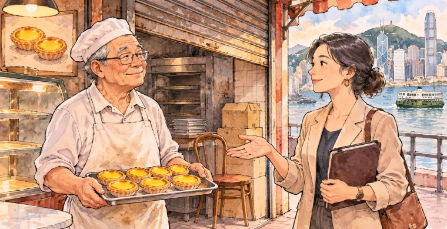

# The last tray of egg tarts

<!-- legacy-case-id: 9 -->

ACC-01 · Hong Kong · 10–15 minutes · Sunk cost · Opportunity cost

*Classroom assumptions, not a news report*

## Hong Kong in the news · June 2024

Wan Chai volunteers collected unsold bread from bakeries at closing time for redistribution. For a baker facing an offer at the door, what other use does the last tray have tonight?

The decision below is a classroom case. The setting, figures and later change of fact are classroom assumptions, not a news report of that collection.

## Your classroom decision

You run a Hong Kong bakery. Twelve egg tarts sit on the counter as you turn the sign to Closed. The café next door offers to buy the whole tray. You have no other buyer or use for it tonight.

**Closing figures, HK$ per tart · classroom assumptions**

|  |  |
| --- | --- |
| Baking cost already incurred | 8 |
| Café offer | 6 |
| Incremental cost of selling | 0 |

Twelve tarts are on the tray.

**Your decision:** Would you sell all twelve? Show the difference tonight’s choice makes to cash.

## Round 2 · One fact changes

Your pastry chef checks tomorrow’s orders. Keeping the tray for bread pudding would save HK$7 per tart in other ingredients, after extra preparation costs. Demand for pudding is already confirmed.

**Your decision:** Would you still sell the tray to the café? What offer would leave you indifferent between selling and keeping it?

## Debrief · Compare the choices

Sell in round one. Under both choices, the HK$96 baking cost has already been incurred: twelve tarts times HK$8. That cost is a sunk cost. Selling brings in HK$72 more cash than discarding: twelve times the HK$6 offer, and the incremental cost of selling is zero.

**Tonight’s cash**

|  | Discard | Sell |
| --- | --- | --- |
| Baking cost already incurred | 96 | 96 |
| Cash inflow tonight | 0 | 72 |

Selling brings in HK$72 more cash.

In round two, keeping the tray saves HK$84 of cost: twelve tarts times HK$7. That cost saving is the opportunity cost of selling. Selling for HK$72 would leave you HK$12 worse off. The offer that leaves you indifferent is HK$7 per tart.

**Compare the uses**

|  | Per tart | Whole tray |
| --- | --- | --- |
| Café offer | 6 | 72 |
| Pudding cost saving | 7 | 84 |

Indifference offer: HK$7 per tart.

Tonight’s choice is the difference it makes to cash from here. Look only at relevant cash flows. The baking cost has already been incurred, whether you sell or keep the tray. Compare the café’s offer with the next-best use you actually have: that is the opportunity cost.

## Instructor note

Minutes 0–3: vote and compare reasons in pairs. Minutes 3–7: reveal the changed fact and vote again. Minutes 7–12: reconcile the answers. The indifference offer is HK$7 per tart. Ask students who chose HK$8 what changes in cash when the already-incurred baking cost is included in both alternatives. Ask those who chose HK$7 how an uncertain pudding order would change the cost saving.

## Sources and case assumptions · optional reference

All information needed for the classroom decisions is provided above. These sources document the background and are optional reading.

The setting, participants, numerical exhibit and changed rule are fictional classroom assumptions. The readings below provide context and economic reasoning.

1. [CUHK Varsity, June 2024](https://varsity.com.cuhk.edu.hk/index.php/2024/06/rescuing-leftover-bread-for-the-needy/). Reports the opening event.
2. [Food Waste Challenge | Environmental Protection Department](https://www.epd.gov.hk/epd/english/environmentinhk/waste/prob_solutions/food_waste_challenge.html). Describes the Hong Kong food-waste setting.
3. [2.1 How Individuals Make Choices Based on Their Budget Constraint - Principles of Economics 3e | OpenStax](https://openstax.org/books/principles-economics-3e/pages/2-1-how-individuals-make-choices-based-on-their-budget-constraint). Defines opportunity cost in individual choices.
4. [Prevent Wasted Food Through Source Reduction](https://www.epa.gov/sustainable-management-food/prevent-wasted-food-through-source-reduction). Describes preventing surplus through planning.
5. [Wasted Food Scale](https://www.epa.gov/sustainable-management-food/wasted-food-scale?trk=article-ssr-frontend-pulse_little-text-block). Distinguishes uses for surplus food.
6. [Hong Kong Government, Food Wise Hong Kong Campaign launch](https://www.info.gov.hk/gia/general/201305/18/P201305180667.htm). Describes the local food-waste reduction campaign.
