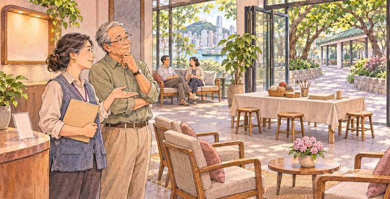

# Ten minutes to wait. Ten minutes without knowing?

<!-- legacy-case-id: 228 -->

HSP-19 · Hong Kong · 10–15 minutes · Waiting experience · Uncertainty and control · Truthful service information

## A return time is not an instant-service guarantee

Hong Kong marked Disneyland’s 20th-anniversary celebration on 28 June 2025. The resort also describes a Standby Pass allowing registered guests to return during a specified period and enter the relevant queue. That illustrates a service arrangement, not proof that every wait disappears. Our visitor centre, costs and feedback are fictional and do not describe the resort’s performance.

## Opening decision

A fictional Hong Kong visitor centre has HK$12,000 for one four-week trial at its optional craft-demonstration desk. Baseline staffing, safe seating, drinking water, access assistance, staff breaks and essential service information are already funded. No emergency, essential service or legal accommodation depends on this trial. Visitors retain existing cancellation and refund rights. Both alternatives have been checked for safe operation and fit the budget, but cannot both be funded now.

A adds a trained host during the busiest periods, increasing service capacity without shortening the demonstration or skipping checks. B retains current capacity but adds staff-maintained progress information and a genuinely optional return arrangement. People can remain in the seated waiting area or leave briefly while preserving their queue position. A paper ticket and human assistance are available without a smartphone, and there is no extra charge or priority advantage for leaving.

Under either trial, nobody is given a false time guarantee. B supplies a current estimated range and updates when circumstances change, with a clearly explained return window. Early service is not forced: a visitor returning within the agreed window keeps the agreed place. Staff handle delays and access needs without automatic cancellation; the process has been rehearsed and does not displace other waiting visitors. Existing basic information remains under A. The proposed B enhancement does not itself increase throughput or reduce elapsed waiting. Neither option’s peak-load results have yet been measured.

## Evidence

| Trial | Operational change | Not yet established |
|---|---|---|
| A: extra trained host | More service capacity | Peak waiting reduction |
| B: live information and optional return | Clear progress and flexible location | Shorter elapsed wait or higher satisfaction |

**Student question:** Would you fund extra service capacity or the information-and-return option first? State whether your priority is less elapsed waiting, greater control during the wait, or both, and what evidence you would collect.

## Round two

In a fictional feedback exercise, staff invite twenty recent visitors who each waited exactly ten minutes to discuss that experience. Twelve mention uncertainty about progress or concern that they might miss their turn; eight focus on the ten-minute delay itself. These are the primary concern selected by each person, not counts of every concern they held. Six of the twenty say they would prefer to stay beside the desk rather than leave; that separate question overlaps the first categories.

The participants were selected for discussion, not randomly sampled. They did not try A or B. Their comments suggest questions for a trial, not the proportion of all visitors who will prefer B or proof that information improves satisfaction. A may still be preferable if shortening actual delays is the priority. B must preserve the stay-nearby option, accurate updates and the promised place. No new capacity, faster service or guaranteed satisfaction is revealed.

**Student question:** Does the new feedback change your first choice? Specify a truthful waiting promise, protect visitors who stay nearby, and choose measures that separate actual waiting from uncertainty and satisfaction.

## Separate clocks from experience

All twenty discussion participants waited ten minutes. Their different concerns do not change that elapsed duration. Twelve of twenty is 60% of this selected discussion group, not a population estimate. Six wanting to stay nearby cannot simply be added to twelve or eight because the questions describe different, overlapping dimensions. Measure waiting from joining the queue to service starting even when someone leaves the physical waiting area.

## Do not manufacture a shorter wait

A can increase capacity, but the effect on waiting depends on demand and operation and requires observation. B can provide clearer progress and more control over location without making service earlier. Do not reset the clock when a visitor returns, count time away as zero waiting or promise an unrealistically short interval. Check the freshness and accuracy of information, and explicitly acknowledge delays.

## Test the promise as well as the outcome

Record actual elapsed waits, their spread, departures, missed or changed return windows, service throughput, access problems and staff workload. Ask separately about uncertainty, perceived control and satisfaction. Protect people who cannot or do not want to leave. A comparison across periods needs demand and staffing context; a single before-and-after difference does not by itself establish causation. Either first trial can be defended with a stated objective and a review threshold.

## Instructor note

OPS-07 compares queue pooling and dedicated counters; HSP-07 separates unwanted payment delay from the desired pace of a meal. This case concerns uncertainty and choice during a pre-service wait, not a queueing formula or rushed consumption. All budgets, arrangements and feedback are original assumptions. Practitioner propositions motivate questions, not guaranteed psychological effects. The mathematical information-delay source is a theoretical caution, not a calibrated model of this centre.

## Sources and case assumptions · optional reference

All information needed for classroom decisions is provided above. Sources are optional reading.

Original optional visitor-centre service. Equal HK$12,000 trials: A adds capacity; B changes information and permitted waiting location, not service rate. Baseline safety, accessibility, lawful rights, breaks and essential information are protected under both. Paper and human alternatives remain, with no compelled departure or automated cancellation. Twenty selected visitors each waited ten minutes: 12 named uncertainty as the primary concern, and 8 named duration. Six preferred to remain nearby, a separate overlapping dimension. Nobody tried the interventions; there is no population or causal result. Actual waiting time continues while away. Two Disney operational references are related provider descriptions, not independent effectiveness studies. Maister offers practitioner propositions; Pender and colleagues provide a theoretical model, not psychological experimental evidence.

- [Hong Kong Financial Secretary: Disneyland anniversary speech, 28 June 2025](https://www.info.gov.hk/gia/general/202506/28/P2025062800468.htm). Actual dated speech supplies local attraction context only; it reports no outcome for these fictional waiting arrangements.
- [Hong Kong Disneyland: Standby Pass](https://www.hongkongdisneyland.com/guest-services/standby-pass/). Actual provider instructions describe returning during a specified period and entering the relevant queue; not a promise of immediate service or independent evidence of satisfaction.
- [Hong Kong Disneyland: Official mobile app](https://www.hongkongdisneyland.com/mobile-app/). Actual provider page describes wait-time and accessibility information and return slots. Related operational illustration, not proof that apps suit every visitor.
- [David Maister: The Psychology of Waiting Lines, 1985](https://davidmaister.com/articles/5/52/). Actual authored practitioner discussion distinguishes objective waits, expectations and experience. Its propositions and anecdotes are not a causal estimate for this centre; no deceptive promise is adopted.
- [Pender, Rand and Wesson: Managing Information in Queues, 2016](https://arxiv.org/html/1610.01972). Actual original theoretical paper models delayed information and queue choices. It motivates checking information freshness; its two-queue fluid assumptions and thresholds are not imported into the case.
