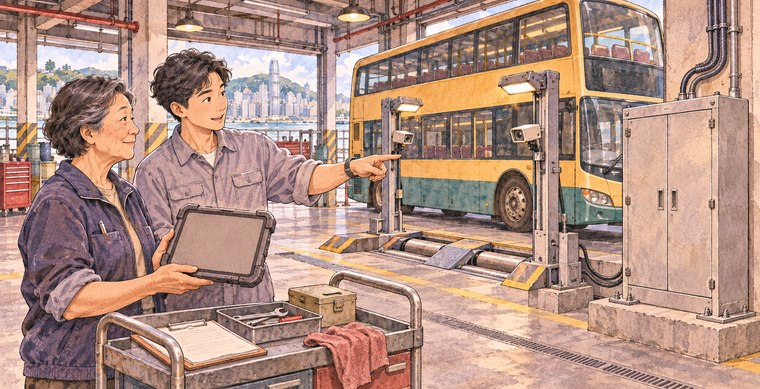

# The franchise ends. What can the operator keep?

<!-- legacy-case-id: 501 -->

STR-41 · Hong Kong · 15 minutes · Resource transferability · Asset specificity · Complementary rights · Staged commitment

## A new franchise brings two Hong Kong bus networks together

In July 2022, Hong Kong’s Chief Executive in Council granted Citybus a new ten-year franchise combining two existing networks, effective 1 July 2023. The government said the arrangement would let the operator deploy resources more flexibly. The new grant did not establish how a hypothetical operator might bid or what particular assets would pass to a new operator.

## Opening decision

Fictional Harbour Ridge Transit expects a decision next year on a franchise that succeeds its current one. It can invest now in portable dispatch software and staff training, or in fixed depot equipment. Both are optional improvement projects. Current operations and required service levels are funded separately.

The portable kit includes the right to use the software and training material on either of the company’s networks. The dedicated installation is part of the depot and cannot be moved or sold. Its value requires both a new franchise and continued access to that depot.

The committee puts the chance of a new grant at 75%. It initially assumes the depot will be available whenever a new franchise is granted. The board may choose at most one project. Use expected net benefit; all figures are in HK$ million on a common present-value basis. Doing nothing adds zero.

## Evidence

| Investment | Cost now | Benefit with grant | Benefit without grant |
| --- | --- | --- | --- |
| Portable kit | 6 | 10 | 8 on another network |
| Fixed equipment | 7 | 16 if depot available | 0 |

**Student question:** On the initial assumptions, which investment would you recommend? What right or capability must be checked before calling that recommendation firm?

## Round two

The depot-use agreement is separate from the franchise. With a new franchise, there is only a 70% chance of retaining the original depot. If the operator loses the depot, the fixed equipment installed there gives the company no benefit. The portable kit still delivers 10 with the grant, whichever depot the operator uses.

A supplier offers a firm deferred installation price of HK$8.5 million on the same present-value basis. The operator can wait for both grant and access decisions, then install only if both go its way and still earn the full benefit of 16. If either goes against it, there is no installation or cost. Choosing to wait rules out the portable project.

**Student question:** Would you install now, choose the portable kit, or wait and install only after both rights are confirmed? What is the most the board could pay for deferred installation before preferring the portable kit?

## Debrief · Ask what brings the value along

Initially, the portable kit adds 0.75 × 10 + 0.25 × 8 − 6 = 3.5. The fixed equipment adds 0.75 × 16 − 7 = 5. It leads only because the board assumes the franchise decision also secures the depot. Check both the site rights and the portable software licence before committing.

## Debrief · Multiply the conditional chances

A grant plus continued depot access now has probability 0.75 × 0.70 = 52.5%. Installing now yields 0.525 × 16 − 7 = 1.4. The portable kit still yields 3.5 because the revised depot assumption does not change the kit’s use or benefits.

## Debrief · Pay more only when the asset can work

Waiting yields 0.525 × (16 − 8.5) = 3.9375. This beats the portable kit by 0.4375. The supplier charges more if installation proceeds, but the operator avoids paying in states where its equipment would be stranded.

## Debrief · Find the deferred price limit

Let C be the deferred installation price. Set 0.525 × (16 − C) = 3.5. The operator is indifferent at about 9.33. Above that, choose the portable kit. This compares project choices, not what anyone should pay for the franchise itself.

## Takeaway · A resource and the right to use it

Staff training, reusable software and licensed use can travel in this case; ownership alone would not prove portability. The fixed equipment needs a specific site as well as the operating right. Ask whether waiting would sacrifice part of the benefit before relying on the deferred option.

## Instructor note

Allow 15 minutes: 3 to list resources and rights, 4 for the initial comparison, 5 for the new choices, and 3 to test the timing assumption. Have one group label what truly travels and another name the separate right the fixed asset requires.

## Sources and case assumptions · optional reference

All information needed for classroom decisions is provided above. Sources are optional reading.

All operator details, probabilities, costs, benefits and contractual terms are fictional. The exercise does not represent a Citybus bid, depot transfer, actual franchise condition, or legal advice.

- [Hong Kong Government, Executive Council grants three new bus franchises (2022)](https://www.info.gov.hk/gia/general/202207/12/P2022071200315p.htm). Primary source for a ten-year Citybus grant combining the two relevant networks effective 1 July 2023, and the stated rationale of flexible resource deployment.
- [Transport Department, Public Transport Passenger Journeys by Operator Group](https://www.td.gov.hk/mini_site/atd/2025/en/section5-3.html). Official series identifies the reorganisation of franchise categories; no case probabilities or asset rights come from the counts.
- [Transport and Logistics Bureau, Legislative Council reply on monitoring bus service frequencies](https://www.tlb.gov.hk/eng/legislative/transport/replies/2023/20231129a.html). Shows that a route’s Schedule of Service can specify requirements such as operating hours and bus allocation. The case’s separate service funding is stipulated.
- [Bravo Transport, announcement of the Citybus and NWFB franchise merger (2022)](https://www.citybus.com.hk/en/uploadedPressRelease/19336_12072022_Bravo_eng.pdf). Operator describes expected staff and asset synergies and intended depot and bus investment, not measured savings or obligations to transfer particular assets.
- [Legislative Council brief on public bus franchises and proposed profit-control resolutions (2023)](https://www.legco.gov.hk/yr2023/english/brief/tlbcr155412021_20230607-e.pdf). Confirms the grant of a named combined franchise under the Public Bus Services Ordinance and its commencement; a source for the grant structure, not these fictional contracts.
