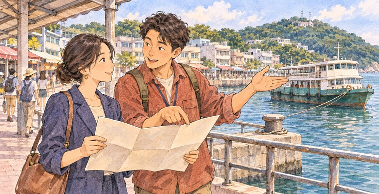

# The last ferry decides the itinerary

<!-- legacy-case-id: 506 -->

HSP-41 · Hong Kong · 15 minutes · Tour design · Service reliability · Connection risk · Expected contribution

## Timetables shape an island-hopping day

Sun Ferry’s published Inter-Islands timetable effective 1 April 2026 listed several sailings from Cheung Chau towards Mui Wo. This case borrows three departure times from that dated timetable, not from a live departures board. Its tour, boarding cutoffs and performance figures are fictional.

## Opening decision

Wing designs a fictional Cheung Chau and Mui Wo group tour with a contracted dinner in Mui Wo at 18:15. The core itinerary uses the 14:45 ferry. An extended itinerary adds a craft workshop and uses the 16:50 ferry. In the model both can reach dinner if boarded; the 18:45 ferry cannot.

Wing uses a group boarding cutoff five minutes before departure. The group must reach the gate by 14:40 or 16:45, respectively. With no overrun it reaches the gate at 14:12 on the core itinerary and at 16:36 on the extended one. These times include the walk after the activity.

If dinner is missed, the operator incurs HK$6,000 in rebooking and compensation for the group. The extension adds HK$1,400 in contribution before that loss, even if dinner is missed. Assume ferries run on time and can board the group if it reaches the assumed cutoff. The only uncertainty is the extra delay before the gate.

## Evidence

| Extra delay | Chance | Core gate arrival | Extended gate arrival |
| --- | --- | --- | --- |
| 0 min | 65% | 14:12 | 16:36 |
| 10 min | 25% | 14:22 | 16:46 |
| 25 min | 10% | 14:37 | 17:01 |

**Student question:** Which itinerary should Wing offer? Compare the probability of making dinner and the extension’s expected contribution relative to the core tour.

## Round two

The workshop can move to a closer room for HK$300 per group. This brings each extended-itinerary gate arrival forward by eight minutes. It does not change the quality of the workshop, the delay probabilities or the ferry rules.

Management now requires at least a 90% chance of meeting the dinner commitment. Among eligible choices, Wing should choose the itinerary with the greater expected contribution.

**Student question:** Does moving the workshop change your recommendation? Calculate the new reliability and contribution, and the most Wing could pay for the room without doing worse than the core itinerary.

## Debrief · A later ferry is not a usable fallback

All core arrivals meet 14:40. On the extension only 16:36 meets 16:45, so it makes dinner 65% of the time. A group reaching the gate at 16:46 can wait for another ferry, but that does not restore dinner.

## Debrief · Value the miss as a group event

The unmodified extension adds HK$1,400 but incurs 35% × HK$6,000 = HK$2,100 in expected losses. Its incremental contribution is −HK$700. Choose the core itinerary under the original inputs.

## Debrief · Protect the connection, then add the stop

The relocated workshop gives gate arrivals of 16:28, 16:38 and 16:53. The first two delay scenarios meet the cutoff, for exactly 90% reliability. Relative contribution is HK$1,400 − HK$300 − 10% × HK$6,000 = HK$500. Choose the relocated extension; HK$800 would make it tie with the core.

## Instructor note

Allow 15 minutes: 2 to read, 4 to mark the cutoffs, 4 to test the new room, and 5 to discuss the recommendation. Ask whether Wing should still promise dinner if vessel capacity or weather could also prevent boarding. The model assumes both are nonbinding; the operator’s actual service is not modelled.

## Sources and case assumptions · optional reference

All information needed for classroom decisions is provided above. Sources are optional reading.

Three historical departures were borrowed from a dated standard timetable and do not represent live or guaranteed sailings. The tour, meeting time, boarding rules, probabilities, costs and offers are fictional. The 16:50 departure is the last usable sailing for this fictional dinner, not the last actual ferry of the day.

- [Sun Ferry, Inter-Islands timetable effective 1 April 2026](https://www.sunferry.com.hk/assets/files/T_interislands_2026.pdf). Shows the route and the dated 14:45, 16:50 and 18:45 departures from Cheung Chau directionally towards Mui Wo.
- [Transport Department, Franchised and Licensed Ferry Service Details](https://www.td.gov.hk/en/transport_in_hong_kong/public_transport/ferries/service_details/index.html). The route table shows boarding locations, indicative journey times and the three departures used in the historical reference.
- [Sun Ferry, Inter Islands route page](https://www.sunferry.com.hk/en/route-and-fare/timetable?route=inter-islands). Distinguishes indicative from actual journey time and notes boarding availability and temporary timetable notices. The model does not incorporate those conditions.
- [Transport Department paper to Islands District Council, six major outlying island ferry routes](https://www.districtcouncils.gov.hk/island/doc/2024_2027/en/committee_meetings_doc/TTC/32056/TTC_2026_6_EN.pdf). Describes the next licence period, coordination of sailing schedules and the risk of passengers being left behind.
- [Hong Kong Tourism Board, Cheung Chau Island Hopping](https://www.discoverhongkong.com/eng/neighbourhoods/outlying-islands/cheung-chau-island-hopping.html). Illustrates combining a walk and a pier transfer in a tourism itinerary and refers readers to the operator for departures.
