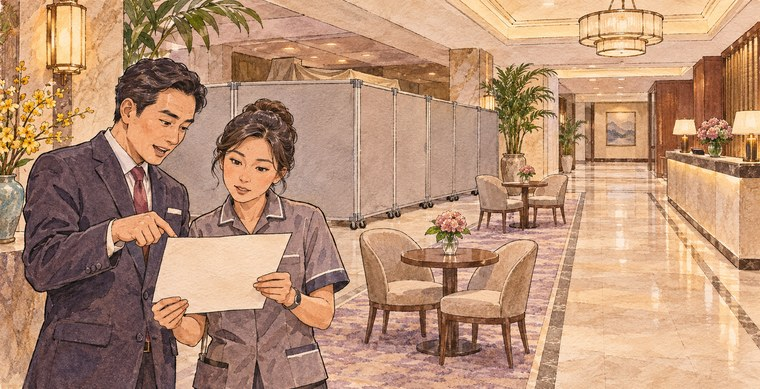

# Visible care. A usable lobby?

<!-- legacy-case-id: 456 -->

HSP-38 · Hong Kong · 15–20 minutes · Frontstage maintenance · Service promises · Guest task continuity

## Seeing the work is not the whole experience

Research on operational transparency suggests that seeing service work can affect perceived value, while servicescape research examines whether a setting supports users’ tasks. Neither implies that visible maintenance is always preferable. This fictional hotel must compare the service it can actually deliver, not treat visible effort as a substitute for promised usable space.

## Opening decision

It is Monday afternoon at fictional Harbour Court Hotel in Hong Kong. The manager must choose one of two assessed windows for routine polishing of a lobby floor section: Tuesday 10:00–12:00, or Tuesday 00:00–02:00. Both include preparation, treatment, drying, inspection and reinstatement. No urgent spill, hygiene emergency or immediate hazard is being deferred.

Three qualified employees provide two paid hours each in either window. The same team has agreed either properly rostered shift, with all rest, pay, workload and transport arrangements protected. Total incremental cost is HK$1,800 by day or HK$2,400 overnight, including all differing costs. Both are affordable; neither changes staffing levels or skills.

The lobby normally has six two-person meeting tables. The safe work area closes four tables for the entire two-hour window, leaving two available. Routes, lifts, reception and emergency access remain unobstructed and accessible. The work zone is physically segregated; warning signs alone are not the safety arrangement.

Qualified assessment has confirmed that both methods protect workers and guests, maintain ventilation and avoid disturbance to sleeping rooms. The two remaining tables are usable without noise or odour interference. No one can enter the work zone before reinstatement. These are fictional feasibility conditions, not cleaning instructions or universal safe drying times.

The lobby is advertised for short informal meetings during daytime hours. Daytime work would be visible to passing guests, while overnight work would usually be less visible. The manager has not yet reviewed Tuesday’s table commitments. The objective is to complete maintenance and honour confirmed meeting access, then compare remaining experience and cost tradeoffs.

## Evidence

| Input | D · Day | N · Night |
| --- | --- | --- |
| Tuesday window | 10:00–12:00 | 00:00–02:00 |
| Paid person-hours | 6 | 6 |
| Incremental cost | HK$1,800 | HK$2,400 |
| Tables during work | 2 of 6 | 2 of 6 |

**Student question:** Would you provisionally choose D or N? What guest activity and commitment information must you check before calling a low-footfall daytime period quiet enough for maintenance? Separate visibility, safety, availability and cost.

## Round two

Tuesday’s confirmed ledger shows six separate two-adult parties each reserved one table from 10:30 to 11:30. Each needs the entire hour and the hotel has confirmed access. No party agrees to a different time, a shared table or relocation. No equivalent alternative space is available within the approved plan.

There are no meeting reservations or meeting-space commitments during 00:00–02:00. Overnight reception and accessible circulation remain fully available. Under N, the four tables are reinstated at 02:00, well before the six daytime meetings. The current timetable and staffing conditions are otherwise unchanged.

In a separate fictional walkthrough, twelve voluntarily participating adult guests see a safely demonstrated maintenance setup. Eight say visible upkeep reassures them that the hotel cares for its premises. Four say the display itself makes no difference to that impression. None is asked to give up a booked meeting, and these are not the six reservation parties.

This small selected feedback exercise does not measure booking acceptance, revenue, cleanliness or the impact of actual polishing. Both options deliver the same assessed floor condition after completion. The manager cannot count reassurance statements as consent to remove someone else’s meeting access or as authority to cross a barrier.

**Student question:** Which window fulfils the confirmed service commitments? Calculate D’s simultaneous table shortfall and N’s additional cost. Explain what the eight positive comments establish, what they do not, and how to communicate maintenance honestly without staging extra work for display.

## Debrief · A quiet lobby can still be committed

D leaves two tables for six simultaneous reservations. It is short by four tables throughout 10:30–11:30: four party-hours of confirmed meeting access cannot be delivered. Twelve adults need six separate tables; counting empty circulation space or people merely passing through does not create meeting capacity.

Four closed tables for two hours equal eight unavailable table-hours, but only four party-hours conflict with the supplied bookings. Keep physical unavailability separate from affected commitments. Do not assume all eight unavailable hours are lost sales or that the four unmet meetings have a known compensation value.

## Debrief · Choose the workable window

N completes the same work by 02:00 and leaves all six tables available at 10:30. It costs HK$2,400 − HK$1,800 = HK$600 more for the same six paid person-hours. Choose N under the requirement to honour all confirmed meetings while completing the work safely.

The extra HK$600 is the complete incremental difference between these packages, not a payment that purchases permission to reduce worker protections. Nor is it a calculated return on investment. No room revenue, guest retention effect or avoided compensation amount is supplied.

## Debrief · Reassurance does not repair unavailability

Eight of twelve selected walkthrough participants, or two-thirds, report reassurance from visible upkeep. That suggests a possible communication benefit in this group. It does not prove that daytime polishing improves satisfaction overall, that all hotel guests prefer visibility or that the six booked parties would accept losing their tables.

A guest can value seeing care and still need uninterrupted use of the promised space. Those are not contradictory reactions. Maintenance has both an operational result and a place in the guest journey. Positive impressions cannot substitute for the function the hotel has committed to provide.

## Debrief · Explain real work and real availability

A truthful notice for N can state that part of the lobby will be closed 00:00–02:00 for scheduled floor care, with reception and the marked accessible route remaining available. Confirm reinstatement after inspection rather than inviting guests through early. Tell staff the same times and escalation route.

The hotel may explain that routine care is scheduled around confirmed guest use. It should not stage unnecessary daytime polishing, manufacture proof of diligence or pressure staff to perform for observers. Visible work is a possible by-product of a sound service plan, not an objective that overrides it.

## Debrief · Learn for the next cycle

For future planning, compare confirmed uses and guest task needs by time, not only lobby footfall. Record closure duration, actual reinstatement, affected requests and whether promised activities remained possible. Invite voluntary feedback without recording private conversations or requiring personal explanations.

A different day with no daytime commitments could make D attractive, if genuine guest needs and all safety and employment conditions still fit. This case does not establish that maintenance belongs overnight everywhere. The given reservations and lack of an accepted substitute determine today’s recommendation.

## Instructor note

Require four separate checks: safety, the advertised function, confirmed access and guest perception. Both windows pass the first check; D fails the confirmed-access condition. Ask why eight reassuring comments cannot be netted against four missing tables as though they were votes on the same outcome.

HSP-13 coordinates routine entry into private rooms; HSP-16 designs acoustic choice. This case locates public-area support work within a promised shared-space service. All timings, staffing, assessments, reservations and comments are fictional. Source studies do not validate this hotel’s methods, establish local legal compliance or predict a financial payoff.

## Sources and case assumptions · optional reference

All information needed for classroom decisions is provided above. Sources are optional reading.

Monday decision; Tuesday N 00–02 precedes D 10–12. Both complete 2 h include prep/drying/inspection/reinstatement, safe workers/guests/access/sleeping rooms protected, no urgent hazard. Same 3 qualified workers×2 paid hrs=6, agreed rosters/rest/pay/transport, all incremental cost D 1800 N 2400 gap 600. 6 tables, 4 close leaves 2; 6 two adult parties book 10:30–11:30 needing full hour, no accepted substitute/time/shared table. D short 4 tables one hour=4 party hours; 4 closed×2 h=8 table hours unavailable not all booked lost sales. N reopen 02 before meetings, no overnight meeting commitments. Selected 12 different adult walkthrough participants 8 reassured 4 indifferent, 2/3 not population/causal/booking waiver. Choose N under commitment rule, no ROI/wage cuts/unfunded work/medical or legal determination.

- [Buell, Kim and Tsay · Creating Reciprocal Value Through Operational Transparency · September 2015 working paper](https://www.hbs.edu/ris/Publication%20Files/14-115_aee7737a-a405-46f1-85e9-67882dd95435.pdf). Original author paper hosted by Harvard Business School. Food-service field and laboratory studies examine visual transparency; their effects and employee mechanisms are not transferred to hotel maintenance.
- [Mary Jo Bitner · Servicescapes · 1992](https://eli.johogo.com/Class/jm-1992.pdf). Original Journal of Marketing article, scholarly teaching-hosted scan, develops a conceptual framework relating physical settings to customer and employee tasks. Propositions are not a measured hotel polishing effect.
- [UK Health and Safety Executive · Cleaning](https://www.hse.gov.uk/slips/cleaning.htm). Regulator explains that cleaning can create hazards and discusses exclusion, dry routes and suitable methods. Safety context only, not approval of the fictional schedule or a universal drying duration.
- [Ireland Health and Safety Authority · Segregate](https://www.hsa.ie/topics/slips_trips_falls/environmental_cleanliness/floor_wet_cleaning/segregate/). Distinct regulator’s guidance discusses physical segregation, emergency routes and the limits of warning signs and fixed drying times. It shares some HSE references; not an independent hotel experiment or Hong Kong legal rule.
- [National Occupational Standards · INSC012: Clean and protect hard and semi-hard floors](https://ukstandards.org.uk/en/nos-finder/INSC012/clean-and-protect-hard-and-semi-hard-floors). Original occupational standard covers preparation, risk assessment, treatment and reinstatement. Used to keep complete safe work inside the planning envelope, not as an equipment-specific procedure or local certification.
