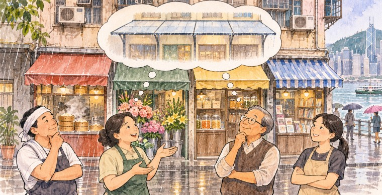

# Who funds the covered walkway?

<!-- legacy-case-id: 14 -->

SUS-04 · Hong Kong · 10–15 minutes · Public goods · Free riding

## Hong Kong in the news · 24 April 2024

During a Legislative Council debate, a member recalled that limited resources had led Cheung Chau festival organisers to use drawings and a small bun tower in place of traditional giant towers. When a whole neighbourhood benefits, whose contribution makes the project possible? The shopkeepers below face that funding question for a shared rain cover.

## Opening decision

Four shops get the same sheltered access if a landlord installs a canopy. Each owner values it at HK$800. The landlord needs HK$2,400 in total pledges. Pledges are returned if the target is missed. You represent one shop.

## Evidence

| One installation, HK$ | Assumption |
|---|---|
| Construction cost | 2400 |
| Benefit to each shop | 800 |
| Other three pledges combined | 1800 |

**Your decision** Would you pledge HK$600 to complete the project? What is your net gain compared with declining?

## Round two

Before you commit, the other shops raise their combined pledges to HK$2,400. The landlord guarantees installation, and your payment cannot change its size or quality.

**Your decision** How much would you now pledge out of financial self-interest? Would you personally choose differently?

## Debrief

Originally you are pivotal: paying 600 produces an 800 benefit and a 200 net gain. In round two you get 800 even with a zero pledge. The project generates 3,200 in total benefits against 2,400 in cost in either round where it is built.

## Instructor note

Minutes 0–3: vote and compare reasons in pairs. Minutes 3–7: reveal the changed fact and vote again. Minutes 7–12: reconcile the answers. Seek both a zero pledge and a positive one. Ask the first owner how a similar project could fail if everyone waited. Ask the second whether fairness, future dealings or another benefit motivates payment.

## Sources and case assumptions

All information needed for the classroom decisions is provided in the case. The sources below are optional background, not assigned reading.

The setting, participants, numerical exhibit and changed rule are fictional classroom assumptions. The readings below provide context and economic reasoning.

1. [Voluntary Provision of Threshold Public Goods](https://ideas.repec.org/a/eee/pubeco/v71y1999i1p53-73.html) — Studies contributions when provision depends on a threshold.
2. [Fischbacher and colleagues, Are People Conditionally Cooperative?](https://econ.uzh.ch/dam/jcr%3Affffffff-9758-127f-0000-00003449356a/ArePeopleCondCooperative.pdf) — Provides experimental evidence on conditional cooperation.
3. [Cinyabuguma and colleagues, Cooperation under the Threat of Expulsion](https://economics.ucsd.edu/~jandreon/Econ264/papers/Cinyabuguma%20et%20al%20JPubE%202005.pdf) — Examines how group institutions affect contributions.
4. [Le Coent and colleagues, Why Pay for Nothing?](https://accessecon.com/Pubs/EB/2014/Volume34/EB-14-V34-I3-P182.pdf) — Studies a conditional subsidy in a threshold game.
5. [One Step at a Time: Do Threshold Patterns Matter in Public Good Provision?](https://www.econstor.eu/bitstream/10419/27486/1/dp2009-5.pdf) — Examines how provision thresholds affect contributions.

- [Hong Kong Legislative Council, 24 April 2024](https://www.legco.gov.hk/yr2024/english/counmtg/hansard/cm20240424-translate-e.pdf). Background for the opening news context.
