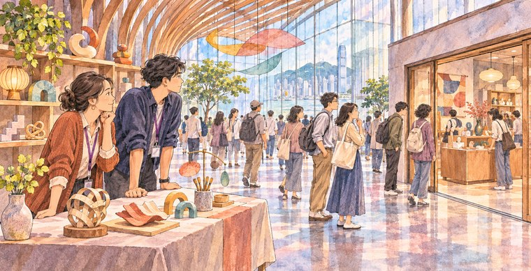

# Whose visit pays for the shop?

<!-- legacy-case-id: 574 -->

STR-48 · Hong Kong · 15 minutes · complementors · incremental demand · bargaining over joint value

## Museum exhibitions and shops can reinforce each other

M+ reports making exhibition-linked products and working with artists and curators on retail collaborations. Hong Kong’s Leisure and Cultural Services Department also identifies shop and café permit or licence fees among museum income sources. Below, the venue, retailers, payment terms and customer counts are fictional.

## Opening decision

You run the shop Lantern Objects under a short concession at a fictional Hong Kong design museum. You propose one evening workshop. Your shop pays the full event cost unless the museum contributes. Your shop gets net contribution of HK$30 per additional transaction before that event cost.

The museum gains HK$8 per additional venue visitor, net of its own variable costs and excluding any shop transaction. One incumbent shop loses HK$24 contribution per sale diverted to Lantern. It has a contract under which the museum must reimburse this contribution for this event. No other party gains or loses.

The exhibit shows incremental effects relative to no event. The fixed concession fee does not change. There is no venue capacity constraint, and there is no value from advertising or from later visits.

## Evidence

| Projected event result | Increment relative to no event |
| --- | --- |
| Visitors who would not otherwise come | 400 |
| Lantern purchases by those new visitors | 100 |
| Purchases redirected from incumbent to Lantern | 40 |
| Workshop cost paid by Lantern | HK$5,000 |

**Student question:** Would Lantern run the workshop without support? What range of museum contributions would make both Lantern and the museum at least as well off as without the event?

## Round two

An updated count finds the workshop will bring only 150 additional venue visitors and 40 Lantern purchases by those new visitors. It will still divert 40 purchases from the incumbent. All unit contributions and costs stay the same.

**Student question:** Should the museum and Lantern fund the workshop under the revised estimate, even if every extra sale at Lantern appears in its own transaction report?

## First decision: share only the value that is created

Lantern gains (100 + 40) × HK$30 = HK$4,200 before its HK$5,000 cost, so it needs at least HK$800. The museum gains 400 × HK$8 − 40 × HK$24 = HK$2,240 after reimbursing the incumbent. Any contribution from HK$800 to HK$2,240 leaves both sides at least as well off. The combined gain is HK$1,440.

## Second decision: do not confuse reallocation with expansion

Lantern gains (40 + 40) × HK$30 − HK$5,000 = −HK$2,600. The museum gains 150 × HK$8 − 40 × HK$24 = HK$240. A transfer cannot bridge the gap: maximum HK$240, minimum HK$2,600. Together they lose HK$2,360; do not run it on these terms.

## What to take away

A venue and tenant can create more value together than either captures alone. Measure traffic that would not otherwise have come and account for partners’ lost business. This is a joint event decision, not a calculation of the tenant’s standalone rent ceiling.

## Instructor note

No claim about any actual lease or event economics. Ask who would bear diverted sales if the fictional reimbursement clause were absent.

## Sources and case assumptions · optional reference

All information needed for classroom decisions is provided above. Sources are optional reading.

No claim about any actual lease or event economics. Ask who would bear diverted sales if the fictional reimbursement clause were absent.

- [M+, Review 2024](https://webmedia.mplus.org.hk/documents/mplus-review-2024-english-2025-03-20.pdf). The museum describes exhibition-linked lifestyle products and artist and brand collaborations.
- [M+, Myths and Monsters exhibition release](https://www.mplus.org.hk/en/press/myths-and-monsters-the-art-of-fantasy-in-asia-opening-this-saturday/). This exhibition announcement identifies exclusive linked retail merchandise and publication.
- [Hong Kong Government, LCQ16 on market-based models in LCSD facilities](https://www.info.gov.hk/gia/general/202510/22/P2025102200284p.htm). The reply identifies permit and licence fees for shops and cafés among museum revenue sources.
- [Hong Kong Government, LCQ3 on public museum sustainability](https://www.info.gov.hk/gia/general/202607/08/P2026070800366p.htm). The reply describes the 2026 invitation for tenders to introduce commercial elements at designated LCSD facilities.
- [West Kowloon Cultural District Authority, offering circular](https://webmedia.westkowloon.hk/documents/notices-to-hkex-20260212.pdf). Describes venue programming and retail activity, including a temporary M+ shop at the airport. It does not estimate how many visits the fictional workshop creates.
