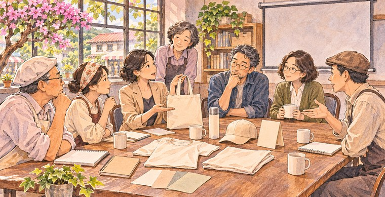

# More effort. No larger prize.

<!-- legacy-case-id: 323 -->

ECO-27 · Hong Kong · fictional organisations · 15–20 minutes · Rent dissipation · Contest design · Private and collective incentives

## Winning effort is not automatically productive effort

Contest research separates the incentive to win an existing reward from the creation of additional value. Mark Fey models costly effort and strategic responses; experimental work by Sheremeta and by Chowdhury, Sheremeta and Turocy shows that prize rules and behaviour matter. Their laboratory findings are not forecasts for this association.

Some contests stimulate useful innovation. Faria and colleagues explicitly model different effort dimensions and a changing prize. That is a reason to inspect what effort produces, not to classify all competition as waste. The deliberately simplified example below holds productive output fixed.

## Opening decision

**Fictional classroom situation.** A business association has HK$1,200 to reward two members for submitting usable promotional cards. Both members can supply the required card with a Basic preparation package costing HK$100. An Enhanced package costs HK$400 in total, including Basic, and adds presentation polish. Only these two packages are feasible; there are no hidden spending levels. Costs represent real staff time and consumed materials, valued at opportunity cost, not fees paid to the association.

The organiser must choose between a single HK$1,200 winner-take-all presentation award and a fixed HK$600 participation payment to each member delivering a usable card. Under either arrangement, a member may opt out before spending, yielding zero. Both are risk-neutral, maximise expected net money, know the rules and costs, and choose independently and simultaneously. There are no later prizes, status benefits or repeated-game effects.

For the contest, Enhanced defeats Basic with certainty. If both choose the same package, each has a one-half chance of being selected by the stipulated symmetric judging process; only one receives the full prize. A sole entrant wins. Both entrants bear their own preparation costs whether they win or lose. Under the fixed-payment design, either package qualifies, but Enhanced earns no extra payment.

The organiser values usable public-facing cards and net member benefit, not spending or spectacle for its own sake. Initially, the campaign lead thinks Enhanced presentation might also improve the cards’ usefulness; that claim has not been tested. The prize budget and ordinary administration costs are the same under both designs. No award or spending has been committed.

## Evidence

| Own choice / rival choice | Basic · HK$100 | Enhanced · HK$400 |
| --- | --- | --- |
| Basic · HK$100 | Half chance of HK$1,200 | No prize |
| Enhanced · HK$400 | Certain HK$1,200 prize | Half chance of HK$1,200 |

**Student question:** Which reward design would you provisionally choose? Explain a member’s incentive to upgrade when the rival chooses Basic, and identify the productive benefit you would need to justify that extra effort.

## Round two

A fictional campaign test now establishes that Basic and Enhanced produce equally usable cards, with identical audience reach, sales effects and learning value. Extra polish changes only the contest ranking. There is no benefit to the association, consumers or outsiders from that additional preparation. All costs, package restrictions and judging rules remain unchanged.

Both members plan Enhanced. When both do so, each still has only a one-half chance of the unchanged HK$1,200 prize. The fixed-payment alternative remains available before either member incurs a cost. Under that design, both would submit Basic cards and each receive HK$600.

The organiser asks whether the extra effort is a success because it is individually rational, or an avoidable use of real resources. Compare expected member payoffs, total resource costs and the unchanged useful output. Keep the association’s prize transfer separate from resources consumed; do not count the award itself as new social value.

**Student question:** After the test, which design should the organiser choose? Calculate the members’ expected net benefits and total resource costs, explain why neither contestant simply cuts effort alone, and state what would change your recommendation.

## Answer the opening decision

A provisional contest choice requires evidence that stronger presentation creates enough additional useful output or another specified benefit to justify its cost. Against a Basic rival, Enhanced gives HK$1,200 − HK$400 = HK$800, versus HK$600 − HK$100 = HK$500 from Basic: upgrading raises private expected payoff by HK$300. This does not establish any increase in campaign value.

A provisional fixed-payment choice avoids that escalation but must still ensure the Basic card meets the real quality threshold. It is not payment for doing nothing. Before the test, uncertainty about useful output makes the benefit question important rather than automatically resolving it in favour of either design.

## Why the effort persists

Against an Enhanced rival, Enhanced yields HK$600 − HK$400 = HK$200 in expectation. Basic yields −HK$100 and opting out yields zero. Against a Basic rival, Enhanced yields HK$800 rather than HK$500. Thus both choosing Enhanced is an equilibrium under the stipulated choices and preferences; neither benefits by changing alone.

Both choosing Basic would give HK$500 each, but it is not a stable contest outcome: either could upgrade and earn HK$800 against the other’s Basic. Asking members merely to be restrained does not change this incentive. These are expected returns, not guaranteed receipts: in the Enhanced pair, one member nets HK$800 and the other loses HK$400.

## Recommend the fixed qualifying payment

After the reveal, choose **HK$600 for each usable card**. Each member chooses Basic and nets HK$500; together they net HK$1,000 after HK$200 of resource costs. Under the Enhanced contest, each expects HK$200; together they net HK$400 after HK$800 of resource costs. The fixed design saves **HK$600 of real resources** while preserving both cards and the same HK$1,200 reward budget.

The contest consumes HK$800, or two-thirds of the prize amount, in total preparation. Of that, HK$200 is required to create the usable cards under either design, and HK$600 is avoidable extra polish. Do not call the whole HK$800 waste relative to the fixed-payment baseline, or say the whole prize disappears. This is partial dissipation, not spending beyond the prize.

## Keep transfers and value separate

The members’ combined net benefit includes HK$1,200 paid by the association. Across association and members together, that payment is a transfer, not a new resource gain. Holding useful output and other costs fixed, the HK$600 resource saving is the relevant improvement. No absolute social-benefit number is available because the cards’ common value is not quantified.

Change the recommendation if enhanced effort creates enough genuine additional value, improves selection between unequal contributions, or if verified qualifying payments are costly or easily gamed. Those are outside this simplified reveal, not benefits to invent to rescue the contest. Measure output and all-in participation cost, rather than celebrating expenditure alone.

## Instructor note

Have students compute the unilateral upgrade before revealing that output is unchanged. Then compare Basic against Enhanced, including the zero opt-out payoff, and identify why mutual restraint fails. The finite package restriction is essential: this is not a continuous all-pay auction equilibrium. The symmetric judging probabilities and all financial facts are invented.

Unlike ECO-02, the core cost is real preparation borne by winners and losers, not an auction payment transferred to a seller. Separate the HK$800 total contest resource cost from the HK$600 avoidable increment. Research on experimental overbidding motivates careful design, but this case needs neither irrationality nor spending beyond the prize. It is an analytical classroom example, not a recommendation to run a monetary game.

## Sources and case assumptions · optional reference

All information needed for classroom decisions is provided above. Sources are optional reading.

Original fictional classroom model. Two risk-neutral, expected-money-maximising members; simultaneous independent choices among Basic at HK$100, Enhanced at HK$400 total, or opt out at zero. Enhanced beats Basic; equal packages imply one-half chance each of a single HK$1,200 award; a sole entrant wins. Costs are real opportunity costs paid regardless of outcome, not transfers to the organiser. No other rewards, benefits, effort levels or repeated interactions. Enhanced against Enhanced is stable: HK$200 expected net versus minus HK$100 from Basic or zero from exit. Fixed qualifying payments of HK$600 induce Basic and HK$500 each. Resource savings are HK$600, with the same useful output and budget. Common output value is not quantified. Public studies motivate distinctions, not the case probabilities or amounts.

- [Mark Fey · Rent-Seeking Contests with Incomplete Information · 2007](https://www.rochester.edu/college/faculty/markfey/papers/RentRevised.pdf). Original theoretical paper; definitions and complete-information benchmark explain costly effort and strategic responses. The classroom has complete information and discrete packages, not this paper’s exact model.
- [Roman Sheremeta · Contest Design: An Experimental Investigation · 2009 working paper](https://mpra.ub.uni-muenchen.de/52101/1/MPRA_paper_52101.pdf). Original laboratory study compares prize structures and effort; read model, experimental design and results. Its observed behaviour is not a local-business forecast.
- [Chowdhury, Sheremeta and Turocy · Overbidding and overspreading in rent-seeking experiments · 2014](https://mpra.ub.uni-muenchen.de/55922/1/MPRA_paper_55922.pdf). Original experiment varies allocation rules and cost structure; all contestants bear effort costs. Proportional-sharing treatment is not the fixed qualifying payment used here.
- [Roman Sheremeta · Behavior in Contests · 2014](https://mpra.ub.uni-muenchen.de/57451/1/MPRA_paper_57451.pdf). Author’s research synthesis distinguishes costly competition, equilibrium expenditure and behavioural over-expenditure. This classroom result does not require behavioural overbidding.
- [Faria, Mixon, Caudill and Wineke · Two-Dimensional Effort in Patent-Race Games and Rent-Seeking Contests · 2014](https://mdpi-res.com/d_attachment/games/games-05-00116/article_deploy/games-05-00116.pdf). Original model makes different effort dimensions and prize effects explicit. Used as a boundary: not all contest effort is unproductive; no historical telephony allegations are carried into this case.
